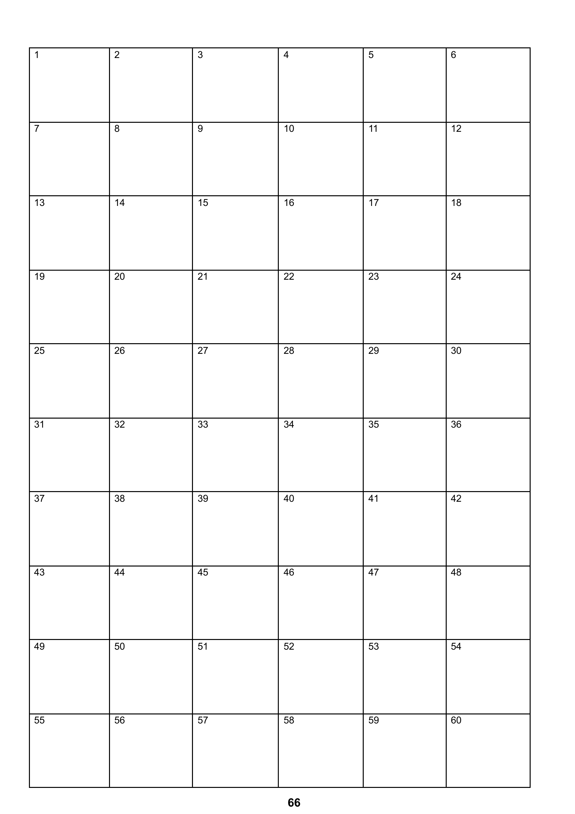

# Encounter System — Adopted consistency revision 61

> **Source:** *Encounters Working Draft.pdf*, 67 printed pages. **Status: adopted working rules (revision 61), 5 November 2026.**
> **Current supplement — adopted revision 62 (5 November 2026):** [The revision-62 decision addendum](encounters-consistency-decisions-r62.md) and [issue supplement](encounters-rule-issues-r62.md) control reference arm length, customary physical dimensions, Reach terminology, and the throwing velocity denominator. Revision 61 remains controlling on all other subjects. Where revision-61 text below conflicts on these limited subjects, revision 62 controls; dated revision-59/60 records remain historical.
> **Current spatial-precision supplement — adopted revision 63 (6 November 2026):** [Revision 63](encounters-consistency-decisions-r63.md) supersedes only the nearest-0.1-meter coordinate-commitment rule below. Authoritative Cartesian positions remain metric at native floating precision through movement, each interval commitment and publication, evaluation, inspection, and Object-observation evidence. Only presentation may round or convert to yards; no rounded/shadow Reality is maintained. All other revision-61/62 rules and action-specific rounding directives remain unchanged. The dated revision-61 and revision-62 statements are retained as decision history.
> **Adopted revision 61 (5 November 2026):** Restores two rules from *COMBATWORKING.RTF*, reconciled with the subsequently adopted Encounter rules: (1) a damaging strike may cause involuntary release of each physical Grab/Hold maintained by the injured Being, including when the strike comes from a third party; each grip and each simultaneous strike is checked independently against the common pre-action HP snapshot; losing a physical grip does not itself terminate an established Grapple; and (2) a Being bearing a tower shield for protection cannot bash with it, Charge, Overrun, or Bull rush. See [Grab](#grab), [Break hold](#break-hold), and [Shields](#shields). These additions supersede the corresponding provisional proposals and are controlling rules. The linked revision-60 decision record and issue register remain references to decisions and issues through revision 60, not newly updated revision-61 documents.
> **Adopted decisions:** ES-001–ES-004, ES-005 (parry weight boundary), ES-006 (weapon-table token), ES-007 (generated Markdown TOC), ES-008 (timeline tracker identification), and ES-009 (sleep recovery). See the [current decision record](encounters-consistency-decisions-r60.md), [issue register](encounters-rule-issues-r60.md), and [saving/check/contest audit](encounters-saving-check-audit-r7.md).
> **Retained from revision 4:** Fortitude, Reflex, and Will use d20 saving throws against a default DC of 20 (unless a different DC is specified). Ability checks instead use the stated number of d6 rolled against the ability. Inconsistent or unspecified dice counts remain flagged, not silently assigned.
> **Adopted revision 6 (supersedes revision 5 Fitness classification):** Fitness is a trainable **ability** and Fitness checks are roll-under ability checks (3d6 ≤ current effective Fitness), not saving throws. Improving Fitness requires a 3d6 Constitution ability check, limited by Constitution. An ordinary skill check at skill level zero defaults to a 3d6 check against the ability identified by the skill unless its rules specify another number of dice. Trip uses an ability contest (3d6 plus the applicable ability bonus on both sides). Door-breaking dice remain a property of the door. Fortitude, Reflex, and Will remain d20/DC saving throws. **Adopted revision 7:** Ride and Tumble both use **Dexterity** as their governing ability for skill-level-zero ability-check fallback (default 3d6 ≤ Dexterity); the prerequisite of at least one Ride level for mounted combat remains unchanged.
> **Adopted revision 8:** ES-011–ES-013 define second-boundary decisions, simultaneous-effect resolution, perception lag, and prepared Parry/Dodge readiness and expenditure. See [timing and defenses](#one-second-action-and-defense-resolution). **Adopted revision 9:** ES-014 fixes strategy-point boundary conditions: negative totals and category caps floor at zero; unused points are allowed; invalid proposed allocations must be rejected immediately, before action declaration is accepted. **Adopted revision 10:** ES-015 is resolved. All actions scheduled to resolve simultaneously use the same post-movement, pre-action state; results for **all** Beings and Objects are committed as a batch after every action has been evaluated. Item destruction or incapacitation during that second cannot cancel another simultaneously resolving action. **Adopted revision 11 (ES-016 partial):** For ordinary single-hex Beings, measure combat reach from Being center to Being center. The entire attack trajectory, including necessary weapon and limb movement, must be unobstructed. More complex multi-hex Beings and weapon-specific minimum effective distances are deferred. Revision 12 removes the three-foot reach-disparity attack-roll requirement: engagement is a directional spatial condition, not a separate action or a prerequisite attack. **Adopted revision 13 (ES-036):** withdrawing does not impose a special zero-defense penalty; ordinary defense, reach, and positional effects still govern. Those first-strike passages remained under review in revision 13, but are now superseded by revision 14. See [Engagement](#engagement).
> **Adopted revision 14:** ES-037 and ES-038 remove general longer-weapon strike precedence, replace the p. 16 armed example with simultaneous resolution, and revise ordinary/mounted Charge and set-pole interception to use the universal same-second model. A successful set-pole hit converts the charger's scheduled strike to a normal attack (without Charge bonuses), terminates that Charge, and precludes Charge-based Bull Rush or Overrun continuation; the pole defender retains specified set-pole damage and counterattack benefits. **Adopted revision 15 (ES-039):** The special immediate Overrun granted to a set-pole defender following a mounted interception is deleted, along with its special Overrun-dependent dismount/fall outcomes. No replacement bonus or action is granted; ordinary Overrun actions and independent mounted-combat dismount rules are unchanged.
> **Adopted revision 16:** ES-017 establishes 0.1 m positional precision, consistent arithmetic/rounding rules, rate-based integer-state updates, rounding down fractional physical exertion, and nearest-integer derived thrown-damage die sizes. The draft is yard-dominant; original yard-based game thresholds are retained with explicit conversion into metric spatial coordinates. ES-018 makes injury-related consciousness conditional on **HP >= 1** and removes any opportunity to regain consciousness below 1 HP; subdual and other causes of unconsciousness remain independent. See [Numerical precision and units](#numerical-precision-and-units) and [Hit Points and Damage](#hit-points-and-damage).
> **Adopted revision 17:** ES-017 confirms discarding fractional exertion after each uninterrupted activity interval and zero damage when a derived throwing damage die size rounds to zero. ES-018 removes the provisional hourly recovery-*eligibility* check; a single Fortitude recovery check remains, with an initial opportunity after one hour of stabilization and daily retries after failure. No check can restore injury-related consciousness below 1 HP. See [Negative hit points](#negative-hit-points).
> **Adopted revision 18:** ES-019 defines combat-environment qualifications by the attacker’s actual mode and support, not the target’s location. All required environmental qualifications apply to every combat type. Missing qualifications negate the relevant effective progressive combat-type skill contribution while preserving distinct weapon training and applicable ability modifiers; a weapon skill that itself is the combat-type proficiency (e.g. bows) cannot simultaneously supply a separate unaffected combat proficiency. Mounted combat also retains the Ride prerequisites and skill cap, independently of the environmental qualification. See [Combat Types](#combat-types) and [Mounted Combat](#mounted-combat).
> **Revision 19 documentation only:** The game mechanics are unchanged from revision 18. An automatically generated [open to-do list](encounters-outstanding-todo.md) and pending rule-review questions ES-040–ES-044 are added outside the controlling rules.
> **Adopted revision 20 (ES-040):** Feint success is tested by the ordinary Attack Roll procedure when its action resolves. On success, the very next chosen action must be a follow-up attack against the same victim to obtain a one-use +2 to hit; the bonus expires after that attack resolves (hit or miss), and is forfeited if another action is chosen instead. A failed Feint grants no bonus. See [Feint](#feint).
> **Adopted revision 22:** An opposed skill check is a symmetric **3d6 + relevant skill level + governing ability bonus + stated situational modifiers** contest (ties preserve the situation). Grapple uses Improved Grapple and each participant’s better Strength/Dexterity bonus; a zero-level participant contributes zero skill, not a roll-under fallback. Spotting and Hearing are difficulty checks (d20 against DC 15 plus integer DC adjustments), not skills. See the skill completeness audit and outstanding to-do for unapproved missing-skill specifications.
> **Adopted revision 24–25 (ES-050, ES-051):** Search, Spot, and Listen are discovery actions, not skills. The discovery DC is assigned to the Entity; **DC 15 applies by default** when unspecified. Relevant racial aptitude contributes **+2 to d20 for +10%** and **+1 for +5%** (Half-elves have +5% Search, Spot, and Listen; Halflings retain +10% Listen). Deliberate attempts normally take **6 seconds**, not shortened by strategy timing. Search covers reachable and examinable locations; Spot works across unobstructed line of sight; Listen works where sound is audible. Independently, a meaningful discovery opportunity presented by the environment triggers an **incidental, unintentional Spot or Listen check** without an action declaration or timing cost; failure may reflect diverted attention. These checks follow ordinary discovery DCs and modifiers and are not voluntary zero-time actions.
> **Adopted revision 26 (ES-042):** A Stun requires a successful threat and failed Fortitude DC 20 save, **not** a confirmed critical hit. A confirmed critical determines damage only: successful Stun + confirmed critical → normal critical damage; successful Stun + unconfirmed threat → normal damage. A Stun that does not succeed but whose underlying attack hits inflicts half normal damage, rounded down, including when the defender succeeds on the save or is immune to Stun. An outright miss inflicts no damage. A double-natural-20 fatal hit remains governed by the general fatal-hit rule even on a Stun attempt. Stun duration is **one d6 per Stun skill level, in seconds**; state changes follow universal same-second simultaneity. The worked example retains its first 1d2 damage roll of 2; its additional critical-damage roll is specified as 1 in revision 27, giving C 15 final HP. See [Stun](#stun), [Unarmed combat example](#unarmed-combat-example), and ES-042 decision record.
> **Adopted revision 27 (ES-052):** The confirmed-critical Stun example includes a second damage roll of **1 on 1d2**, in addition to the first roll of **2 on 1d2**. C takes **3 total critical damage**, leaving **15 HP** from an initial 18 HP. Both appearances of the passage in this working draft reflect the corrected damage; the duplicated and unfinished Archery example is still pending editorial source review under ES-047. See [Unarmed combat example](#unarmed-combat-example) and Revision 27 decision record.
> **Adopted revision 28 (ES-043):** End Run's +2 bonus per size category smaller than the occupant modifies the initiating combatant's **3d6 + Dexterity bonus** ability-contest result, not an attack roll. End Run has **three seconds of preparation** (subject to permitted Combat Strategy timing reduction), on success or failure. In the resolution second the conditional passage occurs in the **movement phase**, before other simultaneous non-movement actions; a failed passage leaves the initiator at the attempted passage's starting hex, without a further three-second delay. See [End Run](#end-run) and Revision 28 decision record.
> **Historical revision 59 (superseded by adopted revision 62 for reference arm length and the throwing denominator):** The former Medium reference arm of **0.800 m**, metric category series, and `sqrt(L / 0.800 m)` throwing denominator remain dated historical decisions, not current values. Its separate equal-Strength/capacity conclusions remain in force. Earlier revision-57/58 entries are retained as chronology. See the [revision-62 addendum](encounters-consistency-decisions-r62.md).
> **Historical revision 58 (superseded by revision 59; ES-041 — Medium reference arm length):** The **Medium (3) Size Category** has a standard reference arm length of **0.7865 m (78.65 cm)**, the adult-male mean reported from the ANSUR II anthropometric survey. The measurement runs from the **acromion (shoulder tip) to the tip of the middle finger**, with the arm straight. This value is a standardized Medium-category geometry default, not an individual measurement, throwing acceleration path, or combat Reach; no values or scale factors have yet been assigned to the other seven categories. See [Strength-based force capacity: calibration evidence](#strength-based-force-capacity-calibration-evidence).
> **Historical revision 57 (superseded by revision 59; ES-041 — size-category arm length):** For physical throwing-force calibration, take a Being’s **reference arm length from its Size Category**, using the existing [Size Categories Table](#size-categories-table) instead of defining a separate individual arm-length measurement. Standard reference lengths for the categories still require calibration; the table’s *effective size* values are not physical lengths or doubling rules. Arm length is a geometric input, **not automatically the object’s acceleration path**, and this choice does not change combat reach or set a Strength-to-newtons function. See [Strength-based force capacity: calibration evidence](#strength-based-force-capacity-calibration-evidence).
> **Adopted revision 56 (ES-041; progressive-skill baseline and Throwing Table):** An **acquired progressive skill starts at level 1**; level 0 indicates no acquired level of that skill. Ordinary progressive skills can still be attempted untrained at level 0 where permitted; extraordinary prerequisites remain in force. For throwing, the rules give **+1 to the maximum-velocity formula when any Throw skill level is acquired** (not +1 for every level). Accordingly, the [Throwing Table](#throwing-table) assumes at least Throw level 1: at Strength 10, `5 × (10 + 1 − 2) / 2 = 22.5 yd/s`, matching the table. An untrained level-0 thrower at Strength 10 uses the formula with modifier 0, giving `20 yd/s` in otherwise identical conditions. This resolves the table/formula discrepancy without altering the weight/velocity data, and **does not** establish a newton force-capacity function. See [Throwing](#throwing), [Gaining Skill](#gaining-skill), and the [current decision record](encounters-consistency-decisions-r60.md).
> **Adopted revision 55 (ES-041; maximum throwability versus effective range):** The **Max Weight** column of the [Throwing Table](#throwing-table) is the heaviest weight a Being of that Strength can **throw at all**, *not* the heaviest weight that can be thrown with sufficient speed to reach an adjacent hex. A thrown object below the 5 yd/s minimum for effective adjacent-hex throwing can still count as throwable, but its limited velocity is not sufficient for an effective throw into the adjacent hex. Maximum thrown weight, maximum launch speed (for favorable lighter loads), and maximum effective throwing weight are **different constraints**; do not assume table maxima apply simultaneously to the same object. The separate formula/table baseline was resolved in revision 56: the table assumes at least one Throw skill level (+1 velocity modifier). See [Throwing](#throwing), [Maximum weight](#maximum-weight), and the [current decision record](encounters-consistency-decisions-r60.md).
> **Adopted revision 47 (ES-041; Grab/Hold versus Grapple Escape):** **Break hold** is the action used to *break* an individual physical **Grab** or its continuation, **Hold**; existing voluntary release and failed-maintenance outcomes are unchanged. **Escape** is a Grapple-only action, available only in an established Grapple, and is resolved by the opposed Grapple check with the approved Escape Artist addition. Escape Artist does not add to Break hold and does not create a physical-grip Escape action. The skill retains its independent existing fixed-DC uses for ropes, entanglement, and confined spaces. The earlier revision-32 suggestion of Escape from a Grab is superseded. See [Break hold](#break-hold), [Grab](#grab), [Grapple](#grapple), and [Escape Artist](#escape-artist-ordinary-progressive-dexterity).
> **Adopted revision 46 (ES-041; supersedes the continuing-grip prerequisite inferred in revision 45):** **Grab** establishes one physical grip; **Hold** maintains that Grab, and neither is itself **Grapple**. A successful Grab is necessary to *initiate* Grapple, but after Grapple is established, breaking any or all individual Holds **does not terminate the opponent’s Grapple**. An opponent’s established Grapple ends only through **Escape** or **unconsciousness**; a Being may independently end **their own Grapple action** by changing actions under the normal Multi-action constraints. The earlier revision-45 last-grip interruption rule is **superseded for an already-established Grapple** and now applies only to loss of a Grab *before a first Grapple check has established the action*. Give the Being whose unestablished attempt becomes ineligible the ordinary new-action choice. To keep the two concepts distinct, the **Grab check** is separately defined with the same opposed 3d6 + Improved Grapple + best applicable ability bonus + modifiers structure as the **Grapple check**, but it governs establishing/maintaining **individual Grabs/Holds**, not Grapple position transitions. This replaces the former d20-versus-d20 opposed Grab check for unwilling Beings; the initial touch attack, object-grabbing rules, and Break hold Strength contest remain distinct. The first Grapple check still replaces a coincident first Grab-maintenance check as previously adopted. See [Grab](#grab), [Grapple](#grapple), and the [current decision record](encounters-consistency-decisions-r60.md).
> **Historical revision 45 (ES-041; limited/superseded by revision 46 for established Grapples):** When a previously established physical grip that is **necessary for a participant’s pending Grapple action** is actually released and no other qualifying grip remains, **terminate that participant’s not-yet-resolved Grapple action immediately when the release takes effect**. Cancel its pending check and preparation, and give that participant the ordinary opportunity to declare a new action at that same decision point, without completing the canceled Grapple or granting an extra instantaneous action. Releasing A’s grip does not cancel unrelated actions or a Grapple still supported by an independent qualifying grip. If the Break hold and Grapple check are due in the **same second**, resolve both against the common pre-action state before committing the release; no same-second retroactive nullification. This qualifies revision 44’s preservation of independently declared actions: **changing A’s action alone** cannot terminate B’s Grapple, but actually releasing B’s last required grip in an earlier second can. See [One-second action and defense resolution](#one-second-action-and-defense-resolution), [Grab](#grab), [Grapple](#grapple), and [current decision record](encounters-consistency-decisions-r60.md).
> **Adopted revision 44 (ES-041):** A Grapple action belongs to the combatant who declared it. When A declares the one-second [Break hold](#break-hold) without an eligible [Multiple actions](#multiple-actions) declaration, **A terminates A's own Grapple action**, including its unfinished preparation, but **does not terminate, interrupt, or cancel B's independently declared Grapple action**. The change of action alone does not release any established physical Grab; each grip persists until an applicable release or maintenance outcome ends it. A successful Break hold releases only its targeted hold. This refines the action-specific meaning of “interrupt Grapple” in revision 43, without changing Multi-action eligibility, checks, or timing. See [Grab](#grab), [Grapple](#grapple), and the [current decision record](encounters-consistency-decisions-r60.md).
> **Adopted revision 43 (ES-041):** A participant already grappling may attempt the one-second [Break hold](#break-hold) action **without interrupting Grapple only through a legally declared [Multiple actions](#multiple-actions) program**, which requires the Multi-action skill and follows its normal priority penalties, timing and compatibility limits. **Without Multi-action**, switching to Break hold **interrupts the declaring combatant’s own Grapple action** and cancels any pending preparation for that action; revision 44 makes explicit that another participant’s Grapple action continues. Break hold still contests 3d6 + Strength bonus and targets only one grip; no free extra action or automatic Grapple Escape is created. This qualifies the earlier general change-of-action statements (revisions 38–39). See [Grapple](#grapple) and the [current decision record](encounters-consistency-decisions-r60.md).
> **Adopted revision 42 (ES-041):** An unsuccessful initial opposed Grapple check (including a tie) **does not end the successful prerequisite Grab**. The Grab remains established until a distinct event or applicable rule actually terminates that grip. In particular, when the initial Grapple check replaces a coincident Grab-maintenance check (revision 41), a failed Grapple transition does not retroactively create a failed Grab-maintenance result. The ordinary separately applicable Grab-maintenance, Break hold, and other release rules still apply. See [Grab](#grab), [Grapple](#grapple), and the [current decision record](encounters-consistency-decisions-r60.md).
> **Adopted revision 41 (ES-041):** When the first opposed Grapple skill check after a successful Grab resolves at the same time that an opposed attack/defense Grab-maintenance check would otherwise be due **for that same grip**, resolve **only the Grapple check**. The Grapple check replaces the coincident Grab-maintenance check; no preliminary or additional maintenance roll is made for that grip at that moment. The Grapple check retains its ordinary six-second base preparation and valid Combat Strategy timing reductions, its existing dice formula, and its usual outcomes. Independently held grips are not covered by this replacement. See [Grab](#grab), [Grapple](#grapple), and the [current decision record](encounters-consistency-decisions-r60.md).
> **Adopted revision 40 (ES-041):** Maintaining a Grab on an unwilling target requires a **Grab check every six seconds**, using the same **opposed attack/defense procedure** as establishing that Grab: the holder rolls an attack using their attack level; the held target rolls the defense-level comparison. The holder must obtain the higher modified result to retain that particular grip; on failure or a tie, the grip is released. This is not the one-second [Break hold](#break-hold) Strength contest or the six-second opposed [Grapple](#grapple) skill check. The later revision 41 settles coincident same-grip maintenance at the initial Grapple transition; multiple-hand grips and Escape eligibility remain open. See [Grab](#grab) and the [current decision record](encounters-consistency-decisions-r60.md).
> **Revision 39 editorial reconciliation (ES-041):** The one-second action for breaking an individual Grab uses the **existing Break hold Strength contest**, rather than a Grab-style opposed attack/defense roll or the six-second opposed Grapple skill check. Each side rolls **3d6 + Strength bonus**; the breaker must achieve the higher total to release the single targeted hold, and a tie leaves that hold in place. The action-change requirement from revision 38 remains. No new roll mechanics have been introduced; see [Break hold](#break-hold), [Grab](#grab), and the [current decision record](encounters-consistency-decisions-r60.md).
> **Adopted revision 38 (ES-041):** Breaking an individual Grab is an intentional **change of action**. A combatant must cancel any action still being prepared and not yet resolved in order to declare an attempt to break a Grab. The abandoned action does not later resolve; a completed action is unaffected. The new attempt follows the Grab section’s existing **one-second, one-hold-at-a-time** timing and the ordinary decision/timeline process. This does not create a free incidental Grab-break check or modify the distinct opposed Grapple timing. The separate Break hold Strength contest is cross-referenced in revision 39; Grab maintenance and multi-hand interactions remain under review. See [Grab](#grab) and the [current decision record](encounters-consistency-decisions-r60.md).
> **Adopted revision 36–37 (ES-041):** Independently declared simultaneous Grapple actions that succeed but require incompatible resulting control states are rerolled against the same frozen state, with no time elapsing. For two participants, repeat until exactly one succeeds. For three or more, reroll every involved participant until at least one succeeds and every successful outcome is compatible; multiple compatible successes may commit together. No interim state is committed; unrelated simultaneous attacks and other compatible effects still resolve normally. See [Grapple](#grapple) and the [current decision record](encounters-consistency-decisions-r60.md).
> **Adopted revision 35 (ES-041):** A completed **Grab** establishes the prerequisite for Grapple, but does **not** itself resolve a Grapple skill check. After the successful Grab becomes established, the first opposed Grapple check requires its ordinary **six-second preparation** (subject to permitted Combat Strategy timing reduction); it cannot occur instantaneously on Grab success. Keep the distinct Grab attack/defense check and its own timing. A legal earlier check selected by either grappling participant is shared by both, as adopted in revision 30. Competing same-second Grapple actions have since been resolved under the no-time conflict rule in revisions 36–37; other Grab-specific interactions remain open under ES-041. See [Grab](#grab), [Grapple](#grapple), and the [decision record](encounters-consistency-decisions-r60.md).
> **Adopted revision 34 (ES-041):** Multiple combatants attempting to Grab, Hold, or Grapple the same target make **independent checks**, not a pooled group check. For each qualifying attacker, the existing held-opponent bonus is determined by the effective sizes of **other attackers already holding or grappling the target** and by the target’s effective size. Preserve existing size-capacity restrictions and use the appropriate Grab-versus-Grapple check type. Simultaneously initiated attempts do not confer new bonus eligibility on one another before the universal state commitment. The first opposed Grapple check after a successful Grab requires its ordinary six-second preparation (subject to legal Combat Strategy timing adjustments); incompatible same-second declarations have since been addressed in revisions 36–37. See [Multiple attackers](#grab), [Grapple](#grapple), and the [current decision record](encounters-consistency-decisions-r60.md).
> **Adopted revision 33 (ES-041):** A valid declaration of **Takedown, Reverse, or Pin** is resolved by the **one opposed Grapple skill check** scheduled for that interval. This check simultaneously contests continuation of the current position and resolves the declared transition; it requires **no separate preliminary Hold-maintenance check** and no follow-up check for the action. On success, apply only the action’s existing position prerequisites, size limits, and consequences. On failure or tie, preserve the current position. Timing remains the earliest legally scheduled check selected by either participant. Grab-specific release, holding and multi-hand interactions remain open under ES-041; simultaneous incompatible successes were resolved in revisions 36–37. See [Grapple](#grapple), [Takedown/Reverse/Pin](#grapple), and [Revision 33 decision record](encounters-consistency-decisions-r60.md).
> **Adopted revision 32 (ES-041):** When a participant declares Escape from an **established Grapple** (Grab-only Escape was removed in revision 47), add the participant’s **Escape Artist skill level** to the **same opposed Grapple skill check**, in addition to **Improved Grapple skill level**. Only the escaping participant receives the Escape Artist contribution. The check still uses one 3d6 roll and the better Strength/Dexterity ability bonus; apply applicable armor check penalties once to the check. No second Escape Artist check, additional Dexterity bonus, or extra timing event is created. See [Escape Artist](#escape-artist-ordinary-progressive-dexterity), [Grapple](#grapple), and the Revision 32 decision record.
> **Adopted revision 29 (ES-044):** Trip retains universal simultaneous-action evaluation: an opponent’s attack resolving in the same second as a successful Trip still resolves. An already-in-progress attack whose resolution is scheduled for a **later second** is **nullified** when the earlier Trip's effect is committed. Earlier completed attacks are unchanged. The prior word “aborted” is replaced by “nullified” in the Trip rule. See [Trip](#trip) and the Revision 29 decision record.
> **Adopted revision 48 (ES-041):** Successfully Escaping an established Grapple does not terminate a separately established physical Grab/Hold. Any such Hold remains in force, including its restrictions on movement. The adjacent-hex movement normally associated with escaping the least restrictive Grapple-control position is subject to those restrictions; no free Break hold, release, or second roll occurs. See [Escape](#grapple), [Grab](#grab), and [Break hold](#break-hold).
> **Adopted revision 49 (ES-041 — Hold movement and Pull):** A Grab/Hold does not forbid ordinary movement, but cannot be broken by movement alone; moving beyond the physical constraints of a Hold requires **Break hold**. For forcing movement through an existing Grab/Hold, use **Bull rush** forward or the new **Pull** backward. Pull inherits the base Bull rush contest, timing and movement rules, but requires a continuing Grab/Hold and ends when a Grab/Hold is broken, subject to simultaneous-action timing. Specify stationary drawing-toward-self and backward dragging as distinct legal displacement patterns without allowing occupied spaces. Shield/Charge/Concerted/Mounted Rush special benefits are *not* automatically imported; their potential Pull applicability remains for review. See [Movement](#movement), [Bull rush](#bull-rush), [Pull](#pull), [Grab](#grab) and the [current decision record](encounters-consistency-decisions-r60.md).
> **Adopted revision 50 (ES-041 — non-forward Pull and Concerted Pull):** **Pull** applies in any **non-forward** direction (including backward and lateral forced displacement); **Bull rush** remains the forward maneuver. Pull keeps Bull rush's basic contest, timing and movement restrictions, but none of Bull rush's special shield, Charge, Mounted Rush, or Trip/Overrun provisions. **Concerted Pull** is expressly authorized: participants communicate intent beforehand, each must keep an effective Grab/Hold on the target, and they combine their modified Strength-contest results using the established Concerted Rush coordination procedure. All moving participants must have a jointly feasible legal path; breaking a participating Grab/Hold ends the Pull under ordinary simultaneous-action timing. The historical backward-only limitation recorded in revision 49 is superseded. See [Pull](#pull), [Bull rush](#bull-rush), [Movement](#movement) and the [current decision record](encounters-consistency-decisions-r60.md).
> **Adopted revision 51 (ES-041 — simultaneous independent Pulls):** Multiple Pull actions on one Being that succeed in the same second are **not** treated as incompatible Grapple-position results and **are not rerolled**. Their physical effects are combined as **vectors of applied force**. Equal and opposite forces cancel with **no net forced movement**; otherwise the possible resulting movement follows the vector resultant, subject to all existing grip, path, occupancy and movement constraints. The ordinary Strength contests still determine whether each Pull succeeds; **the game has not yet established a numerical mapping from contest rolls or Strength statistics to force magnitude, acceleration or displacement**. Do not invent that mapping or mistake a contest total for physical force. See [Pull](#pull), [Movement](#movement) and the [current decision record](encounters-consistency-decisions-r60.md).
> **Adopted revision 52 (ES-041 — physical force versus chance):** An opposed Strength contest or Concerted Pull contest determines **whether the declared Pull succeeds**; it does **not** determine the magnitude of the physical force exerted. A successful puller’s effective applied force is determined **primarily by the Being’s Strength and physical characteristics**, through a physical force model that remains to be specified. Contest dice, rolled totals, victory margins, and luck must not be repurposed as Newtons, accelerations, or force multipliers. The same successful Being acting under equivalent physical conditions should not generate a greater force merely because the dice roll was higher. The actual Strength/body-to-force calibration and resulting displacement are **still open**, and previously adopted vector combination and spatial restrictions remain unchanged. See [Pull](#pull) and [current decision record](encounters-consistency-decisions-r60.md).
> **Adopted revision 54 (ES-041 — force-calibration evidence):** Maximum physical force capacity is a characteristic of the Being, constrained by Strength and bodily attributes; actual force transmitted is action/context dependent. The existing Carrying Capacity, Throwing and Velocity-versus-Weight tables supply *evidence* from which to calibrate that characteristic. Heavy-load limits imply objective reference upward support forces, but do **not** directly measure Pull force. Throwing kinematics require an acceleration path/time assumption; revision 55 clarifies absolute throwability and revision 56 resolves the skill baseline. No numeric general Strength-to-newton force equation has yet been adopted. See [Strength-based force capacity: calibration evidence](#strength-based-force-capacity-calibration-evidence).
> **Adopted revision 53 (ES-041 — SI force unit):** **Force is represented and combined in newtons (N)**. For successful Pulls (including Concerted Pull), applied force is a vector measured in newtons, and simultaneous successful contributions are summed componentwise in that unit. Strength-contest results continue to determine success only; they are **not** measurements of newtons. No numerical mapping from Strength and physical characteristics to force, or from net force to acceleration/displacement, has yet been adopted. See [Numerical precision and units](#numerical-precision-and-units) and [Pull](#pull).
> Except for these recorded edits, text derives from a mechanically extracted transcription. **Dense tables and hyperlinks still require checking** against the PDF. Original PDF page markers remain for traceability; the obsolete source table of contents is intentionally removed. The original PDF remains the historical source, not the controlling version for the explicitly adopted corrections.

## Table of contents

<!-- ENCOUNTERS-TOC:START -->
<!-- Auto-generated from headings; edit the headings, not the list. -->
- [Numerical precision and units](#numerical-precision-and-units)
  - [Strength-based force capacity: calibration evidence](#strength-based-force-capacity-calibration-evidence)
- [I. Encounters](#i-encounters)
  - [Encounter Resolution](#encounter-resolution)
    - [Encounter Distance Table](#encounter-distance-table)
    - [Spotting Modifiers Table](#spotting-modifiers-table)
    - [Hearing Modifiers Table](#hearing-modifiers-table)
  - [One-second action and defense resolution](#one-second-action-and-defense-resolution)
  - [Surprise](#surprise)
  - [Rounds](#rounds)
  - [Location](#location)
  - [Movement](#movement)
    - [Movement Rates Table](#movement-rates-table)
    - [Terrain and Overland Movement Table](#terrain-and-overland-movement-table)
    - [Hampered Movement Table](#hampered-movement-table)
    - [Carrying Capacity Table](#carrying-capacity-table)
- [II. Combat](#ii-combat)
  - [Attack Roll](#attack-roll)
    - [Attack Modifier Table](#attack-modifier-table)
    - [Threat, critical hit, fatal hit](#threat-critical-hit-fatal-hit)
    - [Critical failure](#critical-failure)
  - [Attack Motions](#attack-motions)
  - [Penetration Types](#penetration-types)
  - [Hardness](#hardness)
  - [Facing](#facing)
  - [Reach](#reach)
  - [Engagement](#engagement)
  - [Flank](#flank)
  - [Attack from behind](#attack-from-behind)
  - [Actions and skills](#actions-and-skills)
  - [Saving Throws, Skill Checks, and Ability Checks](#saving-throws-skill-checks-and-ability-checks)
    - [Ability Contests](#ability-contests)
    - [Standard check procedures](#standard-check-procedures)
  - [Hit Points and Damage](#hit-points-and-damage)
    - [Zero hit points](#zero-hit-points)
    - [Negative hit points](#negative-hit-points)
    - [Natural healing](#natural-healing)
    - [Magical healing](#magical-healing)
    - [Diancecht's Saving Salve](#diancechts-saving-salve)
    - [Subdual](#subdual)
    - [Massive damage and recoil](#massive-damage-and-recoil)
  - [Combat Types](#combat-types)
    - [Environmental combat qualifications](#environmental-combat-qualifications)
  - [Combat Strategy](#combat-strategy)
    - [Strategy-point allocation limits](#strategy-point-allocation-limits)
    - [Ability Modifiers Table](#ability-modifiers-table)
    - [Attack level/accuracy](#attack-levelaccuracy)
    - [Defense level](#defense-level)
    - [Extra damage](#extra-damage)
    - [Timing](#timing)
    - [Armed Combat](#armed-combat)
      - [Armed combat example – one-second rounds](#armed-combat-example--one-second-rounds)
      - [Armed combat example – six-second rounds](#armed-combat-example--six-second-rounds)
    - [Unarmed Combat](#unarmed-combat)
      - [Unarmed combat example](#unarmed-combat-example)
    - [Archery](#archery)
      - [Archery combat example](#archery-combat-example)
    - [Bows Table](#bows-table)
      - [Ballista](#ballista)
      - [Bow, pellet](#bow-pellet)
    - [Catapults](#catapults)
    - [Catapults Table](#catapults-table)
      - [Light Catapult](#light-catapult)
      - [Heavy Catapult and Trebuchet](#heavy-catapult-and-trebuchet)
    - [Throwing](#throwing)
      - [Velocity](#velocity)
      - [Maximum distance and projectile trajectory](#maximum-distance-and-projectile-trajectory)
      - [Timing](#timing-1)
      - [Time in flight](#time-in-flight)
      - [Range increments](#range-increments)
      - [Damage](#damage)
    - [Throwing Table](#throwing-table)
      - [Maximum weight](#maximum-weight)
      - [Velocity versus weight](#velocity-versus-weight)
    - [Velocity versus Weight Table](#velocity-versus-weight-table)
      - [Throwing weapons](#throwing-weapons)
      - [Missing](#missing)
      - [Scatter](#scatter)
    - [Throwing Modifiers Table](#throwing-modifiers-table)
    - [Mounted Combat](#mounted-combat)
    - [Mount Speeds Table](#mount-speeds-table)
- [III. Fatigue](#iii-fatigue)
  - [Fitness](#fitness)
  - [Physical exertion](#physical-exertion)
    - [Physical Exertion Table](#physical-exertion-table)
    - [Physical Fatigue Table](#physical-fatigue-table)
  - [Recovery from physical exertion and fatigue](#recovery-from-physical-exertion-and-fatigue)
  - [Mental stress](#mental-stress)
    - [Mental Activity – Stress Table](#mental-activity--stress-table)
    - [Mental Fatigue Table](#mental-fatigue-table)
  - [Recovery from mental stress and fatigue](#recovery-from-mental-stress-and-fatigue)
- [IV. Time Requirements](#iv-time-requirements)
    - [Time Requirements Table](#time-requirements-table)
- [Appendix I. Shields, Armor, and Weapons](#appendix-i-shields-armor-and-weapons)
  - [Shields and Armor](#shields-and-armor)
    - [Armor/Shield Timing Table](#armorshield-timing-table)
    - [Shields](#shields)
    - [Shields Table](#shields-table)
    - [Armor](#armor)
    - [Armors Table](#armors-table)
    - [Weapons](#weapons)
    - [Weapon Groups Table](#weapon-groups-table)
      - [Weapons Tables](#weapons-tables)
    - [Axes Table](#axes-table)
    - [Clubs Table](#clubs-table)
    - [Entanglers Table](#entanglers-table)
    - [Flails Table](#flails-table)
    - [Hammers Table](#hammers-table)
    - [Hand Weapons Table](#hand-weapons-table)
    - [Lances Table](#lances-table)
    - [Rams Table](#rams-table)
    - [Scythes Table](#scythes-table)
    - [Slings Table](#slings-table)
    - [Spears Table](#spears-table)
    - [Special Weapons Table](#special-weapons-table)
    - [Staves Table](#staves-table)
    - [Swords Table](#swords-table)
    - [Thrown Weapons Table](#thrown-weapons-table)
    - [Unarmed Weapons Table](#unarmed-weapons-table)
    - [Weapon details](#weapon-details)
      - [Aklys](#aklys)
      - [Atlatl](#atlatl)
      - [Bola](#bola)
      - [Blowgun](#blowgun)
      - [Bo stick](#bo-stick)
      - [Boomerang](#boomerang)
      - [Caltrop (Tetsu-bishi)](#caltrop-tetsu-bishi)
      - [Chakram](#chakram)
      - [Chijiriki](#chijiriki)
      - [Dagger](#dagger)
      - [Dart](#dart)
      - [Falchion](#falchion)
      - [Fang](#fang)
      - [Flails weapon group](#flails-weapon-group)
      - [Garrote](#garrote)
      - [Gauntlet](#gauntlet)
      - [Harpoon](#harpoon)
      - [Hooked net](#hooked-net)
      - [Javelin](#javelin)
      - [Jo stick](#jo-stick)
      - [Katana](#katana)
      - [Kau sin ke](#kau-sin-ke)
      - [Kawanaga](#kawanaga)
      - [Kiseru](#kiseru)
      - [Knife](#knife)
      - [Kukri](#kukri)
      - [Kumade](#kumade)
      - [Kusari-gama](#kusari-gama)
      - [Lasso](#lasso)
      - [Man catcher](#man-catcher)
      - [Nagimaki](#nagimaki)
      - [Naginata](#naginata)
      - [Needle (Pin)](#needle-pin)
      - [Net](#net)
      - [Nekode](#nekode)
      - [Nunchaku](#nunchaku)
      - [Pike](#pike)
      - [Ram, portable](#ram-portable)
      - [Ram, six-person](#ram-six-person)
      - [Ram, suspended](#ram-suspended)
      - [Ranseur](#ranseur)
      - [Slings weapon group](#slings-weapon-group)
      - [Sap (Blackjack)](#sap-blackjack)
      - [Scourge](#scourge)
      - [Shuriken](#shuriken)
      - [Siangham](#siangham)
      - [Spiked chain](#spiked-chain)
      - [Spiked gauntlet](#spiked-gauntlet)
      - [Staff-sling](#staff-sling)
      - [Three-piece staff](#three-piece-staff)
      - [Stone](#stone)
      - [Tetsubo](#tetsubo)
      - [Uichi-ne](#uichi-ne)
      - [Wakizashi](#wakizashi)
      - [Whip](#whip)
    - [Natural Weapons (not Monks) Table](#natural-weapons-not-monks-table)
- [Appendix II. Skills](#appendix-ii-skills)
  - [Gaining Skill](#gaining-skill)
    - [Experience Table](#experience-table)
    - [Starting Skills Table](#starting-skills-table)
    - [Racial Aptitude Table](#racial-aptitude-table)
  - [Combat-related skills](#combat-related-skills)
    - [Archery (Weapon)](#archery-weapon)
    - [Armed combat (Ordinary, Progressive)](#armed-combat-ordinary-progressive)
    - [Balance Difficulty Table](#balance-difficulty-table)
    - [Catapult (Weapon)](#catapult-weapon)
    - [Escape artist (Ordinary, Progressive; Dexterity)](#escape-artist-ordinary-progressive-dexterity)
    - [Escape Difficulty Table](#escape-difficulty-table)
    - [Extraordinary fortitude (Ordinary, Progressive)](#extraordinary-fortitude-ordinary-progressive)
    - [Extraordinary reflexes (Ordinary, Progressive)](#extraordinary-reflexes-ordinary-progressive)
    - [Extraordinary will (Ordinary, Progressive)](#extraordinary-will-ordinary-progressive)
    - [Extraordinary toughness (Advantage or Ordinary, Progressive)](#extraordinary-toughness-advantage-or-ordinary-progressive)
    - [Improved grapple (Ordinary, Progressive; Strength or Dexterity)](#improved-grapple-ordinary-progressive-strength-or-dexterity)
    - [Ride Difficulty Table](#ride-difficulty-table)
    - [Terrestrial combat (Advantage or Ordinary, Non-progressive; 1000](#terrestrial-combat-advantage-or-ordinary-non-progressive-1000)
    - [Tumble Difficulty Table](#tumble-difficulty-table)
    - [Unarmed combat (Ordinary, Progressive)](#unarmed-combat-ordinary-progressive)
- [Appendix III. Attack Actions](#appendix-iii-attack-actions)
  - [Break hold](#break-hold)
  - [Break weapon](#break-weapon)
  - [Bull rush](#bull-rush)
  - [Pull](#pull)
  - [Charge](#charge)
  - [Coup de grace](#coup-de-grace)
  - [Delay](#delay)
  - [Disarm](#disarm)
  - [End run](#end-run)
  - [Feint](#feint)
  - [Grab](#grab)
    - [Grab check](#grab-check)
    - [Size Categories Table](#size-categories-table)
  - [Grapple](#grapple)
    - [Grapple check](#grapple-check)
  - [Multiple actions](#multiple-actions)
    - [Multiple Actions Table](#multiple-actions-table)
  - [Overrun](#overrun)
  - [Ready](#ready)
  - [Shield bash](#shield-bash)
  - [Shoot](#shoot)
  - [Strike (swing or thrust)](#strike-swing-or-thrust)
  - [Strike an object](#strike-an-object)
    - [Object Hardness and Hit Points Table](#object-hardness-and-hit-points-table)
  - [Stun](#stun)
  - [Subdue](#subdue)
  - [Throw](#throw)
  - [Touch](#touch)
  - [Trip](#trip)
  - [Two-handed strike](#two-handed-strike)
  - [Undefended attack](#undefended-attack)
  - [Wrest](#wrest)
- [Appendix IV. Defense actions](#appendix-iv-defense-actions)
  - [Block](#block)
  - [Deflect](#deflect)
  - [Disengage](#disengage)
  - [Dodge](#dodge)
  - [Parry](#parry)
  - [Yield](#yield)
- [Appendix V. Glossary](#appendix-v-glossary)
  - [Glossary clarifications for checks (revision 22)](#glossary-clarifications-for-checks-revision-22)
- [Printable encounter timeline (60 seconds)](#printable-encounter-timeline-60-seconds)
  - [Timeline as text](#timeline-as-text)
<!-- ENCOUNTERS-TOC:END -->

<!-- Original PDF pages 1–5 contained an obsolete page-number contents list, removed under ES-007. -->

<!-- PDF page 6 -->

## Numerical precision and units

**Default arithmetic.** Keep full calculation precision for intermediate quantities and threshold comparisons, except where a particular rule explicitly directs rounding. An action-specific rounding instruction always takes precedence over this general policy. Do not round percentages, rates, or thresholds before calculating an outcome.

**Current spatial representation (revision 63).** Authoritative Cartesian coordinates are represented in meters at native floating precision. Do not round or quantize coordinates at any movement or interval commitment boundary. Carry the same committed value into the frozen post-movement snapshot, Reach and other calculations, publication, inspection, and successful Object-location evidence. Presentation may convert distances to yards and round visually without changing Reality or observer records. No alternate shadow coordinate is authoritative. Hexes provide a mapping convention, not a requirement to move only in whole hexes; the integer-second action clock is unchanged.

**Historical revision-61 spatial representation (superseded only on commitment precision by revision 63).** Position and traveled displacement are spatially continuous, not integer multiples of map hexes. The former rule recorded each spatial coordinate to 0.1 meter at movement-state commitment while carrying full precision through intermediate calculations. That dated quantization requirement is no longer current; other revision-61 rounding rules are unaffected.

**SI unit of force (adopted revision 53).** Represent the magnitude and directional components of any modeled physical force in **newtons (N)**, the SI derived unit of force (1 N = 1 kg·m/s²). When physical forces are combined, all vector components must be expressed in compatible units, with newtons as the common force unit. **Choosing the unit does not specify a force magnitude**, a Strength-to-force equation, the relevant body-characteristic calibration, or the force-to-motion model. Do not interpret a Strength score, contest total, or success margin as a number of newtons. The previous unit conventions for distance and movement remain unchanged.

### Strength-based force capacity: calibration evidence

**Adopted modeling principle (revision 54):** Maximum physical force capacity belongs to a **Being**, not to a separate independently assigned value for each action. Estimate that capacity objectively from the existing Strength-dependent capabilities and relevant physical characteristics of the Being. In particular, the [Carrying Capacity Table](#carrying-capacity-table), [Throwing Table](#throwing-table), and [Velocity versus Weight Table](#velocity-versus-weight-table) are calibration evidence. An individual action (Pull, Bull rush, lifting, throwing) may utilize only part of that capacity because of leverage, grip, motion, duration, traction, and similar physical conditions. A Strength-contest result continues to indicate action success, **not** physical force magnitude.

**Lifting/reference evidence, not a Pull force rule.** The Carrying Capacity Table gives a Strength-dependent upper limit for a heavy load; the Throwing section states that a Being can pick up a load up to that limit. Holding or slowly lifting such a load against Earth-like standard gravity requires at least the corresponding upward force. In SI units, one pound of weight under standard gravity corresponds to approximately `4.448221615 N`. Illustrative rounded reference values from the *existing table* are:

| Strength | Upper heavy load (lb) | Required upward support force (N) |
| ---: | ---: | ---: |
| 5 | 50 | 222 |
| 10 | 100 | 445 |
| 15 | 200 | 890 |
| 20 | 400 | 1,779 |
| 23 | 600 | 2,669 |

These are **reference support forces**, not an adopted single-valued maximum muscle force, horizontal pulling force, friction limit, or force available for every action. More detailed calibration must account for the Being's body, physical geometry, mode of exertion, and environmental support. Higher Strength values, other body types, and load scaling must be assessed from their actual source rules; do not impose the human-shaped sample numbers universally.

**Throwing/dynamic evidence.** The throwing rules supply maximum launch velocity as a function of Strength, together with a velocity-versus-object-weight relationship. To infer an *average accelerating force* from a thrown mass `m` and launch speed `v` from rest requires additional evidence about the acceleration path length `d` or acceleration interval. For an explicitly assumed constant-force launch over distance `d`, basic work-energy accounting gives `F_avg = m v²/(2d)`; that expression is a **calibration method conditional on d**, not an adopted game action equation. Skill-related launch-speed changes should not silently change a Being's intrinsic maximum strength-force capacity.

**Current reference arm geometry and throwing distance (revision 62).** If positive measured Being height or length is available, estimate anatomical arm length/personal Reach as `(15/37) × max(height_inches, length_inches)`. If neither positive measurement is available, use the explicitly known Size Category estimate in the table below. Do not infer a category from geometry or an unfinished engine stub, and do not add individual random variation. These are reference estimates, not separately observed limb measurements. Throw acceleration distance equals the same reference arm length; Reach is a scalar, not a world coordinate.

| Size Category | Reference arm length |
| --- | ---: |
| Diminutive | 3.5 in |
| Tiny | 7 in |
| Small | 14 in |
| Medium | 28 in |
| Large | 56 in |
| Huge | 112 in |
| Gargantuan | 224 in |
| Colossal | 448 in |

The revision-59 0.800 m Medium anchor and metric series are historical and superseded for current reference-length calculations.

**Clarified throwing limits (revision 55).** At Strength 10, the Throwing Table lists `50 lb` as the greatest weight that can **be thrown at all**, not the greatest weight that reaches an adjacent hex. The Carrying Capacity Table gives a `100 lb` heavy-load limit; `50 lb` is therefore 50% of maximum lifted weight. The Velocity versus Weight Table assigns only 4% of maximum velocity to this weight, or `0.9 yd/s` using the tabulated `22.5 yd/s` maximum speed. That is **below** the `5 yd/s` minimum for an *effective* throw into an adjacent hex, but **not a contradiction**: a throw may occur without effectively reaching the adjacent hex. The table's maximum velocity and distance refer to the fastest/longest possible throw at a favorable load, **not** the maximum-weight object. **Resolved in revision 56:** The Throwing Table assumes at least one acquired Throw skill level, which provides a `+1` Throw skill modifier: `5 × (10 + 1 − 2) / 2 = 22.5 yd/s`. At level 0, the modifier is 0, giving `20 yd/s`. This aligns the table and equation without inferring a force in newtons.

**Still open outside throwing:** Derive a general Being-level force-capacity profile in N for physical maneuvers, including grip, traction, leverage and exertion mode, and establish resultant-force-to-motion mechanics. Lifting and carrying capacity remain independent of the throwing calibration. Equal Strength implies exactly equal maximum lifted weight and carrying capacity regardless of Size Category. The adopted throwing equation below does not provide an all-purpose force law.

**Customary physical units and metric spatial representation.** Being height/length, anatomical arm length, personal Reach, and calculated weapon Reach are expressed in **inches**; Being and Object weights are expressed in **pounds**. Existing rules tables retain their published values and source-unit labels, including weapon-length entries published in feet. Movement, range, and other player-facing spatial distances remain in **yards**. World-space positions, collision geometry, and projectile trajectories remain metric; a yard and a meter are not interchangeable. Revision 63 controls authoritative coordinate precision; trajectory conventions and all other units remain as specified.

**Rate-based changes to integer-valued state.** For a nonzero rate of recovery, loss, or other change that alters a state counted in whole units, first calculate its magnitude over the defined interval, including any explicit modifiers, then **round a non-integer magnitude upward to the next integer** before applying that change. A zero rate yields zero change. Do this once per defined rate interval rather than once per simulation frame. Explicit action-specific integer rounding rules take precedence. For natural healing, 1.7 HP/day heals 2 HP in a day; a base 1.1 HP/day doubled under complete rest yields ceil(2.2) = 3 HP/day, not twice the previously rounded base rate.

**Fractional physical exertion.** For each **uninterrupted activity interval** with a given exertion rate, calculate the exertion accrued during the entire interval and **round the result down** before adding it to accumulated physical exertion. **Discard the fractional remainder permanently** when that interval ends; it does not carry into a subsequent activity interval. A change of activity or exertion rate ends the current interval. A simulation's clock ticks do not independently end an interval: do not round every second or split an uninterrupted activity arbitrarily into smaller intervals.

**Calculated thrown-object damage dice.** When a formula determines the maximum weapon-damage die size, round that result to the **nearest integer**, with an exact half rounded upward (for example, 1.6 gives a d2). This applies to a calculated die size, not to ordinary damage after rolling a die. **If the calculated die size rounds to zero, the attack inflicts zero damage from that damage calculation; do not roll a die and do not impose a minimum d1.** Other independent attack effects, if any, follow their own rules.

## I. Encounters

An encounter begins when any one or more members of a group becomes aware of the existence of another group and decides to act. This document describes a fantasy encounter simulation system that is meant as an alternative to that provided in the Dungeons and Dragons® Core Rulebooks. It differs from that system in two fundamental respects. The first is that combat-related skills are treated as universally available rather than an inherent aspect of a generalized experience level. The second difference is that this system can simulate detailed second-by-second action in addition to, or even mixed with, the traditional round-based system. Most of the basic concepts are the same in this system as in the traditional one. Terms that have a specific meaning within this document will be in italics (e.g., encounter) and can be found in the Glossary. Concepts that are described in more detail in a dedicated section will be in italics and underlined in their first appearance in a paragraph, with a link in the digital version of this document (e.g., Skills Appendix).

### Encounter Resolution

The first important aspect of an encounter is the context in which it occurs, that is, what the conditions are and where everything relevant is located. A good starting point is to figure out the formations of each party and use the nature of the intervening environment to determine how far apart they are when one or more individuals of one party become aware of one or more individuals in another party. Once the encounter distance is known, every individual can be mapped.

To determine the initial distance between parties, find the most constraining encounter distance from the Encounter Distance Table. For example, A party traveling through the mountains in a dense forest in heavy fog in the dark with a lantern would be detectable at a distance of 10 yards. A party traveling in hills with only vegetation shorter than those in the party under full moonlight carrying no light source would be detectable at a distance of 750 yards.

#### Encounter Distance Table

| Terrain | Encounter; Distance |
| --- | --- |
| Cloudy water | touch |
| Dense forest | 20 |
| Light forest, clear water | 50 |
| Plains | 2000 |
| Hills, Valley | 3000 |
| Waterborne | 5000 |
| Mountains, Airborne | 10000 |
| Precipitation |  |
| Heavy fog | 10 |
| Heavy snow | 50 |
| Light fog | 100 |
| Light snow | 1000 |
| Heavy rain | 50% |
| Light rain | 75% |
| Lighting |  |
| Darkness, invisible | touch |
| With torch in dark | 20 |
| With lantern in dark | 40 |
| To light source | line of sight |
| Starlight | 10% |
| Full moonlight | 25% |

With the initial encounter distance set, decide on the attack difficulty class value (see the Attack Modifier Table) and the round length for the encounter. Create a timeline for actions. Map all participating objects. Then determine which individuals are initially aware of others from the other party. This can be done in detail if desired or using a simplified method. In the detailed version, make a Spotting difficulty check and a Hearing difficulty check for each individual against every other individual in the other party: roll a **d20** separately for each sense against the Entity’s discovery DC (**15 by default**) plus the applicable integer DC adjustments from its modifier table; apply any racial action aptitude bonus to the d20 result. These are incidental opportunity-triggered checks, **not declared six-second Spot or Listen actions**: they use no action time and can occur while a Being is engaged in something else. No special Spotting or Hearing skill is required. Anyone who makes a successful check is aware of the other specific individual(s), either by seeing them or hearing them or both. Everyone else is initially in a state of surprise. For the simplified method, make one roll for each check for each member of each party using the adjustments from the modifiers tables, but using the value in the Target Size column as an adjustment for only the largest member of the other party. Anyone who

<!-- PDF page 7 -->

makes a successful check is aware of the other party, either by seeing them or hearing them or both. Everyone else is initially in a state of surprise.

**Discovery actions (adopted revisions 24–25).** **Search**, **Spot**, and **Listen** are actions, **not skills**; they have no trainable skill levels or skill-acquisition XP costs. Resolve discovery with a **d20 difficulty check against the discoverable Entity’s discovery DC**, or **DC 15 by default** if the Entity has no explicit discovery DC. Add the applicable racial action-aptitude modifier to the d20 result. Add the relevant integer DC adjustments from the **Spotting** or **Hearing** modifier tables to the discovery DC. A failed check does not reveal what a successful discovery would have revealed. Where a circumstance makes discovery impossible, the check cannot succeed regardless of modifiers.

**Racial action aptitude.** Each **+10%** racial aptitude for Search, Spot, or Listen grants **+2 to the d20** for the corresponding action; **+5%** grants **+1 to the d20**. The Elf has +2 on all three; the Half-elf has +1 on all three; the Gnome has +2 on Listen; the Halfling has +2 on Listen. These percentages signify success-roll modifiers for discovery actions, **not** trainable-skill XP discounts or multipliers of detection distance. Other skills’ racial aptitude entries retain their XP-cost meaning. No unlisted racial modifier is conferred.

**Search.** Search is a focused attempt to discover something not obvious. A deliberate Search takes **6 seconds** under normal circumstances, and strategy-point timing allocations **cannot shorten** it. Search can cover a location, object, or area only insofar as the searcher can **reach and examine it during that six-second attempt**, respecting normal movement and access restrictions. The Entity’s discovery DC, or **DC 15 by default**, and applicable circumstances govern success; there is no additional unlisted bonus merely for concentrating on Search.

**Spot.** Spot uses the same discovery check but may detect an Entity at **any line-of-sight distance** for which visual perception is physically possible, rather than being restricted to the area accessible during Search. A **deliberate** Spot action normally takes **6 seconds** and cannot be shortened through strategy timing. Apply the Spotting Modifiers Table to the Entity’s discovery DC (default 15). The absence of a trainable Spot skill does not prevent anyone from making the attempt.

**Listen.** Listen uses the same d20 discovery check, based on **audibility** and the circumstances of sound transmission rather than line of sight or physical search reach. A **deliberate** Listen action normally takes **6 seconds** and cannot be shortened through strategy timing. Apply the Hearing Modifiers Table to the Entity’s discovery DC (default 15). No trainable Listen skill is required.

**Incidental environmental discovery opportunities (ES-051).** Separately from deliberate six-second Spot or Listen actions, the **environment can present an opportunity to notice** a visible or audible Entity or occurrence. When that opportunity arises, make the applicable **Spotting or Hearing difficulty check incidentally** for a Being capable of that perception, without a declaration, action-duration cost, interruption of an ongoing action, or decision to attend. Apply the same Entity discovery DC (default 15), racial action aptitude, and environmental/other applicable modifiers as for deliberate discovery. A failure may reflect divided attention or attention directed elsewhere. The opportunity, **not a desire to retry**, causes the check. An unsuccessful incidental check does not itself generate a new opportunity or a free repeat check every second; new checks occur when an independently meaningful discovery opportunity is presented. The existing detailed and simplified **initial encounter awareness** checks are instances of such incidental checks. These checks do **not** confer an additional voluntary instantaneous Search, Spot, or Listen action or alter the established timing and same-second commitment rules.

**Scope:** Search and Spot differ in the **distance/area from which an Entity can be discovered**; Listen requires sound to be perceptible. The ordinary discovery DC and modifier procedure is common. No new bonus for focused Search or special detection-range multiplier is created; percentages in the Encounter Distance Table continue to scale distance only.

#### Spotting Modifiers Table

| Condition | DC |
| --- | --- |
| High contrast | -5 |
| Camouflage | +5 |
| Target moving | -5 |
| Spotter moving | +5 |
| 25% concealment | +1 |
| 50% concealment | +2 |
| 75% concealment | +3 |
| 90% concealment | +4 |
| Starlight | +4 |
| Full moonlight | +3 |
| Into the sun | +3 |
| Into shadows | +2 |
| To light source | -10 |
| Target Size |  |
| Diminutive | +3 |
| Tiny | +2 |
| Small | +1 |
| Medium | 0 |
| Large | -1 |
| Huge | -2 |
| Gargantuan | -3 |
| Colossal | -4 |
| Environment |  |
| Clear water | 0 |
| Cloudy water | +5 |
| Light fog | +1 |
| Heavy fog | +3 |
| Light rain | +1 |
| Heavy rain | +2 |
| Light snow | +1 |
| Heavy snow | +3 |
| Light forest | +1 |
| Dense forest | +3 |

#### Hearing Modifiers Table

| Condition | DC |
| --- | --- |
| Area of silence, deaf | impossible |
| Sleeping | +5 |
| Burbling brook | +1 |
| Light rain | +1 |
| Heavy rain | +2 |
| Outside enclosure | +3 |
| Into enclosure | +3 |
| Through door | +1 |
| Through wall | +2 |
| Through thick wall | +3 |
| Through conversation | +2 |
| Through yelling, singing | +5 |
| Light breeze | +1 |
| Moderate wind | +2 |
| Strong wind | +3 |
| Gale | +4 |
| Storm | +5 |
| Hurricane | +6 |

<!-- PDF page 8 -->

Resolve encounters in a repeating cycle, one step at a time using the following order of events to determine the outcome:

1. Make movement decisions: Set relative or stationary movement targets for everything that can move.

2. Resolve movement: Determine the new acceleration, velocity, location, facing, and engagement of everything that has moved this round. Movement relative to moving targets may have to be tracked carefully in increments within the round because movement is simultaneous.

3. Resolve non-movement actions: Assess the success or failure and new states for all actions that are marked on the timeline to be resolved in this round. All actions are resolved simultaneously within one-second rounds. In longer rounds, an earlier action may resolve before and affect the outcomes of later actions.

4. Resolve environmental effects: Determine and apply changes in relevant conditions in the environment of the encounter area (e.g., wind, precipitation, fire, cold, magical effects, etc.).

5. Make action decisions: Decide whether to continue with or change actions based on the currently knowable circumstances of the encounter. Actions may be chosen secretly and given to the referee. Those who have ongoing actions, but want to change to a new action must abort the old one. If a multiple action is aborted before all of its constituent actions are complete, the incomplete actions are lost. **For example, a held Being choosing to break an individual Grab must declare that action change and cancel any ongoing, not-yet-resolved action; the new one-second Grab-break attempt is placed on the timeline normally. This does not retroactively cancel an action that has already resolved in the current second.**

6. Put actions on the timeline: Set this round as the beginning of new actions and mark the round in which each new action should be resolved on the timeline. For rounds longer than one second, make a list of actions that resolve within the round in order by how fast they resolve (quickest first).

7. Advance to the next round: If the encounter is complete, stop the cycle, otherwise document that the round has been completed and start a new round by going to Step 1, Make movement decisions.

### One-second action and defense resolution

*Adopted clarification (revision 8; ES-011–ES-013). The following formalizes the one-second encounter cycle above without changing the durations or success mechanics of the individual actions.*

**Action clock and information.** An action declared at the end of second `t` with duration `d` completes during second `t + d`. For example, a three-second attack chosen at the end of second 0 resolves in second 3. A combatant cannot know an opponent's action choice in the same second as that choice is made. The action may become perceptible when the next second begins, if the circumstances permit awareness. Choices about actions and defensive responses must be based only on what the combatant can perceive at the relevant decision point.

**Universal simultaneous-action evaluation and state commitment.** Movement is resolved first, as prescribed by the encounter cycle. For all non-movement actions scheduled to resolve in the same second, establish a **single common post-movement, pre-action state** of every Being and Object. Evaluate the eligibility, success, failure, damage, protection, and other consequences of **every** such action against that unchanged state. **Do not update any Being or Object state while evaluating individual actions in this simultaneous set.** After all actions have resolved, commit their resulting Being and Object changes together. This is a universal rule of encounter resolution, not a special exception for shields, armor, weapons, or fatalities. In particular, death, incapacitation, weapon or object destruction, and equipment condition changes arising from an action this second cannot prevent any other action already resolving this second. Effects becoming operative in later seconds use the newly committed state. Where limited protection can be assigned to only some simultaneous attacks (for example, shield-size capacity), make the assignment **before** determining any of those attacks' outcomes. Add simultaneous damage and durability losses from all relevant actions when committing the new state. An object that is destroyed by this batch retains its pre-action protective capability for **all** assigned attacks in that batch and cannot provide it in subsequent seconds. This rule does not change the already specified order of the movement phase and environmental-effects phase. **Coupled attack interactions:** When a specific rule such as *Pole set against charge* makes the success of one same-second attack determine the classification or modifiers of another same-second attack, adjudicate those interacting attacks together from the same frozen snapshot, before committing any state. This is not an ordered strike, prior damage application, or a general exception permitting one action's state changes to cancel another. Only an expressly specified interception effect may modify the simultaneously resolving attack; no general longer-reach precedence exists.

**Grab prerequisite and independently continuing Grapple (revised in revision 46).** A successful Grab is necessary to **start** a Grapple; if that prerequisite is lost before the **first** Grapple check establishes the Grapple, terminate the unfinished initiation attempt when the release becomes effective, and permit the combatant to choose a new action under normal timing. **Once Grapple is established, its continuation no longer depends on the persistence of that or any other individual Grab or Hold.** Breaking the last Hold, whether via Break hold or a Grab-maintenance outcome, does **not** terminate the opponent's established Grapple or cancel that opponent's scheduled Grapple action. To terminate the **opponent's established Grapple**, the relevant means are **Escape or unconsciousness**. A combatant can also voluntarily end **their own** Grapple by changing actions, subject to Multi-action rules. Maintain simultaneous-action semantics: if the last prerequisite Grab is released in the same second as the **initial** Grapple check, both checks resolve against the common pre-action snapshot; release cannot retroactively cancel the same-second check. Do not apply revision 45's last-grip rule to an **already-established** Grapple.

**Incompatible simultaneous successes (adopted revisions 36–37).** When two or more independently declared actions resolve in the same second and their individually successful outcomes would prescribe **mutually incompatible resulting positions or control states**, identify **all participants whose actions are involved in that conflict** and reroll each such participant's relevant action check. For two conflicting actions, continue the paired rerolls until **exactly one succeeds**; outcomes in which both succeed or both fail require another reroll. For a conflict involving **three or more participants**, reroll every participant involved, repeating until **at least one** succeeds and **all successful outcomes in the rerolled group are mutually compatible**. A reroll with no successes, or with successes that remain mutually incompatible, requires another reroll of the **entire involved group**. More than one successful action may be applied if their resulting states can coexist. Each reroll uses the **same eligibility conditions, declared actions, abilities, skills, and modifiers** from the original common post-movement, pre-action state. Do not alter the group of checks partway through a reroll, use intermediate results to modify another check, or grant initiative-like precedence. All rerolls adjudicate the **same scheduled action resolution**: **no game time elapses**, no additional preparation or action declaration is required, and no intermediate outcome is committed. Commit only the final **compatible set of successes** at the ordinary end-of-second commitment, along with independently compatible simultaneous outcomes. An ordinary tie in **one opposed Grapple check** still retains the existing position and does not trigger this separate-action conflict procedure. Independently compatible simultaneous attacks, damage, incapacitations, and other effects still all resolve as usual.

**Preparing and using Parry and Dodge.** A combatant may initiate a Parry or Dodge in anticipation of an attack; no target opponent, weapon, or particular incoming attack need be identified at initiation. Parry timing is determined by the defender's own weapon under the Parry rule, not by an attacker's weapon. The duration of Dodge follows its own timing and strategy rules. When preparation finishes, the defense is **ready**. It may be applied to an eligible incoming attack that resolves in that same second or any later second, so long as the defender is aware of that attack and the defense has not been expended, aborted, or otherwise forfeited. Readiness does not expire merely because an earlier incoming attack went undefended.

**Committing a ready defense.** Before resolving the outcomes of attacks in a given second, the defender may choose whether to spend a ready Parry or Dodge against an eligible attack or retain it. The defender may not wait for the attack roll or its effects before making that choice. Once applied against an attack, the defense is expended; a subsequent attack requires a newly initiated Parry or Dodge. A single prepared defense does not cover multiple simultaneous attacks unless the applicable Multiple Actions rules explicitly permit the necessary separate defenses. A Parry may be spent on any eligible attack of which its user is aware, without having named that attack during preparation. The ordinary Parry skill, weapon-weight, and other eligibility requirements still apply.

**Example.** A combatant initiates a Parry at the end of second 0 that needs four seconds to prepare. It is ready during second 4. An opponent's strike is set to resolve in second 6. The defender can choose to apply the ready Parry to that strike before the strike's outcome is known in second 6, or retain the Parry for a later strike. If spent in second 6, it must be prepared again for another attack.

### Surprise

Unless otherwise indicated, anytime someone is unaware of the action of another they have the potential to be surprised by it. Surprised or otherwise inactive individuals have no defense level and no dexterity modifiers.

In the system of one-second rounds, if you are surprised, you remain so until you are made aware, given the circumstances of the encounter (e.g., an arrow whizzing past your head or someone yelling “Goblins!”). Those who are not surprised may decide their actions immediately. When a longer round is used, those who have made successful checks may decide their movement and actions in the first round of an encounter, called the surprise round, while those who are surprised generally make decisions in the following round or as soon as they are made aware.

### Rounds

In real life, actions are continuous and often simultaneous. For the sake of simulation and game management, the passage of time is broken down into discrete units, called rounds, in which movement and other actions take place. Though rounds may be of any duration, the shorter the round, the more detailed the encounter simulation can be. Two convenient time scales for rounds are one second and six seconds. A six-second round is easier to manage; each individual decides her/her actions for the whole round and resolves them based on how quickly they can be completed. The one-second round offers greater flexibility and detail for combat strategy; actions are decided and resolved over multiple rounds on a second-by-second timeline. For rounds longer than one second you can attempt as many actions in a round as you like, as long as the sum of the times to complete them is less than or equal to the length of the round. It is possible to switch between the different systems as the circumstances of an encounter and the interests of the players warrant.

One-second rounds: Each action has a duration, which begins when you decide to take that action and ends when the effects of the action are resolved. While the action is in progress you can perform no other action other than the movement allowed by the action and the environment. If you want to delay an action so that it resolves at a later time, you can do so in step 5, Make action decisions as long as the action does not rely on momentum for success (e.g., strike, charge). If two or more actions by different individuals are scheduled to resolve in the same second, they must be resolved

<!-- PDF page 9 -->

simultaneously. The results of any of these actions cannot affect the outcomes of any of the others set to resolve in the same second. It is helpful in this system to place two counters on the timeline for each action (one for when the decision to do the action was made and one for when it is set to resolve) and to track the movements on an encounter map.

Six-second rounds: In rounds longer than one second, a faster action can interrupt a slower action that is supposed to resolve later in the round or in a later round. The victim of the interrupted action can choose to initiate a new action in the decision step of the same round. Using this system there will usually be one or more actions per individual in each round. Any individual may do as many actions in a round as they like as long as the sum of the times required is less than or equal to six seconds. Using the Multi-action skill, it may be possible to do multiple actions simultaneously within a round. Movements are tracked simultaneously. Movements and actions are completed in order by how much time is required to complete them.

Changing round lengths: Changing the round length in the middle of an encounter is simple. For example, to change from six-second rounds to one-second rounds, just start a new round with the new round length any time at the beginning of Step 7, Advance to the next round. To go from shorter to longer round lengths, in Step 7, change the round length and map all uncompleted actions into the new round in which they will occur. Use the rules for the new round length as long as it is in effect.

### Location

Location refers to a three-dimensional space that can be mapped. The convention used for location in this system consists of a map made of interlocking hexagons ("hexes"). The size of the hexes depends on the immediate needs for mapping. For encounters, the conventional hex side-to-side distance is one yard. The vertical dimension is a distance; player-facing spatial distances use yards, while spatial state is represented in meters as specified under customary physical units and metric spatial representation. The location of an object or other entity includes all of the space it occupies.

### Movement

Movement is calculated continuously; spatial positions retain full native floating precision in meters when committed after movement resolution, as specified in [Numerical precision and units](#numerical-precision-and-units) and adopted revision 63. The former revision-61 nearest-0.1-m commitment is superseded. Original movement rates and distances expressed in yards are converted before being used with meter-based coordinates.

Movement refers to changes in location rather than in situ actions that change size or orientation. There are five categories of movement rate – sprint, run, jog, hustle, and walk. Your race, fitness, and Run skill level determine the actual speed these movement rates represent. A sprint is the limit of how fast you can move in a forward direction in an unhampered environment when completely unencumbered. The sprint rate for humans, elves, half-elves, and half-orcs is given by dividing fitness by two, in yards per second. For dwarves, gnomes, and halflings, divide fitness by three to get the speed of a sprint. Each of the other four categories of movement rate is based on the sprint as shown in the Movement Rates Table.

#### Movement Rates Table

| Rate | Equivalent |
| --- | --- |
| Run | sprint*2/3 |
| Jog | sprint/2 |
| Hustle | sprint/3 |
| Walk | sprint/4 |

Your maximum movement rate at any given time depends on a variety of factors. You can normally move one yard in any unobstructed direction while performing another demanding action. Exceptions and details are given in the action descriptions. If you are not performing an action that limits your movement, your maximum movement rate (MMR) is given by the following equation:

MMR = sprint*TM*HM*(1-PFL/5)*(2*HL-E)/(2*HL)

where TM is a terrain movement penalty (see the Terrain and Overland Movement Table), HM is a modifier for hampered movement penalty (see the Hampered Movement Table), PFL is your physical fatigue level (see the Physical Fatigue Table), HL is the upper limit of a heavy load based on strength (see the Carrying Capacity Table), and E is encumbrance (a measure of the bulkiness of the gear on your person as a pound equivalent). Under the effects of fatigue, your strength may be reduced, which will lower your HL value and affect your maximum movement rate accordingly.

Your maximum movement rate in any backward direction can be no more than one yard per second. The same is true of movement in any direction while crouching. Movement while lying down can be done no faster than one yard every two seconds.

**Movement while Grabbed or Held:** A Grab or Hold does not prohibit ordinary movement, but movement cannot automatically break an effective Hold. A Being wishing to move beyond the limits imposed by a Hold must first break it. A Being wishing to force movement of another Being through an existing Grab or Hold must use Bull rush in a forward direction or Pull in a non-forward direction. The restrictions apply to relative positions, not to all locomotion. Ordinary movement that maintains the existing physical connection remains permissible under the standard movement rules, and the two Beings may move together if each participant’s movement is otherwise legal. Movement cannot enter or pass through occupied space under the usual spatial rules. When more than one successful Pull acts on the same Being in the same second, resolve the net movement from the **vector combination of applied forces**, not by sequentially applying conflicting displacements. See [Grab](#grab), [Bull rush](#bull-rush), and [Pull](#pull).

<!-- PDF page 10 -->

#### Terrain and Overland Movement Table

| Column 1 | Movement Penalty | Column 3 | Column 4 |
| --- | --- | --- | --- |
| Terrain | Road | Trail | Wild |
| Plains | x 1 | x 90% | x 75% |
| Scrub, rough | x 1 | x 90% | x 75% |
| Light forest | x 1 | x 90% | x 50% |
| Dense forest | x 1 | x 75% | x 25% |
| Swamp | x 1 | x 75% | x 50% |
| Hills | x 1 | x 75% | x 50% |
| Mountains | x 75% | x 50% | x 25% |
| Sandy desert | x 1 | – | x 50% |

#### Hampered Movement Table

| Condition | Example | Movement; Penalty |
| --- | --- | --- |
| Obstruction |  |  |
| Light | Shin-deep snow | x 75% |
|  | Tall grass | x 75% |
| Moderate | Undergrowth | x 50% |
|  | Knee-deep water or snow | x 50% |
|  | Snow | x 50% |
| Heavy | Thicket | x 25% |
|  | Waist-deep water or snow | x 25% |
| Surface |  |  |
| Incline | Slope | x cosθ* |
| Slippery | Mud | x 50% |
|  | Ice | x 25% |
| Visibility |  |  |
| Compromised | Heavy fog, rain, or snow | x 50% |
| Zero | Darkness | x 25% |

* θ is the angle of incline from horizontal, which is 0 degrees. For vertical surfaces, consult the Climb skill.

#### Carrying Capacity Table

| Strength | Light; Load (lbs) | Medium Load (lbs) | Heavy; Load (lbs) |
| --- | --- | --- | --- |
| 1 | up to 3 | >3 and <7 | 7-10 |
| 2 | up to 6 | >6 and <14 | 14-20 |
| 3 | up to 10 | >10 and <21 | 21-30 |
| 4 | up to 13 | >13 and <27 | 27-40 |
| 5 | up to 16 | >16 and <34 | 34-50 |
| 6 | up to 20 | >20 and <41 | 41-60 |
| 7 | up to 23 | >23 and <47 | 47-70 |
| 8 | up to 26 | >26 and <54 | 54-80 |
| 9 | up to 30 | >30 and <61 | 61-90 |
| 10 | up to 33 | >33 and <67 | 67-100 |
| 11 | up to 38 | >38 and <77 | 77-115 |
| 12 | up to 43 | >43 and <87 | 87-130 |
| 13 | up to 50 | >50 and <101 | 101-150 |
| 14 | up to 58 | >58 and <117 | 117-175 |
| 15 | up to 66 | >66 and <134 | 134-200 |
| 16 | up to 76 | >76 and <154 | 154-230 |
| 17 | up to 86 | >86 and <174 | 174-260 |
| 18 | up to 100 | >100 and <201 | 201-300 |
| 19 | up to 116 | >116 and <234 | 234-350 |
| 20 | up to 133 | >133 and <267 | 267-400 |
| 21 | up to 153 | >153 and <307 | 307-460 |
| 22 | up to 173 | >173 and <347 | 347-520 |
| 23 | up to 200 | >200 and <401 | 401-600 |
| +5 | x2 | x2 | x2 |

<!-- PDF page 11 -->

## II. Combat

Combat is an interplay of actions from opposing parties attempting to achieve conflicting goals and is often the focus of a hostile encounter. In the combat system presented here, it is possible to simulate the details of location, position, orientation, movement, acceleration, and environment relevant to a combat. The Encounter Resolution section describes how to set the original context of an encounter. This section describes how that context changes in response to movement and other action decisions and outcomes.

### Attack Roll

The attack roll is used to determine whether an attack is successful. Roll a 20-sided die (d20). The attack is successful if the result is greater than or equal to a predetermined attack difficulty class (DC) after all modifiers for the circumstances of the attack have been taken into account (see the Attack Modifier Table for modifiers that aren’t listed in the attack action descriptions). The base attack DC can be set for the campaign, or even for an encounter just as it begins. The higher the number, the less often attacks will be successful and the longer the combat will last. In general, a base DC of 15 is recommended. If faster resolution of combat is desired, or if opposing parties are of equivalent overall skill, the DC can be set lower for an encounter.

#### Attack Modifier Table

| Condition | DC |
| --- | --- |
| Attacker |  |
| Attacker invisible | -2 |
| Attacker on higher ground | -1 |
| Attacker blind | 50% miss chance |
| Attacker prone | +4 |
| Attacker entangled | +2 |
| Attacker kneeling or off-balance | +1 |
| Attacker tries to touch or grab; With buckler on that arm | -1 |
| Attacker tries to touch or grab; With small shield on that arm | -2 |
| Attacker off hand | -3 Strength, -3; Dexterity |
| Defender |  |
| Defender blind | -2 |
| Defender entangled | -2 |
| Defender held | -2 per limb holding |
| Defender prone | -4 |
| Defender kneeling | -2 |
| Defender sitting | -3 |
| Defender stunned, cowering, or off-balance | -2 |
| Defender climbing | -2 |
| Defender moving laterally relative to attack | +1 |
| Defender accelerating laterally relative to attack | +2 |
| Target size |  |
| Diminutive | +4 |
| Tiny | +2 |
| Small | +1 |
| Medium | 0 |
| Large | -1 |
| Huge | -2 |
| Gargantuan | -4 |
| Colossal | -8 |
| Concealment |  |
| 25% | 10% miss |
| 50% | 20% miss |
| 75% | 30% miss |
| 90% | 40% miss |
| Invisible or 100% | 50% miss, if location; guessed correctly |

<!-- PDF page 12 -->

| Cover | Column 2 |
| --- | --- |
| 25% | +2 |
| 50% | +4 |
| 75% | +7 |
| 90% | +10 |

#### Threat, critical hit, fatal hit

An unmodified attack roll of 20 constitutes a threat (i.e., a hit with a chance to be critical). When an attack roll indicates a threat, make another attack roll with all of the same conditions and modifiers; if it is successful, the hit is critical. If the second d20 roll is a 20 again, the hit is fatal (resulting hit points are -10) unless the victim makes a successful fortitude saving throw against DC 20. If the victim makes a successful Fortitude saving throw, the hit is still critical - roll the weapon damage twice. The first roll plus any extra damage based on the Combat Strategy plus any other modifiers is used in determinations of damage stopped by Shields and Armor. The second weapon damage roll without the extra damage or any other modifiers is not stopped by shields or armor.

#### Critical failure

A d20 die roll of 1 for an attack action is always a failure, with a chance for further adverse effects. Make another attack roll with all of the same conditions as the roll that failed. If the second attack roll is also a 1, the attack is a normal attack that hits the attacker instead of the defender. If the second roll is greater than 1 and less than necessary for a successful hit under the same conditions as the original roll, the attacker must make a reflex saving throw against the same difficulty class set for the encounter. If the reflex saving throw fails, the weapon has been dropped. If the second roll is successful under the same conditions as the original roll, then the attack attempt was merely a spectacular miss.

### Attack Motions

There are three attack motions by which a blow may be delivered – a range, a thrust, or a swing. A range attack is either from a throw motion or a shot fired from a weapon in the bows or catapults weapon group. A thrust is strictly forward or backward. A swing is a sweeping arc. Every weapon can be wielded in attack motions as shown on the Weapons Tables. The attack timing is the unmodified number of seconds required to complete the action. Every weapon has timing for each of the possible attack motions in which it can be wielded.

At times during combat an attack motion may not be possible due to space limitations. An attack requires at least as much unoccupied space in its trajectory as the reach of the attacker plus the weapon. For example, you can't swing a battleaxe if someone is standing next to you unless you swing overhead and the ceiling is at least 3 feet above your reach.

**Adopted attack-clearance clarification (revision 11):** The **entire trajectory** required to execute an attack must be unobstructed by intervening Beings or Objects. This includes the path swept by the weapon and the necessary path of the attacker's limbs. Permission for one attack motion does not imply clearance for another.

### Penetration Types

There are three penetration types through which damage may be inflicted – bludgeon (B), pierce (P), and slash (S). Entangle (E) is a fourth penetration type that does no damage, but hinders the movement of the target. Entangled creatures generally suffer –2 on attack rolls and –2 on effective dexterity and can move no faster than a walk. Each weapon may be able to use zero or more penetration types for each attack motion. Armor is capable of providing a passive defense against the three penetration types that can do damage. This defense is characterized by a number of points of damage that the armor can stop from reaching its wearer. The damage adjustments for armor against penetration types are given on the Armors Table.

### Hardness

Hardness is a measure of how much damage an object can take from a single strike without losing any hit points. Hardness is a characteristic of the material from which an object is made and the quality of its construction. Other than shields and armor, which are treated differently, when two objects strike each other, regardless of which one has the impetus, both are at some risk of taking damage. For each object, subtract its hardness from the damage done in the strike to determine the damage done to the object. If an object reaches 0 or fewer hit points it is rendered useless and cannot be repaired. See also break weapon.

### Facing

Objects can have an orientation or "facing" within the location they occupy. In the hexagonal mapping system, it is possible to face any one of the six sides or six points of a hex. The facing is usually the

<!-- PDF page 13 -->

direction of most effective action and movement. You can attack and defend normally only toward the front.

The front is any direction that is between one point or side to the left of and one point or side to the right of your facing, inclusive. If facing a point of a hex, the front consists of directions between and including the hex side to the left and the hex side to the right of the facing point. If facing a side of a hex, the front consists of directions between and including the hex point to the left and the hex point to the right of the facing side. Behind consists of all directions that are opposite to the front. All directions that are neither to the front or behind are to the side (the flanks).

You can change your facing in one second if you are moving or able to move and you can usually do so at the same time as you do other actions, though you may expose yourself to attacks against which you can’t defend as well, or at all. As you move between hexes you need to decide whether you also want to change your facing.

Forward movement, at a normal movement rate, can only be done toward the front. Movement in any other direction can normally be done at no more than one hex per second.

You can change your position between standing, kneeling, crouching, and lying down. Changing between any of these positions takes one second, except that you normally have to kneel before standing from a lying position (unless you have the Tumble skill). When you kneel from lying down you can occupy any of the hexes in which you were lying.

### Reach

Personal Reach is the arm-length estimate specified in the revision-62 reference-arm rule. Effective weapon Reach is personal Reach plus the applicable weapon length; both are scalar distances, not world coordinates. Greater Reach can permit an attack from a position where an opponent cannot return a melee attack. **Longer Reach does not grant first-strike precedence** for actions scheduled to resolve in the same second. Compare the resulting Reach with post-movement Being center positions to determine attack eligibility, not attack resolution order.

**Adopted current measurement convention (revision 11):** For ordinary Beings represented within one hex, measure combat reach using **Being center-to-center distance**, not the current position of a hand or weapon contact surface. Keep the distinction between each Being's own personal reach and weapon length. For complex Beings occupying multiple hexes, the precise origin, target point, and occupied-space intersection conventions remain **future design work**.

**Deferred weapon detail:** No universal minimum effective weapon distance is added in this revision. Modeling a minimum useful distance may require weapon- and attack-motion-specific statistics for every Object usable as a weapon; such statistics and corresponding action mechanics are reserved for future development. This deferral does not waive the requirement that the selected attack motion be physically unobstructed.

### Engagement

Any time an opponent comes within reach of you or your weapon in a forward direction you pose a potential threat and they become **engaged by you**. Engagement is a **directional spatial condition**: you may engage an opponent without being engaged by that opponent, depending on relative reach and facing. Engagement does **not** require a ready weapon, a declared attack, a successful attack roll, or the ability to attack in that second. There is **no special roll or restriction on closing distance** for a reach disparity of three feet or more. Movement may establish or end engagement whenever relative position, orientation, or reach changes.

**Movement before attacks:** Resolve relative movement for the second before determining the outcomes of non-movement attacks. Check melee reach using the positions resulting from that movement. If movement takes a target outside the attacking Being's effective reach before the attack resolves, the attack fails for being out of reach, even if the target was previously engaged. A Being's withdrawal does not allow an out-of-reach melee hit.

**Withdrawal (adopted revision 13):** Disengaging or attempting to withdraw does **not**, by itself, change the withdrawing Being's defense level to zero. Resolve ordinary attacks using post-movement positions and facing, applicable defense levels, and any **independently applicable** rule for undefended attacks. If the target is outside the attacker's effective reach after movement, the attack fails as out of reach. No special withdrawal-triggered attack or defensive penalty applies.

### Flank

To flank someone who is facing a point of a hex, two opponents must be positioned on the two orthogonal sides of the hex and have sufficient reach to threaten the target from those positions. To flank someone who is facing a side of a hex, two opponents must be in hexes through the points orthogonal to the side the defender is facing and must have sufficient reach (=5.2 feet for a hex height of 1 yard and with hex width =1.15 yards). Attack rolls against a flanked opponent gain a +2 bonus to hit.

### Attack from behind

All directions that are opposite the front of the target are considered behind. The defense level against any attack from behind is 0.

### Actions and skills

Adding to the basic combat strategy (the distribution of emphasis between the attack level, defense level, timing and extra damage) are many specific actions such as charging, feinting, grappling, and parrying, to name just a few. Skills other than the basic combat skills affect many of these actions. For example, the chances of grappling are affected by the Improved Grapple Skill. Some skills, such as Ride, are progressive skills, which means that the skill level can increase with experience. Other skills, such as Blind-fight, are learned once and serve you ever after. Though most actions can be attempted by anyone, there are some, such as Stun, that require a prerequisite skill. Prerequisites are given in the descriptions of the actions. Some skills have abilities or other skills as prerequisites; these are enumerated in the skill descriptions. Some skills are extraordinary; these can only be learned or conferred under extraordinary circumstances such as through membership in a sect or guild.

<!-- PDF page 14 -->

### Saving Throws, Skill Checks, and Ability Checks

Whenever you attempt to avoid an adverse effect or situation, your success can be determined by making a saving throw. A saving throw is successful if the sum of a d20 roll and any modifiers based on your experience level (see the Experience Table) and relevant skills and abilities is greater than or equal to a predetermined difficulty class (DC). The difficulty class is a number that characterizes how difficult it is to succeed at the action and is either documented or determined ad hoc by the referee based on the circumstances. A higher result is always more likely to succeed. A roll of 20 always succeeds. A roll of 1 always fails. Saving throws fall into three categories – reflex (based on dexterity), fortitude (based on constitution), and will (based on wisdom). **The default DC for Fortitude, Reflex, and Will saving throws is 20 unless the governing rule specifies another DC; the referee can set a different DC when circumstances warrant.** These are d20 saving throws, not roll-under ability checks. The associated ability supplies an applicable modifier rather than replacing the DC.

When you want to achieve a goal based on a skill, a skill check is needed to determine whether you succeed. A skill check functions in much the same way as saving throw, comparing a result of a d20 die roll against a DC with modifiers for your relevant skill level plus ability modifiers.

When you want to achieve a goal based on an ability rather than a skill, an ability check is needed to determine whether you succeed. An ability check compares the result of the sum of a predetermined number of six-sided dice (usually 3d6 or 4d6) against an ability. For example, a dexterity check compares the sum of the **specified** d6 rolls against your dexterity. A sum less than or equal to the ability value signifies success. Ordinary ability checks use the number of d6 specified by their rule; for instance a Constitution check to improve Fitness uses 3d6, and a door-breaking Strength check uses the number specified for the door. **If a skill check falls back to an ability check because skill level is zero, use 3d6 by default unless that skill or action specifies a different dice count. The skill must identify the governing ability.** See the revision 6 audit for skills whose governing ability is not defined.

#### Ability Contests

An **ability contest** is an opposed procedure, distinct from an individual roll-under ability check. In a contest of Strength, both contestants roll **3d6 plus their Strength bonus** (from the Ability Modifiers Table); in a contest of Dexterity, both roll **3d6 plus their Dexterity bonus**. Other ability contests, when specified, use the same procedure with the named ability bonus. Add any situational bonuses stated for the action to the appropriate contestant’s total. The higher modified total wins. A tie has no winner; in a contest initiated to change an existing situation, that situation remains unchanged unless the particular rule specifies another result. A contest does not use a DC and does not compare dice to the full ability score.

#### Standard check procedures

Use the following terms consistently. An action-specific rule may prescribe a different dice count or modifiers; otherwise these generic procedures control. The two procedures involving opponents must not be confused with each other.

- **Difficulty check:** Roll **d20** and succeed when the modified total meets or exceeds the specified difficulty class (DC). It may be initiated deliberately or triggered incidentally by a discovery opportunity. A Difficulty Check **does not imply a named skill**. **Search, Spotting, and Hearing** use the discoverable Entity’s DC (**15 by default**), with applicable integer DC-table adjustments for Spotting/Hearing and applicable racial action-aptitude roll bonuses; none requires a named Search, Spot, or Listen skill.
- **Skill check:** For an individual task governed by a named skill, roll **d20 + applicable skill level + governing ability modifier + stated situational modifiers** against the DC. At skill level 0, use the established **3d6 roll-under governing ability** fallback unless the specific rule requires a trained participant or provides its own procedure. The chosen skill must identify a governing ability; absence of a specification is a documentation gap, not license to guess.
- **Ability check:** Roll the specified number of d6 and succeed if their total is no greater than the effective ability score. This is an individual roll-under procedure, not a contest.
- **Ability contest:** Each participant rolls **3d6 + the bonus for the governing ability + stated situational modifiers**; higher wins. A tie preserves the current situation unless the action specifically says otherwise.
- **Opposed skill check:** Each participant rolls **3d6 + applicable skill level + the bonus for the skill’s governing ability + stated situational modifiers**. Higher wins; a tie preserves the current situation unless the action says otherwise. At skill level 0 the skill contribution is **0** and the participant still rolls the same 3d6 opposed procedure, **not** the ordinary skill check’s 3d6 roll-under fallback. If several abilities are authorized, each participant uses the one yielding the greater valid modifier. There is no fixed DC.
- **Attack roll:** Use the Attack Roll section and combat strategy allocation; do **not** add combat and weapon levels again after they have contributed to the strategy pool.
- **Opposed attack/defense roll:** The specialized two-**d20** comparison explicitly described in Grab, Disarm, and unwilling Touch. Apply attack level to the initiator and defense level to the target plus their stated modifiers; the initiator must achieve the comparison required by that action. **Do not substitute** the opposed skill-check formula or double-count strategy contributions.
- **Saving throw:** Use the separate d20 saving-throw mechanism, including the Fortitude, Reflex, and Will governing abilities and the ordinary default DC 20 unless overridden.

**No automatic conversion of unrelated percentage quantities.** Percentages that scale encounter distance or modify experience-point acquisition costs are not DC bonuses. Keep them in their stated physical/economic domains; only the actual Spotting and Hearing modifier tables adjust their DCs.

### Hit Points and Damage

**Consciousness and capacity from injury.** A Being at **0 HP or below is unconscious due to injury and cannot perform voluntary actions**, including speech and deliberate mental actions. Regaining consciousness because of improvement in injury requires reaching **at least 1 HP**; no Fortitude check can confer consciousness at 0 or negative HP. At 1 HP or more, injury-based unconsciousness ends, and the Being may act if otherwise capable; an independent condition such as subdual or mental fatigue can still prevent consciousness or action. When healing raises an unstable Being to 0 HP, that Being becomes stable but remains unconscious. These changes to consciousness occur on the applicable state-commitment boundary, never midway through simultaneous action evaluation.

Hit points are a measure of “toughness,” or the potential to sustain damage without dying or being rendered useless. All objects have them. The more hit points something has, the harder to kill or destroy. Successful attacks can inflict damage, which you subtract from the hit point total of the target. When the damage is healed or mended, hit points can be restored up to the maximum total number of hit points that the target can sustain.

#### Zero hit points

At **exactly 0 HP** you are **stable but unconscious**. You can regain hit points naturally at the applicable healing rate, but cannot take voluntary actions while unconscious. **No consciousness saving throws are made at 0 HP.** When healing raises your total to at least 1 HP, injury-based unconsciousness ends and you may act if no other condition prevents you.

#### Negative hit points

If at any time your hit point total reaches –10, you are dead. At **–9 through –1 HP**, you are unconscious from injury and will die unless stabilized. Make a Fortitude saving throw against DC 20 every minute until stable. If the check fails, lose another hit point; if it succeeds, you become temporarily stable. **Stability does not restore consciousness below 1 HP.**

**Natural recovery after stabilization.** After a Being has been stable at negative HP for one hour, make **one Fortitude saving throw against DC 20** to determine whether natural healing begins. **There is no separate eligibility-to-attempt-recovery roll.** On success, natural healing begins at the applicable rate. On failure, lose one hit point and repeat the **single recovery check once per day** until successful or dead. No additional hourly recovery-eligibility or consciousness saves are made. These recovery checks do **not** restore consciousness: the Being remains unconscious due to injury until its HP reaches at least 1. Healing to exactly 0 HP establishes stability but not consciousness. Other causes of unconsciousness may continue beyond 1 HP.

#### Natural healing

Natural healing occurs at a rate per day of one-tenth of your hit point maximum plus a number of hit points equal to your constitution modifier. If your constitution modifier is negative, add one day for every point of negative constitution modifier to the time it takes to heal one-tenth of your hit point maximum. These healing rates assume no more than moderate activity. Under complete rest, double the healing rate. With more than moderate activity, the healing rate is 0. Do not double the healing rate while your hit point total is negative. **After applying the appropriate activity, rest, and recovery rules, round a positive fractional HP-per-day recovery amount upward to the next whole HP before applying healing for that day.** Thus, a calculated recovery of 0.7 HP/day heals 1 HP/day, while a zero recovery rate heals none. See [Numerical precision and units](#numerical-precision-and-units).

#### Magical healing

If you are made stable by a healer, a spell, or other magical means, you can begin to recover hit points naturally without the normal recovery saving throw. **While your HP are 0 or below you remain unconscious because of injury; no hourly consciousness checks are made.** Upon reaching at least 1 HP, you regain consciousness from that injury and may act if otherwise capable.

#### Diancecht's Saving Salve

This sacred salve stabilizes and heals victims who have been rendered unconscious from physical injury. This salve will stabilize an unconscious recipient (hit points between -1 and -9 inclusive) when applied to the temples. The recipient will regain consciousness with a minimum of 1 hit point and more than that if the 4-10 hit points the salve restores is greater than 1. If applied to the wound of a

<!-- PDF page 15 -->

conscious victim, the salve will heal up to 4-10 points of damage within six seconds, leaving no scar tissue.

#### Subdual

Subdual is a final non-lethal blow that can intentionally render someone unconscious without killing them. Subdual damage should be tracked separately from normal damage. Subdual-induced unconsciousness is independent of unconsciousness due to ordinary hit-point loss; recovering to 1 HP does not automatically remove a separate subdual or mental-fatigue condition. Subdual damage is removed as fatigue at a base rate of 1 point per hour. Subdual damage cannot be inflicted from a range attack. There are many creatures, such as trolls, that cannot be subdued.

#### Massive damage and recoil

If ever you take 90% or more of your hit point maximum in damage from any one source at one time, you must make a fortitude saving throw (against DC 15) or die, regardless of your remaining hit points. If you take 50% or more of your current remaining hit points in damage at one time you will recoil from the shock, losing your current action unless you make a successful fortitude saving throw (against DC 15). Multiple sources of the damage are possible for this determination, as long as they deliver damage at the same time.

### Combat Types

There are numerous combat types, each employing its own skills and techniques. The primary division of combat types is based on range. Combat at close quarters, where opponents can reach each other with their weapons, is called melee combat and is distinct from range combat, which is conducted at a distance. Armed combat and unarmed combat are the two types of melee combat, while the three types of range combat are archery, catapults, and throwing. All combat types are progressive skills whose skill levels must be tracked separately.

Though combat in aerial and aquatic environments share common features with Terrestrial combat, the special non-progressive skills Aerial combat and Aquatic combat are required to be effective in those environments.

#### Environmental combat qualifications

**Which environment applies.** Use the environment **from which the attacker fights**, not the location or nature of the target. An archer standing on land uses Terrestrial combat when shooting at a flying target; a Being attacking while flying uses Aerial combat even when the target stands on the ground. A Being standing on the ground and fighting in waist-deep water still fights terrestrially; a Being swimming or attacking while submerged fights aquatically. A Being standing on the deck of a ship fights terrestrially. Terrain and other environmental penalties to movement apply independently; being partly in water does not by itself impose Aquatic combat qualification on someone standing and fighting terrestrially.

**Effect of missing qualifications.** The applicable Terrestrial, Aerial, or Aquatic combat skill is a **non-progressive qualification**, not an added strategy-point bonus. It applies to **every combat type**, including armed and unarmed melee, throwing, archery, and catapults. If a required environmental combat qualification is absent, the attacker functions as having **effective level zero in the relevant progressive combat-type skill** for the action. Distinct weapon skills, applicable ability modifiers, and other independently permitted modifiers are not erased. For combat types whose proficiency is itself defined through the weapon skill (for example Archery through skill in bows), that proficiency has **effective level zero when used as the combat-type skill in that environment**; a single skill cannot also be counted a second time as an unaffected, independent combat contribution. The underlying learned skill levels remain unchanged for use in qualifying environments. An otherwise legal attack is not automatically prohibited merely because its effective combat skill is zero; explicit action prerequisites still apply.

**Several requirements together.** If several non-combat qualifications are required by the circumstances, **every one must be satisfied** for progressive combat-type training to be effective. The combatant's own qualifications matter; a mount's inherent environmental qualification does not transfer to its rider. For mounted combat, the Ride requirements, trained-mount prerequisite, and Ride-based cap below apply independently. If a required environmental qualification is absent, the effective combat-type skill is zero even when the rider has the necessary Ride skill. Do not add environmental qualification levels to the Ride level or combat-type level.

You can use any combat type while mounted if you have the Ride skill for the creature you are using for a mount. Your Ride skill level determines the limits on your other combat skills while mounted (see the section Mounted Combat).

### Combat Strategy

Much of melee combat consists of an ever-changing balance of emphasis of strategy based on four factors – attack level, defense level, extra damage, and timing. Your defense level represents your emphasis on protecting yourself against attacks. By putting effort into timing you can make your action faster than normal. Extra damage can be done for a successful hit if you choose to put effort into doing so.

Every time you declare a new action you must distribute strategy points from the sum of your relevant skill levels, any bonuses for a magic weapon, your strength modifier, and your dexterity modifier (see the Ability Modifiers Table) among the four factors mentioned above. The relevant skill levels depend on your action. For armed combat and throwing, use your combat skill level plus your weapon skill level. For unarmed combat, use twice your Unarmed combat skill level (the second contribution represents your body as a weapon). For attacks with a bow, crossbow, catapult, or ram, use your weapon skill level. You cannot use a strength modifier for archery or catapult attacks except when using a composite bow.

#### Strategy-point allocation limits

The strategy-point total available for an action is the sum of the applicable contributions described above, with a minimum of **zero**. Negative contributions still count in calculating that sum; a negative result does not create negative strategy points or prevent an otherwise eligible action. The rules and prerequisites for attempting an action continue to apply even when its available strategy-point total is zero.

At declaration, all assigned points must be nonnegative and the total spent must not exceed the available pool. **Not all available points need be allocated:** unspent points confer no benefit and cannot be assigned later while that action remains in progress. Allocations remain fixed for the duration of the action and can be changed only when a new action is declared, subject to the normal rules for completing or aborting an existing action.

All action-specific and category-specific allocation limits are absolute. **Any attempted allocation that exceeds a limit must be rejected immediately**, before the declaration is accepted or the action begins. It must be corrected to a legal allocation by the combatant; the referee or software must not silently clamp, discard, or redistribute the excessive points. If a calculated category-specific maximum is negative, its effective maximum is **zero**. In particular, no extra-damage points can be assigned when the sum of the relevant combat skill and Strength modifier is negative, and no timing reduction can be purchased when the applicable timing-reduction capacity is negative. The established extra-damage restrictions and increasing cost of timing reductions otherwise remain unchanged.

#### Ability Modifiers Table

| Score | Modifier |
| --- | --- |
| 1 | -5 |
| 2-3 | -4 |
| 4-5 | -3 |
| 6-7 | -2 |
| 8-9 | -1 |
| 10-11 | 0 |
| 12-13 | +1 |
| 14-15 | +2 |
| 16-17 | +3 |
| 18-19 | +4 |
| 20-21 | +5 |
| 22-23 | +6 |
| 24-25 | +7 |

<!-- PDF page 16 -->

#### Attack level/accuracy

This is a measure of the effort you put into making your attacks successful. Normally your attack level is added to your attack roll and the target's defense level is subtracted, with the result compared to the attack difficulty class (DC) for the encounter or the circumstances of the action. A result equal to or higher than the DC signifies success. For range weapon attacks, the attack level is synonymous with the emphasis on accuracy. Modifiers to the difficulty class for throwing can be found on the Throwing Modifiers Table.

#### Defense level

This is a measure of the effort you put into defending yourself against attacks. Normally your defense level is subtracted from the sum of the attacker's attack level and attack roll.

#### Extra damage

There is potential for extra damage if your attack is successful. You will roll a die with a number of sides equal to the value you set for extra damage and add the result to the separate roll for weapon damage or damage from an unarmed attack. The number of points assigned for extra damage cannot exceed the sum of your relevant combat skill level and your strength modifier. Extra damage cannot be assigned for weapons in the catapults weapon group. Only the weapon damage, not the extra damage, is rolled twice in damage from critical hits.

#### Timing

This is the amount of time it takes to complete an action. Timing can be reduced using the sum of your dexterity modifier plus either your relevant combat skill level for melee combat, or your weapon skill level for archery and catapults, or your Throw skill level for throwing. One strategy point is required to make an action faster by one second. Each subsequent adjustment of one second requires one more point than the previous adjustment. Thus, adjusting from a timing of 5 seconds to a timing of 2 seconds requires 6 (1+2+3) strategy points. No action can take less than one second to accomplish.

#### Armed Combat

Armed combat is a progressive skill that applies when you use a weapon with which you can reach your target. You can use your weapon with any of its possible attack motions as long as you have enough space around you to wield it (i.e., none of the hexes through which your attack motion will pass is occupied by other than you or your target).

##### Armed combat example – one-second rounds

Two men, "A" and "B", of roughly equal size encounter each other. Neither is surprised by the other and neither has armor or shield. The attack difficulty class (DC) for the encounter has been set at 15. A has an Armed combat skill level of 2, a longsword weapon skill level of 2, a dexterity modifier of +1, and 14 hit points. B has an Armed combat skill level of 5 and 26 hit points. He is armed with a six-foot walking stick that is equivalent to a staff, with which he has no weapon skill.

A has 5 strategy points to distribute and decides to apply 3 to his attack level, 1 to his defense level, and 1 to improve the timing of a swing with the longsword from 7 to 6 seconds. B has 5 strategy points to distribute and decides to apply 2 to his attack level, 1 to his defense level, and 2 to extra damage when he attacks with a thrust, which will take 6 seconds.

The two move toward one another while their strikes are in progress. At the end of their sixth second of movement, they are **within 3.5 feet of each other**, so both the longsword (reach 3.5 feet) and staff (reach 6 feet) can strike. Their two attacks are scheduled for the **same second**, and greater reach does not give B an earlier resolution. Neither attack's damage can alter the other's outcome during that second.

B has an attack level of 2 versus A's defense level of 1; with a DC of 15, B needs a 14 to hit. He rolls a 19 and hits. B rolls 3 on a four-sided die for staff damage and 1 on a two-sided die for extra damage, totaling **4 damage** to A.

A has an attack level of 3 versus B's defense level of 1; with a DC of 15, A needs a 13 to hit. He rolls a 20, threatening a critical hit, and then rolls a 7 on the critical confirmation roll. Because 7 is below the required 13, the hit is not critical. A rolls 5 on an eight-sided die for longsword damage, totaling **5 damage** to B.

Both attacks use the same post-movement, pre-action state. **After both have been evaluated**, apply their effects together: A has 10 hit points remaining and B has 21 hit points remaining. Both actions are now complete, so each combatant can choose the next action. Had they finished moving six feet apart, B's staff strike would have been in reach but A's longsword strike would have failed as out of reach.

<!-- PDF page 17 -->

##### Armed combat example – six-second rounds

Here we’ll continue the example above. Since both combatants are ready to choose new actions, it is a convenient time to switch to a six second round if desired.

A decides to attack again. In order to finish the attack in this round he needs to apply 1 strategy point to timing so that his swing with the longsword takes 6 seconds. He applies 3 points to attack and 1 to defense as before. B decides to thrust again. He doesn’t have to use any strategy points on timing for his attack to be complete this round (the timing of the thrust with a staff is six seconds). He sets his attack level to 2, his defense level to 2, and his extra damage to 1.

A needs a 14 to hit (attack level 3 versus defense level 2 with a DC of 15). He rolls a 9 and misses. B also needs a 14 to hit (attack level 2 versus defense level 1 with a DC of 15). He rolls a 4 and misses. All actions have been resolved for the round, so we move on to the next round.

#### Unarmed Combat

Unarmed combat is a progressive skill that applies when you use your body as a weapon in melee. Unarmed combat is similar to armed combat except that the number of strategy points available to you for any given action is equal to twice your Unarmed combat skill level. Your strength and dexterity modifiers can be used in the same way as for armed combat. Unarmed combat while wearing any but the lightest armors is less effective than when wearing no armor at all. Subtract your armor check penalty (see the Armors Table) from your available strategy points (not your skill level) when fighting unarmed while wearing armor. Those without Unarmed combat skill who take actions against armed or armored opponents run the risk of sustaining damage to themselves, as their body is the proxy for the weapon, and weapons may be damaged in the course of combat. See the specific actions for details (break weapon, disarm, feint, strike an object, stun, deflect).

Unarmed strikes against shields and heavy armor: Any unarmed attack by an attacker unskilled in unarmed combat against an opponent protected by a shield or heavy armor suffers the chance of damaging the attacker as well as the defender. Make a fortitude saving throw against DC 20; if it fails the attacker must roll for damage on a die with a number of sides equal to damage done to the shield or armor. If the saving throw succeeds, the attacker sustains no damage.

Ki: Unarmed combatants with special training (e.g., monks) may be empowered with Ki, which is an extraordinary progressive skill stemming from mental discipline and training. Ki can be used to effectively increase the hardness of the body during attacks and defenses. An unaltered human body has a hardness of 0. Ki increases the hardness to be the same as the Ki skill level. For every five levels of Ki, the body effectively gains a +1 magic bonus, though no magic is involved.

##### Unarmed combat example

Two women, "C" and "D", of roughly equal size encounter each other. Neither is surprised by the other and neither has a shield or weapons. C has no armor, but D is wearing padded armor. The attack difficulty class (DC) for the encounter has been set at 15. C has an unarmed combat skill level of 5 and 18 hit points. D has an unarmed combat skill level of 2, the Stun skill level 2 with knowledge of humanoids, skill with padded armor, a dexterity modifier of +2, and 10 hit points.

C and D close ready to strike with their legs using swing attack motions. C has 10 strategy points, twice her unarmed combat level and decided to distribute them evenly between attack level (5) and defense level (5). D has 6 strategy points, 4 from twice her unarmed combat level, 2 for her dexterity modifier, and 0 rather than -1 for her padded armor armor check penalty because she has skill with that armor. She decided to distribute all 6 points to the attack level.

C and D strike simultaneously. C has an attack level of 5 versus D’s defense level of 0; with a DC of 15, C needs a 10 to hit. She rolls a 10 and hits. C rolls a 4 on a 4-sided die for the damage, making a total of 4 points of damage. However, D's padded armor stops all 4 hit points because the leg swing attack has a bludgeon penetration type. D has an attack level of 6 versus C’s defense level of 5; with a DC of 15, D needs a 14 to hit. She rolls a 12 and misses.

C realizes the need to change strategy and decides to distribute 3 points to attack level, 2 to defense level, 0 to timing and 5 to extra damage (her limit having unarmed combat level 5 and no strength modifier) to another leg swing attack motion in 5 seconds. D decides to try to make a stun attack using a thrust with an arm. Here the armor check penalty of -1 does apply because it is a stun attack, so she has only 5 strategy points to distribute in this situation. She distributes 2 points to attack level, 2 to defense level, and 1 to improve the timing by 1 second from 3 seconds to 2 seconds.

Two seconds after the decisions were made, D's attack is resolved. D has an attack level of 2 versus C's defense level of 2; with a DC of 15, D needs a 15 to hit. To have her attack become a threat she needs to roll a 19, since her Stun skill level is 2 and there is a modifier of -1 to the normal threat requirement of 20 for every two Stun levels. D makes an attack roll of 19, which is a threat. C fails a Fortitude saving throw against DC 20, so D succeeds in stunning C regardless of the outcome of the critical confirmation roll. D's follow-up confirmation roll is 15, a hit, so this Stun is also a confirmed critical hit.

<!-- PDF page 18 -->

D rolls 2 on the first 1d2 weapon damage die, reducing C from 18 HP to 16 HP. Since the attack is a confirmed critical hit, D rolls the weapon-damage die a second time, getting **1 on 1d2**. The total critical damage is **3 HP**, leaving C with **15 current hit points**. The second roll follows the general critical-hit rule (no additional extra-damage modifiers; normal critical-hit shield and armor treatment). D rolls 7 on 2d6 (because D has Stun skill level 2), so C is stunned for 7 seconds. C loses her unfinished attack scheduled for a later second, not an attack that resolves in the same second as D's Stun.

#### Archery

The archery combat type is synonymous with the weapon skill for the bows weapon group. It is not a separate skill in addition to that. As for all weapons, the skill in the weapon group is one half of the weapon skill level for the weapon in that group with which you are most accomplished. For example, if you have a longbow skill level of 6, you have an Archery skill level of 3. The characteristics of weapons in the bows weapon group are given on the Bows Table.

##### Archery combat example

An elf, "E" with a longbow, leather armor and dexterity of 16 encounters an hunan "F" at a distance of X with a composite longbow, leather armor and a strength of 16. F is initially unaware of E. The attack difficulty class (DC) for the encounter has been set at 15. E has a weapon skill level of 4 with the longbow, a dexterity modifier of 3 and 12 hit points. F has a weapon skill level of 2 with the composite longbow, a strength modifier of 3 and 10 hit points.

XXX C and D close ready to strike with their legs using swing attack motions. C has 10 strategy points, twice her unarmed combat level and decided to distribute them evenly between attack level (5) and defense level (5). D has 6 strategy points, 4 from twice her unarmed combat level, 2 for her dexterity modifier, and 0 rather than -1 for her padded armor armor check penalty because she has skill with that armor. She decided to distribute all 6 points to the attack level.

C and D strike simultaneously. C has an attack level of 5 versus D’s defense level of 0; with a DC of 15, C needs a 10 to hit. She rolls a 10 and hits. C rolls a 4 on a 4-sided die for the damage, making a total of 4 points of damage. However, D's padded armor stops all 4 hit points because the leg swing attack has a bludgeon penetration type. D has an attack level of 6 versus C’s defense level of 5; with a DC of 15, D needs a 14 to hit. She rolls a 12 and misses.

C realizes the need to change strategy and decides to distribute 3 points to attack level, 2 to defense level, 0 to timing and 5 to extra damage (her limit having unarmed combat level 5 and no strength modifier) to another leg swing attack motion in 5 seconds. D decides to try to make a stun attack using a thrust with an arm. Here the armor check penalty of -1 does apply because it is a stun attack, so she has only 5 strategy points to distribute in this situation. She distributes 2 points to attack level, 2 to defense level, and 1 to improve the timing by 1 second from 3 seconds to 2 seconds.

Two seconds after the decisions were made, D's attack is resolved. D has an attack level of 2 versus C's defense level of 2; with a DC of 15, D needs a 15 to hit. To have her attack become a threat she needs to roll a 19, since her Stun skill level is 2 and there is a modifier of -1 to the normal threat requirement of 20 for every two Stun levels. D makes an attack roll of 19, which is a threat. C fails a Fortitude saving throw against DC 20, so D succeeds in stunning C regardless of the outcome of the critical confirmation roll. D's follow-up confirmation roll is 15, a hit, so this Stun is also a confirmed critical hit. D rolls 2 on the first 1d2 weapon damage die, reducing C from 18 HP to 16 HP. Since the attack is a confirmed critical hit, D rolls the weapon-damage die a second time, getting **1 on 1d2**. The total critical damage is **3 HP**, leaving C with **15 current hit points**. The second roll follows the general critical-hit rule (no additional extra-damage modifiers; normal critical-hit shield and armor treatment). D rolls 7 on 2d6 (because D has Stun skill level 2), so C is stunned for 7 seconds. C loses her unfinished attack scheduled for a later second, not an attack that resolves in the same second as D's Stun.

#### Bows Table

| Weapon | Wt. | Cost | L | T | D | PT | Range; Increment* | H | HP | Size |
| --- | --- | --- | --- | --- | --- | --- | --- | --- | --- | --- |
| Bow |  |  |  |  |  |  |  |  |  |  |
| Short | 2 | 1800 | 3 | 6 | 4 | P | 20 | 0 | 1 | S |
| Pellet | 3 | 3000 | 5 | 6 | 5 | B | 30 | 0 | 1 | M |
| Long | 3 | 3000 | 5 | 6 | 6 | P | 30 | 0 | 1 | M |
| Composite; bow** |  |  |  |  |  |  |  |  |  |  |
| Short | 3 | 2400 | 3 | 6 | 4 | P | 20 | 0 | 1 | S |
| Long | 4 | 4000 | 5 | 6 | 6 | P | 30 | 0 | 1 | M |
| Crossbow |  |  |  |  |  |  |  |  |  |  |
| Hand | 3 | 7000 | 1.5 | 7 | 4 | P | 10 | 0 | 1 | T |
| Light | 6 | 7000 | 3 | 8 | 8 | P | 25 | 0 | 1 | S |
| Heavy | 9 | 10000 | 4 | 9 | 10 | P | 40 | 0 | 1 | M |
| Repeating | 16 | 30000 | 3 | 2(30)*** | 8 | P | 25 | 0 | 1 | M |
| Ballista | 100 | 30000 | 10 | 18 | 15 | B, P | 40 | 3 | 3 | L |

* The maximum range for any weapon in the bows weapon group is 10 times its range increment. Numbers given

are in yards. **Only composite bows afford a strength modifier to the damage they do. If your strength modifier is negative,

you cannot use a composite bow. For every point of strength modifier, add 5 yards to the range increment. *** The number in parentheses represents the time to load the cartridge with 6 bolts and ready it for use. Wt: The weight of the weapon in pounds. Cost: The price of the weapon in copper pieces.

<!-- PDF page 19 -->

L: The length of the bow in feet. T: Timing between shots in seconds. D: Normal maximum weapon damage in hit points. PT: Penetration types (B=bludgeon, P=pierce) H: Hardness. HP: Hit points sustainable by the weapon.

##### Ballista

A ballista is essentially a very large, non-portable crossbow that is usually mounted.

##### Bow, pellet

The pellet bow is similar to the normal longbow, except that it has a pouch to hold a stone or bullet. A pellet bow cannot fire normal arrows.

#### Catapults

Catapults are siege weapons of great size that are designed to throw rocks, rotten cows, or whatever payload pleases the engineer who is in charge of the machine. The attack level and timing with the machine are determined by using the lead engineer’s weapon skill level. Add all of the appropriate modifiers found on the Throwing Modifiers Table. If an attempt to hit is successful, the machine is aimed correctly and subsequent attacks under the same conditions (including exactly the same payload - no two cows are exactly the same) will hit the same spot without re-aiming the machine and no new attack roll will be necessary. If the attack misses, but is in the right direction, then the only aiming that has to be done is in the cocking of the machine and this takes no longer then the value given in the timing column of the Catapults Table. If the attack was not in the right direction or if a new target in a different direction is desired, the machine must be re-aimed; this takes a number of minutes as given in parentheses in the timing column and requires a full crew. Use the Missing and Scatter rules to determine the trajectories of missed shots.

#### Catapults Table

| Weapon | Wt | Cost | L | T* | D | PT | Range; Increment** | H | HP | Size | Crew |
| --- | --- | --- | --- | --- | --- | --- | --- | --- | --- | --- | --- |
| Light | 500 | 110000 | 15 | 30(5) | 20 | B | 50 | 5 | 5 | H | 2 |
| Heavy | 1000 | 160000 | 30 | 48(10) | 30 | B | 60 | 6 | 6 | C | 5 |
| Trebuchet | 1000 | 200000 | 20 | 48(10) | 36 | B | 70 | 6 | 6 | G | 5 |

* The number in parentheses is the number of minutes required to aim or adjust the aim of the weapon with a full crew. ** The range increment for these weapons is the minimum distance that can be targeted. Treat the next range increment as the first for the purposes of determining the chance to hit. The maximum range for these weapons is 5 range increments beyond the value listed (e.g., the maximum range for a light catapult is 300 yards). Wt: The weight of the weapon in pounds. Cost: The price of the weapon in copper pieces. L: The length of the bow in feet. T: Timing between shots in seconds. D: Normal maximum weapon damage in hit points. PT: Penetration types (B=bludgeon, P=pierce) H: Hardness HP: Hit points sustainable by the weapon.

##### Light Catapult

This weapon can be loaded and prepared by one person in 90 seconds, but it requires two people to aim it.

##### Heavy Catapult and Trebuchet

These weapons can be loaded and prepared by two people in 120 seconds, but they require full crews to aim them.

#### Throwing

Though anyone can throw just about anything they can pick up, throwing is a range combat type used when using the Throw action, and is supported by the Throw skill.

##### Velocity

The principle variable for determining projectile motion is velocity. The velocity with which an object is thrown determines the maximum horizontal distance it can travel, the time it spends aloft between the source and target, the damage it delivers on impact, and the limiting distance between short range

<!-- PDF page 20 -->

and long range. Your strength determines the maximum velocity with which you can throw an object. The formula for maximum velocity as a function of strength is:

maximum velocity = 5*(strength + throw skill modifier – 2)/2

**Throw skill modifier (revision 56):** Apply `+1` if the Being has acquired the progressive Throw skill (at least level 1), or `0` if Throw is unacquired (level 0). This is a benefit of having any acquired Throw skill level; do not replace it with the numeric skill level or increase it once per additional level. The Throwing Table uses the `+1` case. For Strength 10, the formula produces `22.5 yd/s` at Throw level 1 or higher and `20 yd/s` at Throw level 0. Ordinary level-zero throwing remains permitted, subject to the usual rules.

##### Maximum distance and projectile trajectory

Use **gravitational acceleration `g = 10 m/s²` exactly** for all standard throwing calculations, including maximum range, time aloft, and range increments. Convert yard-based velocities to m/s (`1 yd = 0.9144 m`) before calculation; convert calculated distances to yards for published throwing-table outputs. Use full precision internally and round only for display.

**Default release height:** A Being releases a thrown object from its own body height above the local landing surface, unless a different height is explicitly specified. The reference height for the Medium humanoid Throwing Table is **6 ft = 1.8288 m**. For any other Being or situation, substitute the actual release height `h` in meters above the landing elevation. Release height is separate from the size category's reference arm length. If the target landing elevation differs from the reference surface, use the signed vertical separation of the release and impact points as `h` (negative values are allowed if the impact surface is higher, provided a trajectory exists).

Let release speed be `v` in m/s, angle `θ` be measured upward from horizontal, and horizontal distance be `x`. Vertical position relative to the impact elevation is:

`y(t) = h + v sin(θ) t − (g/2)t²`; `x(t) = v cos(θ) t`.

For a launch with `v cos(θ) > 0`, the nonnegative landing time at impact elevation `y=0` is:

`t = [v sin(θ) + sqrt((v sin(θ))² + 2gh)] / g`, where the square-root argument must be nonnegative.

The horizontal landing distance is `R = v cos(θ) t`. If `h ≥ 0` and launch angle is free to optimize, the **maximum horizontal ground range** and corresponding flight time are:

`Rmax = (v/g) sqrt(v² + 2gh)`;

`tan(θopt) = v / sqrt(v² + 2gh)`;

`tmax = sqrt(2(v² + gh)) / g`.

For the special case of identical release and landing heights (`h=0`), these simplify to `Rmax=v²/g`, `θopt=45°`, and `tmax=sqrt(2)v/g`. The actual release velocity for a particular projectile (not the table's limiting maximum velocity) must be used for that projectile's flight. These rules deliberately omit aerodynamic drag; its treatment is deferred to the launched-projectile review.

##### Timing

The time it takes to prepare and throw a weapon is given in the Weapons Tables. It normally takes 4 seconds to ready and throw an object that is no more than one-tenth of the upper limit of a light load (see the Carrying Capacity Table). 5 seconds are required for an object up to one-fifth of the upper limit for a light load, 6 seconds are required for an object up to one-tenth of the upper limit of a heavy load, and 7 seconds for any greater weight. The time it takes to throw an object can be reduced by using the normal timing rules (1 point for a one second reduction, 3 points for 2 seconds, 6 points for 3 seconds, etc.). No throw can take less than one second to release. The time aloft (see the Throwing Table) will determine when the object gets to its destination.

##### Time in flight

Calculate the positive landing time from the projectile equation in **Maximum distance and projectile trajectory**, using actual release velocity, launch angle, and release-to-impact height difference. For the optimal maximum-range trajectory, use `tmax = sqrt(2(v² + gh))/g` when `h ≥ 0`. Time aloft is not `distance / release velocity`; the horizontal component is `v cos(θ)`. The thrower is free to choose another action after release, while the projectile continues its flight.

##### Range increments

Short range is the horizontal distance obtainable when launching **horizontally** (`θ=0`) from the specified release height above the landing surface. The short-range distance is also the range increment:

`range increment = v sqrt(2h/g)`, for `h ≥ 0`, using `v` in m/s, `h` in meters, and `g=10 m/s²`.

By default `h` equals the thrower's body height; for the reference Medium humanoid in the Throwing Table, `h=6 ft = 1.8288 m`. A nondefault release height or landing elevation must be substituted explicitly. Where the release point is level with the landing surface (`h=0`), this horizontal-release distance is zero; do not divide by a zero range increment. Such cases require a nonhorizontal trajectory and an explicitly defined range treatment rather than an arbitrary increment. Beyond short range an upward trajectory is needed. Add +1 to the DC for each full or partial range increment beyond short range. Calculate increment boundaries at full precision, rounding only the displayed distance.

##### Damage

Damage and penetration types for weapons that are thrown are given on the Weapons Tables. Blunt generic objects deliver damage through a bludgeon and the maximum amount is given by:

maximum damage = 2*W*(V/20)2

where W is the weight of the object measured in pounds and V is the relative velocity of the object with respect to the target on impact. Round the maximum damage to the nearest whole number (exact halves round upward) and use that integer as the number of sides on a damage die. If it rounds to zero, the attack has no defined damage die under this formula; do not invent a zero-sided or one-sided die without an explicit rule. Note that thrown objects can deliver critical hits just as normal strikes.

<!-- PDF page 21 -->

The Throwing Table supplies **reference extrema**, not values obtainable simultaneously from a single projectile. Maximum weight is the absolute throwability limit, and maximum velocity assumes favorable projectile mass and an acquired Throw skill. Reference maximum ground range and its corresponding time aloft are calculated from that maximum velocity at **6 ft (1.8288 m) release height**, with optimal launch angle and **g=10 m/s²**. The range increment uses a **horizontal launch at the same 6 ft height**. All three trajectory quantities must be recalculated using actual release speed and the actual height difference for a specific throw. Wind adjustments in earlier source prose are historical and are not part of the drag-free calculation; aerodynamic/wind rules are deferred to the later launched-projectile review.

#### Throwing Table

| Strength | Max; Weight | Max; Velocity | Max; Distance | Time; aloft | Range; Increment |
| --- | --- | --- | --- | --- | --- |
| 3 | 15 | 5.0 | 3.8 | 0.89 | 3.0 |
| 4 | 20 | 7.5 | 6.9 | 1.14 | 4.5 |
| 5 | 25 | 10.0 | 11.0 | 1.43 | 6.0 |
| 6 | 30 | 12.5 | 16.2 | 1.73 | 7.6 |
| 7 | 35 | 15.0 | 22.5 | 2.03 | 9.1 |
| 8 | 40 | 17.5 | 29.9 | 2.34 | 10.6 |
| 9 | 45 | 20.0 | 38.5 | 2.66 | 12.1 |
| 10 | 50 | 22.5 | 48.3 | 2.97 | 13.6 |
| 11 | 58 | 25.0 | 59.1 | 3.29 | 15.1 |
| 12 | 65 | 27.5 | 71.1 | 3.61 | 16.6 |
| 13 | 75 | 30.0 | 84.3 | 3.93 | 18.1 |
| 14 | 88 | 32.5 | 98.6 | 4.25 | 19.7 |
| 15 | 100 | 35.0 | 114.0 | 4.57 | 21.2 |
| 16 | 115 | 37.5 | 130.6 | 4.89 | 22.7 |
| 17 | 130 | 40.0 | 148.3 | 5.21 | 24.2 |
| 18 | 150 | 42.5 | 167.2 | 5.53 | 25.7 |
| 19 | 175 | 45.0 | 187.2 | 5.85 | 27.2 |
| 20 | 200 | 47.5 | 208.3 | 6.17 | 28.7 |
| 21 | 230 | 50.0 | 230.6 | 6.49 | 30.2 |
| 22 | 265 | 52.5 | 254.0 | 6.82 | 31.8 |
| 23 | 300 | 55.0 | 278.6 | 7.14 | 33.3 |
| 24 | 350 | 57.5 | 304.3 | 7.46 | 34.8 |
| 25 | 400 | 60.0 | 331.2 | 7.78 | 36.3 |
| 26 | 460 | 62.5 | 359.2 | 8.10 | 37.8 |
| 27 | 520 | 65.0 | 388.3 | 8.43 | 39.3 |
| 28 | 600 | 67.5 | 418.6 | 8.75 | 40.8 |
| 29 | 700 | 70.0 | 450.1 | 9.07 | 42.3 |
| 30 | 800 | 72.5 | 482.6 | 9.39 | 43.8 |

Strength: The strength of the one who is throwing. Max weight: The greatest weight in pounds that can be thrown at all; this is distinct from the maximum heavy load that can be picked up and from the greatest weight throwable at an effective velocity of at least 5 yd/s. Max velocity: The maximum velocity in yards per second achievable when the object weight permits it; this is not the speed for the maximum-weight object. Max distance: The maximum horizontal distance in yards that an object can be thrown. Time aloft: Seconds an object is in transit when covering the maximum horizontal distance. Range increment: The distance in yards between incremental changes in range (consistent with the Throwing Table and its yard-based calculations).

**Adopted revision 62 throwing velocity model.** Use the smooth empirical approximation below in place of looking up a Velocity versus Weight percentage. It retains the historical table as a *surrogate* calibration; the original per-throw observations are unavailable. For projectile weight `projectile_weight_lb` and heavy-load reference `heavy_load_reference_lb`, let `x = projectile_weight_lb / heavy_load_reference_lb`. Maximum velocity remains `Vmax_yd_s = 5 × (Strength + Throw_skill_modifier − 2)/2` yards per second, where the Throw modifier is 1 for any acquired Throw level and 0 otherwise. Resolve `L_inches` by the revision-62 measured-first reference-arm rule, falling back only to an explicitly known Size Category, and calculate release velocity in yards per second:

`Vrelease_yd_s = Vmax_yd_s × exp(−(x / 0.08081)^0.6010) × sqrt(L_inches / 28 inches)`.

The heavy-load quantity `H(S)` is a **historical normalizing reference** in the fitted throwing formula, not an assertion that lifting capacity physically causes throwing ability; lifting/carrying rules remain separate and unchanged. For equal Strength and identical projectile weight, the same effective accelerating-force model applies regardless of size; arm length changes delivered work, so velocity scales with the **square root** of arm-length ratio. **Linear-in-arm-length velocity scaling is rejected.** Muscle cross-sectional area contributes to what absolute Strength a Being can attain; no additional size-to-muscle multiplier is applied to two Beings of equal Strength. No separate throwing-hand speed limit or detailed arm-inertia/aerodynamics model is introduced.

Respect the Throwing Table's separate **maximum throwable weight** as a hard eligibility limit, and the established **5 yd/s** effective adjacent-hex threshold. The fitted curve approaches, but does not attain, zero as mass increases; it therefore cannot replace the maximum-weight limit. Preserve the existing launch geometry and projectile/range rules, applying them to the actual calculated release velocity rather than the historical table's reference maximum velocity. Maximum-distance, flight-time and range-increment columns in the historical Throwing Table describe reference maxima, **not calculated outputs for a specific projectile**. Values for sizes other than Medium or actual projectile masses must be calculated, not simply copied from those columns. Round only for display unless a particular rule specifies rounding.

**Revision 60 trajectory verification:** Adopted `g=10 m/s²`, corrected the maximum-distance, time-aloft and short-range calculations, and established release height equal to body height by default with a variable-height override. Historical wind/drag approximations are deferred to the later launched-projectile review. The smooth mass–velocity model and square-root arm-length scaling remain unchanged. Check implementation and regression output when engine code is updated.

##### Maximum weight

The **Max Weight** value in the Throwing Table is the greatest weight that a Being of that Strength can **throw at all**. This is distinct from the maximum heavy load that can be picked up (see the Carrying Capacity Table); at the upper limit of a heavy load, a Being can do little more than drop it. A throw of an object at the listed maximum throwable weight need **not** travel as far as an adjacent hex. For a throw to be *effective into an adjacent hex*, the object must have a velocity of at least **5 yards per second**. Use the revision 62 release-velocity equation to determine which **lighter** weights achieve this minimum. Do not interpret the Throwing Table's maximum weight, maximum velocity, and maximum distance as simultaneous properties of the same throw.

##### Velocity versus weight

**Historical baseline (superseded for velocity calculation by revision 59).** The percentage table below is retained for comparison and provenance; use the smooth release-velocity equation above for new calculations.

The weight of an object, your strength, and whether you have any Throw skill levels determine the maximum speed with which you can throw that object. Your strength determines the maximum weight that you can pick up, as described above. The Velocity versus Weight Table compares percentages of your maximum weight against the percentages of your maximum velocity. Determine the weight that you want to throw as a percentage of your maximum weight. For the historical curve, locate that percentage in the % Max Weight column and find the corresponding velocity percentage; the revision 59 adopted rule instead uses the smooth equation. The previous procedure multiplied the percentage by

<!-- PDF page 22 -->

your maximum velocity to get the actual velocity with which you can throw the object. If you have any Throw skill levels, determine the velocity as if your strength were one greater than it actually is. **This is the same one-time `+1` Throw skill benefit used by the maximum-velocity formula and assumed in the Throwing Table, not one extra effective Strength point per Throw level.**

#### Velocity versus Weight Table

| % Max; Weight | % Max; Velocity |
| --- | --- |
| 50% | 4% |
| 45% | 6% |
| 40% | 8% |
| 35% | 10% |
| 30% | 13% |
| 25% | 16% |
| 20% | 19% |
| 15% | 24% |
| 10% | 31% |
| 9% | 34% |
| 8% | 37% |
| 7% | 39% |
| 6% | 43% |
| 5% | 47% |
| 4% | 52% |
| 3.5% | 54% |
| 3% | 57% |
| 2.5% | 60% |
| 2% | 63% |
| 1.5% | 68% |
| 1% | 74% |
| 0.5% | 84% |
| 0.33% | 88% |
| 0.167% | 96% |
| 0.083% | 100% |

##### Throwing weapons

Throwing a weapon is much like throwing any other object except that some are designed for the purpose and can be thrown more easily than a generic object of the same weight. Such weapons allow you to throw as if your strength were greater than it actually is (see the individual weapon description for details). Use the timing and damage values for the range attack motion for the weapon (see the Weapons Tables).

##### Missing

Whenever an attempt to hit fails in a range attack, the object did not hit the intended target and it may be of interest to determine how it went astray. The fate of the stray weapon can be determined by using the roll of a d8 to determine direction from the intended target. A result of 1 is below or in front of the target, 2 is low-left, 3 is left, 4 is high-left, 5 is high, 6 is high-right, 7 is right and 8 is low-right. The distance off of the mark can be determined by figuring out how large a target the attacker could have hit under the circumstances with the given attack roll. Modifiers to the difficulty class for throwing can be found on the Throwing Modifiers Table.

##### Scatter

It is possible to throw a handful of objects in an attempt to increase the chances to hit. Add one to the attack level for every object beyond the first. Use the total weight of the objects when determining the maximum velocity and maximum weight. Keep in mind that it will be harder (or impossible) to hold five objects than it will be to hold one object of the same weight. If the attack roll is successful, the number of objects that hit is equal to 1 plus the number by which the attack roll exceeded the DC. Which thrown objects that hit should be determined randomly and calculate the results of each hit separately. If the attack roll results in a critical hit, choose only one of the objects for determining the results. Any object that deals less than 1 hit point of damage does no damage at all. When determining the results of a scatter throw into a crowd, a primary target must be chosen. All hits come to bear on that target. The fates of all misses should be determined as described in the section on Missing.

<!-- PDF page 23 -->

The referee may decide on a point of diminishing returns if you try to use the scatter throw option. For example, it may be decided that the maximum number of objects that can figure into the attack roll is ten. Any more than that will not increase the chances to hit, and only calculations for that many objects will be allowed.

An extreme example of using the scatter option is throwing sand. Sand is fine enough that its weight cannot overcome the effect of viscosity; thus the maximum distance that a handful of sand can be thrown effectively is 3 yards in still air; double that if thrown with the wind.

#### Throwing Modifiers Table

| Condition | DC |
| --- | --- |
| Defender |  |
| prone | +4 |
| sitting or kneeling | +2 |
| stunned, cowering, or off-balance | -2 |
| Target |  |
| Diminutive | +12 |
| Tiny | +8 |
| Small | +4 |
| Large | -4 |
| Huge | -8 |
| Gargantuan | -12 |
| Colossal | -16 |
| Concealment |  |
| 25% | 10% miss |
| 50% | 20% miss |
| 75% | 30% miss |
| 90% | 40% miss |
| Invisible, 100% or blind attacker | 50% miss, if location guessed correctly |
| Cover |  |
| 25% | +2 |
| 50% | +4 |
| 75% | +7 |
| 90% | +10 |
| Moving |  |
| Target | +2 |
| Source | +4 |
| Wind |  |
| Moderate breeze | +1 |
| Strong breeze | +3 |
| Gale | +5 |
| Storm | +7 |
| Hurricane | +10 |
| Range |  |
| Short | 0 |
| Short x 2 | +2 |
| Short x 3 | +4 |
| Short x 4 | +6 |
| Short x 5 | +8 |
| Short x 6 | +10 |
| Short x 7 | +12 |
| Short x 8 | +14 |
| Short x 9 | +16 |
| Short x 10 | +18 |

#### Mounted Combat

In order to participate in combat while mounted, your mount must be combat trained and you must have at least one level of Ride skill for a mount of that type. If you are mounted while participating in combat, whether armed, unarmed, throwing or archery, your effective combat skill level is the lesser of your appropriate combat skill level and your Ride skill level for the mount you are using at the time. Your mount must be trained to participate in melee. A trained mount can attack in addition to the rider.

**Environmental qualification while mounted.** The rider must also have the combat-environment qualifications for the environment **from which the rider attacks** (see [Environmental combat qualifications](#environmental-combat-qualifications)). For example, a rider attacking from a flying pegasus needs **Aerial combat** as well as the appropriate **Ride** skill; the pegasus's own Aerial combat qualification does not transfer to the rider. When all qualifications are present, apply the normal Ride-based effective-combat-skill cap. If an environmental qualification is absent, the rider's relevant effective combat-type skill is **zero**, irrespective of the Ride cap; separately applicable weapon/ability contributions remain subject to their own rules. The existing requirement for at least one appropriate Ride level and a combat-trained mount is **not** waived by the zero-skill rule.

<!-- PDF page 24 -->

One or both of the rider and the mount can be attacked while mounted as long as the opponent has a long enough reach.

Whenever an attack against a mounted rider delivers more damage in a blow than the Ride skill level of the rider, the rider must make a Ride skill check against a DC of 15 plus damage dealt to remain mounted. Whenever a mount goes down the rider must make a Tumble skill check against a DC of 15 to land on her/his feet. If the skill check roll is a one, the mount lands on the rider. Various other activities and their difficulties are enumerated in the Ride skill section.

The sizes and maximum speeds of various mounts are given in the Mount Speeds Table. Carrying capacities can be determined from the strength given on the table and from the Carrying Capacity Table.

#### Mount Speeds Table

| Mount | Size | Max; Speed* | Strength | Constitution |
| --- | --- | --- | --- | --- |
| Riding dog | M | 12 | 12 | 15 |
| Pony | M | 10 | 16 | 12 |
| Donkey | L | 10 | 17 | 12 |
| War pony | M | 10 | 18 | 14 |
| Light horse | L | 12 | 21 | 15 |
| Mule | L | 11 | 22 | 17 |
| Heavy horse | L | 11 | 23 | 15 |
| Light warhorse | L | 12 | 24 | 17 |
| Heavy warhorse | L | 11 | 26 | 17 |

* The Max Speed for trained animals can be affected by their Run skill level. Max speed is in yards per second.

## III. Fatigue

Fatigue results from activity. There are two kinds of fatigue - physical and mental. Both are measured in levels; the higher the level, the greater the detrimental effect. Physical fatigue, the effect of accumulated physical exertion, is governed by fitness, which varies among individuals as well as for a given individual over time. Mental fatigue is the result of accumulated mental stress and is unaffected by any normal ability. Natural recovery from physical fatigue is through rest, sleep and sustenance while natural recovery from mental fatigue is through sleep or meditation.

### Fitness

Fitness is the measure of the efficiency with which your body can both avoid physical fatigue and recover from it. The more fit you are, the more activity it takes for you to become physically fatigued and the faster you can recover. **Fitness functions as a trainable ability rather than a skill**, with a score in the same numeric range as the other abilities. Unlike the basic abilities, Fitness is one over which the individual has a measure of control. Fitness is maintained by participating in normal physical activity with proper nutrition. Fitness drops by one point every week that these conditions are not met. **Fitness increases by one point (up to the limit established by Constitution) after one week of above-normal activity if a Constitution ability check against 3d6 is successful.** Roll 3d6; the check succeeds if the total is less than or equal to Constitution. No DC is involved. You are in peak physical shape—the best you can be—when Fitness equals Constitution.

### Physical exertion

Physical exertion is a measure of accumulated exertion while your physical fatigue level is a measure of how you are currently affected by physical exertion. A fully rested person has 0 points of accumulated physical exertion and physical fatigue level 0. While awake, physical exertion continues to accumulate at rates determined by the activities you perform. The more strenuous an activity, the faster exertion is accumulated. The Physical Exertion Table shows a representative list of activities and the time scales to accrue a point of physical exertion when burdened by each of three categories of encumbrance (see the Carrying Capacity Table). For example, one point of physical exertion is accumulated every 6 seconds during melee combat while encumbered with no more than a light load, while one point of physical exertion is accumulated every 10 minutes during activities such as walking with no more than a light load. Time scales for activities not listed can be interpolated from those given on the table.

**Fractional exertion points are rounded down** after calculating the number of points accrued over an uninterrupted activity interval. Record integer exertion points; **discard the fractional remainder when the interval ends** rather than carrying it to the next activity. Do not round down a separate tiny contribution on each one-second clock step.

Track accumulated physical exertion. **Make a Fitness ability check (3d6)** each time your total points of physical exertion equal a multiple of your current effective Fitness to determine whether your physical fatigue level increases. The check succeeds if the sum of 3d6 is less than or equal to effective Fitness; it fails if the sum is greater. **No DC is involved.** For example, if your effective Fitness is 10, make a Fitness check every 10 points of accumulated physical exertion. If the check fails, your physical fatigue level increases by one and the effects of the new fatigue level take effect immediately.

<!-- PDF page 25 -->

Important: If you ever fail a Fitness check while inactive, you cannot improve your fatigue level above what it is after the failure without sleep. Failing a Fitness check when exhausted renders one incapacitated - unable to perform physical activity. The levels of physical fatigue, their effects, and the maximum movement rate while at a given level are given on the Physical Fatigue Table.

Example: An average person who is winded with a fitness of 11 would have to make a Fitness check after 55 minutes of walking with a medium load or after 33 seconds of melee combat with a medium load. Failing that, he/she would become tired and all abilities, including effective fitness, would be reduced by 1. With the new effective fitness of 10, this tired person would have to make a Fitness check after 50 more minutes of walking with a medium load or after 30 more seconds of melee combat.

#### Physical Exertion Table

| Activity | Light Load; Time Scale | Medium; Load Time; Scale | Heavy; Load Time; Scale |
| --- | --- | --- | --- |
| inactive (awake) | 1 hour | 30 min | 15 min |
| walk, normal activity | 10 min | 5 min | 2.5 min |
| walk in rough terrain, hustle, above normal activity | 5 min | 2.5 min | 45 sec |
| jog | 1 min | 30 sec | 15 sec |
| swim | 30 sec | 15 sec | - |
| run | 30 sec | 15 sec | - |
| combat | 6 sec | 3 s | 1 s |
| sprint | 1 sec | - | - |

#### Physical Fatigue Table

| Level | State | Effect | Maximum; Movement Rate |
| --- | --- | --- | --- |
| 0 | fresh | none | sprint |
| 1 | winded | none | run |
| 2 | tired | -1 on all abilities (including fitness) | jog |
| 3 | weary | -2 on all abilities (including fitness) | hustle |
| 4 | exhausted | -3 on all abilities (including fitness) | walk |
| 5 | incapacitated | no physical activity possible | none |

### Recovery from physical exertion and fatigue

Physical exertion continues to accumulate while awake, even when inactive. When asleep, accumulated physical exertion is actually removed.

You can reduce your physical fatigue level by one category by sleeping a number of hours equal to your current fatigue level. You can keep sleeping and remove more fatigue in the same way with the new fatigue level. Thus, you could go from incapacitated to exhausted with 5 hours of sleep, then from exhausted to weary with another 4 hours of sleep, etc.

You may also be able to reduce your physical fatigue level by being inactive as well as eating and/or drinking if necessary. Recovery from fatigue while inactive is at the same rate as for sleeping. The problem is that you keep accumulating physical exertion and having to make Fitness checks. If you fail any of those, you cannot improve your fatigue level above the level that applies after you failed without sleeping.

Example: A fit human (constitution = fitness = 12) wakes up fresh and makes breakfast (40 minutes normal activity, accumulated physical exertion = 4). Then he sits down and eats breakfast (20 minutes inactive, less than 1 exertion point, accumulated physical exertion = 4). Then he breaks camp (20 minutes above normal activity, 4 more exertion points, accumulated physical exertion = 8) and starts walking through the forest with a light load for 20 minutes (rough terrain, above normal activity, 4 more exertion points, accumulated physical exertion = 12). Since his net exertion is now equal to an integer multiple of his Fitness he needs to make a Fitness check (3d6 ≤ 12 succeeds; for example, a total of 10). His Fitness check is successful and he continues for another 20 minutes through the forest (4 more exertion points, accumulated physical exertion = 16). At this point he encounters a wild boar, wounds it with an arrow and gives chase at a run. For every 30 seconds of running he adds an exertion point. After 240 seconds of running (8 exertion points) his accumulated physical exertion = 24, which is twice his fitness, so he must make another Fitness check. This time his 3d6 total is 15, greater than his Fitness of 12, so the Fitness check fails and he becomes winded. Still running, 180 seconds later he catches up to the boar (6 more exertion points, accumulated physical exertion = 30). He manages to stab and kill the boar after another 30 seconds (one exertion every 6 seconds for 5 more exertion points, accumulated

<!-- PDF page 26 -->

physical exertion = 35). Finally, he sits down to rest. After an hour of inactivity his accumulated physical exertion = 36 and he is entitled to a Fitness check. If he fails the check, he will become tired and will not be able to recover to a winded state again until he sleeps. If the check is successful, he will be fresh again, but will continue to accumulate physical exertion.

### Mental stress

Mental stress, like physical exertion, is also a measure of accumulated exertion. When you are fully rested you have 0 points of mental stress and a mental fatigue level of 0. Track your mental stress over time by using the stress rates given on the Mental Activity – Stress Table. Every time your accumulated mental stress reaches a multiple of 12, make a will saving throw against DC 20, adjusted by your current mental fatigue level. If you fail, your mental fatigue level rises by one and you suffer the effects given for the new level on the Mental Fatigue Table.

#### Mental Activity – Stress Table

| Activity | Stress Rate |
| --- | --- |
| meditation | -1 per 10 minutes |
| unconsciousness, sleep | -1 per 20 minutes |
| enthusiasm, euphoria | 1 per 2 hours |
| normal, awake | 1 per hour |
| boredom,stress, depression | 2 per hour |
| physical fatigue level >1 | +1 per hour |
| mage spells | 1 per 5% of total mana cast since last fresh |

#### Mental Fatigue Table

| Level | State | Effect |
| --- | --- | --- |
| 0 | rested | none |
| 1 | off | none |
| 2 | tired | -1 on all abilities |
| 3 | weary | -2 on all abilities |
| 4 | exhausted | -3 on all abilities |
| 5 | unconscious |  |

### Recovery from mental stress and fatigue

Mental stress can be removed at a rate of one point every 20 minutes of sleep and twice that rate with proper practice of certain meditations. Every time your accumulated mental stress reduces to a multiple of 12, make a will saving throw against DC 20, adjusted by your current mental fatigue level. If it is successful, remove one level of mental fatigue. However, you can only move from off to fresh when your mental exertion point total is less than or equal to 12. Whenever your mental exertion point total reaches 0, you recover the fresh state.

If left to sleep undisturbed under normal circumstances while mentally fatigued, you will awaken when your mental stress point total is 0. Natural sleep while fresh is not possible under normal conditions.

## IV. Time Requirements

There are innumerable actions that can be taken aside from those directly associated with combat. The Time Requirements Table attempts to give a representative sample of these in the hope of providing guidance for common actions in campaign situations.

<!-- PDF page 27 -->

#### Time Requirements Table

| Activity | Time Required (s) |
| --- | --- |
| Mapping Inside |  |
| Preparation | 30 |
| each 100 ft2 | 6 |
| Mount, with skill | 4 |
| Mount, sans skill | 6 |
| Dismount, with skill | 2 |
| Dismount, sans skill | 4 |
| Bind wounds | 30 |
| Bind severe wounds | 60 |
| Drink potion | 6 |
| Potion takes effect | d4+4 |
| Retrieve item at hand | d4+1 |
| Retrieve item from container | d4+7 |
| Psionics, begin discipline | 2 |
| Psionics, recovery | 2 |
| Psionics, concerted effort per individual | 2 |
| Apply oil or dust | 10 |
| Read spell from scroll | * |
| Search 100 ft2 | 30 |
| Search item | 30 |

## Appendix I. Shields, Armor, and Weapons

### Shields and Armor

Most individuals who expect to be involved in combat will use protective gear. It takes time to put these things on (see the Armor/Shield Timing Table). Both armor and shields provide passive protection to the individual wearing them, and both can wear out from the abuse they take in this role.

#### Armor/Shield Timing Table

| Armor | Time Required | Die Type |
| --- | --- | --- |
| Helmet | 4 |  |
| Padded or Clothing | 6 |  |
| Leather, VC clothing, Hide | 20 |  |
| Studded, Ring | 11 |  |
| Scale, Chain | 30 |  |
| Banded | 60* | d6 |
| Plate Mail | 105* | d7 |
| Field Plate | 240* | d8 |
| Full Plate | 270* | d9 |
| Remove | don/3 |  |
| Don Shield | ST x 5 |  |
| Remove Shield | ST x 2 |  |

*Parts may be donned at 10,15,30, and 30 seconds each, respectively. If a person is partially armored when an attack indicates that , roll on the appropriate die to see if the armor or the defender is hit. Roll as for shields. (e.g., if four of six parts of banded are donned, the armor is hit on a roll of 1 through 4 on a d6.

#### Shields

If you have one, your shield is the first defense against an attack. Shields can be used not only for passive protection, but also for active blocking. A shield can even become an effective weapon in its own right, especially if mounted with a spike.

If a shield is not being used for active protection or for an attack it can still provide passive protection. Passive shield use does not require the Shield skill. A shield can provide passive protection against a number of attacks equal to the shield size (see the Shields Table) at any given time. In the event that more attacks come to bear in any given round than the shield size, the bearer must decide against which attacks to defend with the shield.

<!-- PDF page 28 -->

Whenever a successful attack is made against someone bearing a shield for passive protection, the chance that the attack hits the shield is based on the shield size. If a roll on a d10 is less than or equal to the shield size+4, the attack hits the shield first and it will stop damage equal to the lesser of a) the damage done in the attack and, b) the shield size. For each hit on the shield, the total damage in excess of the shield size is taken from the shield’s hit points. Critical hit damage (that part of damage from extra dice due to a hit being critical) is not stopped by a shield. **Simultaneous protection and durability:** when multiple actions resolve in one second, the shield uses the same pre-action size, hit points, and protection eligibility for every assigned attack; all shield hit-point losses are applied together only after all those actions have resolved. A shield destroyed by that combined damage still provides its full applicable protection for the resolving second, but not for a subsequent second. The same universal state-commitment principle applies to armor and all other Beings and Objects (see [One-second action and defense resolution](#one-second-action-and-defense-resolution)).

#### Shields Table

| Weapon | Cost | Wt. | L | AMs | RT | RD | RP | ST | SD | SP | TT | TD | TP | HP | Size |
| --- | --- | --- | --- | --- | --- | --- | --- | --- | --- | --- | --- | --- | --- | --- | --- |
| Shield spike | 400 | 1 | 0.5 | T | - | - | - | - | - | - | - | +2 | P | - | - |
| Buckler, wooden | 200 | 2 | 2 | R,T | 4 | 3 | B | 4 | 1 | B | 4 | 1 | B | 16 | 1 |
| Buckler | 400 | 3 | 2 | R,T | 4 | 3 | B | 4 | 1 | B | 4 | 1 | B | 16 | 1 |
| Small wooden | 600 | 4 | 2.5 | R,T | 4 | 3 | B | 4 | 2 | B | 4 | 2 | B | 24 | 2 |
| Small | 800 | 6 | 2.5 | R,T | 5 | 3 | B | 5 | 2 | B | 5 | 2 | B | 24 | 2 |
| Medium wooden | 1200 | 6 | 3 | R,T | 5 | 3 | B | 5 | 3 | B | 5 | 3 | B | 40 | 3 |
| Medium | 1400 | 8 | 3 | R,T | 6 | 4 | B | 6 | 3 | B | 6 | 3 | B | 40 | 3 |
| Large wooden | 1600 | 12 | 3.5 | R,T | 6 | 4 | B | 6 | 4 | B | 6 | 4 | B | 48 | 4 |
| Large | 2000 | 15 | 3.5 | R,T | 6 | 4 | B | 6 | 4 | B | 6 | 4 | B | 48 | 4 |
| Tower | 4000 | 30 | 5 | R,S | 7 | 4 | B | 7 | 4 | B | 7 | 4 | B | 56 | 5 |

Cost: The price of the shield, in copper pieces, based on a medium-sized humanoid. Wt: The weight of the shield, measured in pounds, based on a medium-sized humanoid. L: The length of the shield in feet. AMs: The viable attack motions for the shield – range (R), swing (S), thrust (T) RT, RD, RP: The timing, damage, and penetration types, respectively, for range attacks with the shield as a

weapon. ST, SD, SP: The timing, damage, and penetration types, respectively, for swing attack motions with the shield as

a weapon. TT, TD, TP: The timing, damage, and penetration types, respectively, for thrust attack motions with the shield as

a weapon. H, HP: The HP column lists the number of hit points the shield can take before it is rendered useless and beyond

repair. Any time before a shield reaches 0 hit points an armorer can repair it. Size (and armor check penalty): The shield size is used to determine if an attack hits the shield, how much

damage the shield stops from passing through to the one wielding it, how much damage the shield itself takes in an attack, and the penalty whenever an armor check penalty is required, (e.g., climb when the skill is attempted while wearing a shield with which you have no skill).

Buckler: A buckler is a small shield strapped to the forearm that allows you to use your hand while wearing it. You can use bows while wearing it, but you cannot throw effectively, attempts to do so are at -4. You have passive protection while wearing a buckler and attacking with the same hand, but the attack suffers –2 to hit. This penalty is in addition to other penalties, such as that for an off hand.

Small, medium, and large shields: Small, medium and large shields are strapped to one arm and held in one hand. Nothing other than wielding the shield can be done with the arm that bears it.

Tower shield: A tower shield is quite large; you can stand it on the ground and use it for cover, but you cannot wield it as other shields.

**Tower-shield maneuver restrictions (adopted revision 61).** While bearing a tower shield for protection, a Being cannot use it to make a shield bash and cannot perform **Charge, Overrun, or Bull rush**. A tower shield placed on the ground for cover is not being carried; this specific prohibition does not extend to maneuvers undertaken after it has been put down. Ordinary requirements for movement, equipment access, and the individual actions still apply.

Spike: A spike added to a shield makes the shield a weapon with the pierce penetration type. Treat it as a normal weapon when using it to make an attack.

Magic shields: Magic shields are often given a bonus between +1 and +5. For each action with a magic shield, you can distribute the bonus to diminish the shield size and/or the timing. The bonus on a magic weapon must be at least as great as the bonus on a magic shield for the weapon to do any damage to the shield. Non-magical weapons cannot damage magic shields.

#### Armor

Armor is the second defense against an attack and falls into the following four categories: light, medium, heavy, and natural. Natural armor is a characteristic of a creature and requires no skill to use. Damage that gets past a shield connects with the armor worn by the defender. Distinct kinds of armor provide distinct measures of protection against the bludgeon, pierce, and slash penetration types. The amount of damage that gets through armor is the amount that got past a shield (if any) minus the number in the damage column under the appropriate penetration type (see the Armors

<!-- PDF page 29 -->

Table). Critical hit damage (that part of damage from extra dice due to a hit being critical) is not stopped by armor.

Sleeping in armor: If you sleep in any armor with an armor check penalty of 5 or worse, you can recover to no better than the winded category of physical fatigue and the off category of mental fatigue.

Magic armor: Like magic shields, magic armor is often conferred with a magic bonus as a number between +1 and +5. Add the magic armor bonus to the amount of damage the armor can stop for all penetration types. In addition, subtract the magic armor bonus from the armor check penalty. The bonus on a magic weapon must be at least as great as the bonus on the armor for it to do any damage to the armor. Non-magical weapons cannot damage magic armor.

Barding: Barding is available in all of the same types as listed on the Armors Table at double the cost for a medium-sized creature and four times the cost and weight for a large-sized creature. All other attributes of barding are the same as listed for the same type of armor.

#### Armors Table

| Armor | Wt. | Cost | HP | Hardness | Column 6 | Column 7 | Damage; Stopped | Column 9 | Column 10 | Armor; Check; Penalty | Dexterity; Check; Penalty |
| --- | --- | --- | --- | --- | --- | --- | --- | --- | --- | --- | --- |
|  |  |  |  | B | P | S | B | P | S |  |  |
| No armor | 0 | 0 | 0 | 0 | 0 | 0 | 0 | 0 | 0 | 0 | – |
| Accessories |  |  |  |  |  |  |  |  |  |  |  |
| Armor spike | 1 | 400 | 10 | 10 | – | 10 | – | – | – | – | – |
| Gauntlet | 1 | 400 | 30 | 5 | 5 | 5 | – | – | – | special | -1 |
| Locked gauntlet | 1.5 | 1600 | 30 | 5 | 5 | 5 | – | – | – | special | -1 |
| Spiked gauntlet | 2 | 1000 | 30 | 5 | 5 | 5 | – | – | – | special | -1 |
| Clothing |  |  |  |  |  |  |  |  |  |  |  |
| Normal | 4.5 | 1360 | 3 | 1 | 4 | 0 | 0 | 0 | 0 | 0 | 0 |
| Cold | 8 | 1780 | 5 | 3 | 5 | 0 | 0 | 0 | 0 | 0 | 0 |
| Very cold | 20 | 2880 | 10 | 5 | 6 | 0 | 1 | 0 | 1 | 1 | -1 |
| Light |  |  |  |  |  |  |  |  |  |  |  |
| Padded | 10 | 3000 | 20 | 8 | 7 | 0 | 4 | 1 | 2 | 1 | -1 |
| Leather | 15 | 3600 | 30 | 7 | 5 | 0 | 2 | 1 | 2 | 1 | 0 |
| Studded leather | 20 | 5000 | 35 | 7 | 5 | 1 | 2 | 1 | 3 | 1 | 0 |
| Ring | 20 | 6000 | 40 | 6 | 5 | 2 | 2 | 1 | 4 | 1 | 0 |
| Chain shirt | 25 | 20000 | 50 | 7 | 6 | 5 | 3 | 1 | 5 | 1 | 0 |
| Medium |  |  |  |  |  |  |  |  |  |  |  |
| Hide | 25 | 3000 | 30 | 7 | 5 | 1 | 3 | 1 | 2 | 2 | -1 |
| Scale | 35 | 20000 | 60 | 6 | 5 | 4 | 3 | 2 | 4 | 3 | -2 |
| Brigandine | 30 | 25000 | 70 | 5 | 5 | 4 | 5 | 3 | 5 | 4 | -2 |
| Chain | 40 | 30000 | 80 | 7 | 6 | 5 | 3 | 2 | 5 | 5 | -1 |
| Breastplate | 30 | 40000 | 60 | 5 | 8 | 7 | 3 | 6 | 7 | 4 | -1 |
| Heavy |  |  |  |  |  |  |  |  |  |  |  |
| Banded | 35 | 50000 | 80 | 5 | 6 | 6 | 5 | 4 | 6 | 6 | -3 |
| Half-plate | 45 | 120000 | 90 | 5 | 8 | 7 | 6 | 5 | 7 | 7 | -4 |
| Full plate | 50 | 300000 | 100 | 5 | 8 | 7 | 7 | 6 | 7 | 8 | -4 |

Wt.: The weight of the armor, measured in pounds, based on a medium-sized humanoid. Cost: The price of the armor, in copper pieces, based on a medium-sized humanoid. The prices are what you

would expect to pay in a well-stocked armory based on a medium-sized humanoid. Weights for small-sized creatures are 50% of those listed while the price is generally 75% as much. Weights and prices for large creatures are generally 200% of the values listed. HP: The amount of damage the armor itself can take before it is rendered useless and beyond repair. Any time

before reaching 0 hit points a qualified armorer can repair armor. Hardness: The amount of damage the armor can take in a single event without subtracting any hit points from

the armor itself. If the damage exceeds the hardness of the armor, subtract the damage in excess of the hardness from the armor’s hit points. Damage Stopped: The amount of damage the armor stops from hitting the wearer when an attack with that

penetration type hits. If an attack motion has more than one penetration type use the one that is most effective against the target armor. B(ludgeon), P(ierce), and S(lash): The values to use for hardness or damage stopped for the three penetration

types.

<!-- PDF page 30 -->

Armor Check Penalty: A modifier to the roll for success when attempting actions that require movement (this

includes combat) and skill checks when it is attempted in armor with which the wearer is not skilled. The following skills and actions always suffer an armor check penalty: climb, deflect, escape artist, grapple, hide, move silently, pick pockets, run, stun, swim, and tumble. Dexterity Check Penalty: Add the penalty for dexterity checks while wearing non-magical armor of this type. For

gauntlets, the penalty only applies when using the covered hands.

#### Weapons

All combat types entail the use of weapons. Unarmed combat actually uses the body as a weapon, and creatures may have natural weapons. One can gain progressive skill in the use of each individual weapon. Weapons are organized into groups with similar form and function (see the Weapon Groups Table). Each weapon group has a corresponding table describing the characteristics of the individual weapons in the group.

Weapon skills are separate from combat skills. Since weapons in a given group are similar, advanced skill (a skill level greater than 1) in any one weapon in a group affords a measure of skill with all weapons of that group. Specifically, your weapon skill level when using a weapon in the same group in which you have an advanced skill is one half (rounded down to the nearest integer) of the highest weapon skill level for any weapon in the same group. The Special Weapons Group is an exception to this rule; each of the weapons in this group is unique and should be treated as being the only member in its group. Without having advanced skill in at least one weapon in a group, one has no skill in that group.

Drawing a weapon: Drawing a weapon takes 2 seconds unless otherwise specified in the weapon description. If you have the Quick-draw skill and advanced skill in a weapon, you can draw that weapon in essentially no time at all.

Readying a weapon: One-third of a weapon’s timing (rounded down) is used to re-ready a weapon after an attack. If your weapon is readied, you can reduce the timing of a strike by the readying time. You can never reduce the timing of a strike to less than one second.

#### Weapon Groups Table

| Group 1 | Group 2 | Group 3 | Group 4 | Group 5 |
| --- | --- | --- | --- | --- |
| Axes; Bardiche; Battleaxe; Bec de corbin; Greataxe; Guisarme-voulge; Halberd; Handaxe; Lochaber axe; Tomahawk; Voulge | Bows; Ballista; Composite longbow; Composite short bow; Longbow; Pellet bow; Short bow; Hand crossbow; Heavy crossbow; Light crossbow; Repeating crossbow | Clubs; Bo stick; Club; Greatclub; Heavy mace; Light mace; Jo Stick; Kiseru; Morningstar; Tetsubo | Entanglers*; Bola; Chain; Chijiriki; Hooked net; Kawanaga; Kusari-gama; Lasso; Net; Spiked chain; Whip | Thrown**; Boomerang; Chakram; Dagger; Dart; Javelin; Knife; Needle (Pin); Shuriken; Stone; Uichi-ne |
| Hammers; Fang; Hammer; Lucern hammer; Heavy pick; Light pick; Warhammer | Lances; All lances; Unarmed; Arm; Leg; Gauntlet; Nekode; Spiked gauntlet; Stone | Catapults; Heavy catapult; Light catapult; Trebuchet; Rams; Portable ram; Six-person ram; Suspended ram | Flails; Heavy flail; Light flail; Kau sin ke; Kusari-gama; Nunchaku; Sap (Blackjack); Scourge; Three-piece staff | Staves; Bo stick; Nunchaku; Quarterstaff; Staff-sling; Three-piece staff |

<!-- PDF page 31 -->

| Group 1 | Group 2 | Group 3 | Group 4 | Group 5 |
| --- | --- | --- | --- | --- |
| Hand; Dagger; Dagger, punching (Katar); Gauntlet; Knife; Kukri; Needle (Pin); Nekode; Sai (Jitte); Siangham; Spiked gauntlet; Stone; Uichi-ne | Scythes; Battle scythe; Fauchard; Fauchard-fork; Glaive; Glaive-guisarme; Guisarme (Bill hook); Guisarme-voulge; Hook fauchard; Kama (Sickle); Kusari-gama; Nagimaki; Naginata | Spears***; Bec de corbin; Chijiriki; Fauchard-fork; Halfspear; Harpoon; Hook fauchard; Javelin; Kumade; Military fork; Partisan; Pike; Ranseur; Spear; Spetum; Trident | Special****; Aklys; Armor spike; Atlatl; Blowgun; Caltrops (Tetsu-bishi); Garrote; Lajatang; Man catcher; Slings; Sling; Staff-sling; Shields; All shields | Swords; Bastard sword; Broadsword; Falchion; Greatsword; Katana; Longsword; Machete (Parang); Rapier; Scimitar; Short sword; Wakizashi |

* See the Escape artist skill for information on escaping from entanglement. ** When throwing weapons of this group, treat the range increment as if your strength is two greater than it

actually is. *** When throwing weapons of this group, treat the range increment as if your strength is one greater than it

actually is. **** Advanced skill in any weapons in the Special Weapons Group does not confer any weapon skill for any other

weapon in the group.

<!-- PDF page 32 -->

##### Weapons Tables

The following definitions and notes apply throughout the tables for each weapon group:

* The weapon has a hook that is designed to pull horsemen from their mounts. A successful hit with this weapon

against a mounted rider allows the wielder to dismount the rider if s/he fails a ride check with a DC of 20 modified by the strength of the wielder. The weapon also confers a +2 bonus to trip. Cost: The price of the weapon, in copper pieces, based on a medium-sized humanoid. Wt: The weight of the weapon, measured in pounds, based on a medium-sized humanoid. L: The length of the weapon in feet. Add the weapon length to your own reach to get the reach of your wielded

weapon. AMs: The viable attack motions for the weapon – range (R), swing (S), thrust (T) RT, RD, RP: The timing, damage, and penetration types, respectively, for range attacks with the weapon. ST, SD, SP: The timing, damage, and penetration types, respectively, for swing attack motions with the weapon. TT, TD, TP: The timing, damage, and penetration types, respectively, for thrust attack motions with the weapon. H: The hardness of the weapon. HP: The hit points of the weapon. S: The weapon size. The size of a weapon compared to your own size determines whether the weapon is light,

one-handed, two-handed, or impossible for you to wield effectively. A weapon is light if its weapon size category is smaller than yours. Light weapons can be used while grappling. If the weapon size category is the same as yours you can wield it one-handed, though you may use two (see Two-handed strike). If the weapon size category of the weapon is one larger than your own, you must use two hands to wield the weapon and you do not get the bonus for a two-handed strike with it. If the weapon size category is more than one size category larger than your own, it is too large for you to wield.

#### Axes Table

| Weapon | Cost | Wt. | L | AMs | RT | RD | RP | ST | SD | SP | TT | TD | TP | H | HP | S |
| --- | --- | --- | --- | --- | --- | --- | --- | --- | --- | --- | --- | --- | --- | --- | --- | --- |
| Battleaxe | 1000 | 7 | 4 | R,S,T | 6 | 7 | B,S | 6 | 8 | B,S | 5 | 4 | B,P | 5 | 5 | M |
| Bardiche | 1400 | 9 | 5 | R,S,T | 6 | 5 | S | 6 | 9 | S | 6 | 6 | P,S | 5 | 5 | L |
| Bec de corbin | 1600 | 6 | 6 | R,S,T | 6 | 4 | P | 6 | 6 | P | 5 | 4 | P | 5 | 5 | L |
| Greataxe | 4000 | 20 | 4 | R,S,T | 6 | 9 | B,S | 6 | 10 | S | 6 | 5 | B | 5 | 8 | L |
| Guisarme-voulge* | 1600 | 9.5 | 7 | R,S,T | 6 | 6 | P,S | 6 | 9 | P,S | 6 | 9 | P,S | 5 | 5 | L |
| Halberd* | 2000 | 8.5 | 5 | R,S,T | 6 | 6 | P,S | 6 | 10 | P,S | 5 | 7 | P,S | 5 | 5 | L |
| Handaxe | 200 | 4 | 1.5 | R,S,T | 5 | 5 | B,S | 5 | 6 | B,S | 5 | 3 | B | 5 | 3 | S |
| Lochaber axe* | 1000 | 8.5 | 12 | R,S,T | 6 | 8 | P,S | 6 | 9 | P,S | 5 | 9 | P,S | 5 | 5 | L |
| Tomahawk | 100 | 3 | 1.5 | R,S,T | 5 | 4 | B,S | 5 | 4 | B | 5 | 3 | B,S | 5 | 2 | T |
| Voulge | 1000 | 8.5 | 8 | R,S,T | 6 | 8 | P,S | 6 | 9 | P,S | 5 | 7 | P,S | 5 | 5 | L |

#### Clubs Table

| Weapon | Cost | Wt. | L | AMs | RT | RD | RP | ST | SD | SP | TT | TD | TP | H | HP | S |
| --- | --- | --- | --- | --- | --- | --- | --- | --- | --- | --- | --- | --- | --- | --- | --- | --- |
| Bo stick | 100 | 4 | 6.5 | R,S,T | 5 | 4 | B | 5 | 5 | B | 4 | 4 | B | 6 | 3 | M |
| Club | 0 | 3 | 3 | R,S,T | 5 | 3 | B | 5 | 6 | B | 4 | 4 | B | 5 | 10 | S |
| Greatclub | 1000 | 10 | 4 | R,S,T | 6 | 5 | B | 6 | 8 | B,P | 6 | 5 | B | 5 | 20 | L |
| Jo stick | 50 | 1.5 | 3 | R,S,T | 5 | 3 | B | 4 | 4 | B | 4 | 4 | B | 6 | 3 | S |
| Kiseru | 250 | 0.5 | 2 | R,S,T | 5 | 3 | B | 4 | 3 | B | 4 | 3 | B | 10 | 2 | T |
| Mace, heavy | 2400 | 12 | 2.5 | R,S,T | 6 | 7 | B | 6 | 9 | B | 6 | 4 | B | 10 | 12 | M |
| Mace, light | 1000 | 6 | 1.5 | R,S,T | 5 | 5 | B | 6 | 6 | B | 4 | 3 | B | 10 | 10 | S |
| Morningstar | 1600 | 8 | 4 | R,S,T | 6 | 8 | B,P | 6 | 9 | B,P | 5 | 5 | B,P | 10 | 5 | M |
| Tetsubo | 600 | 7.5 | 4 | R,S,T | 6 | 6 | B | 6 | 7 | B | 5 | 4 | B | 10 | 10 | M |

#### Entanglers Table

| Weapon | Cost | Wt. | L | AMs | RT | RD | RP | ST | SD | SP | TT | TD | TP | H | HP | S |
| --- | --- | --- | --- | --- | --- | --- | --- | --- | --- | --- | --- | --- | --- | --- | --- | --- |
| Bola | 600 | 2.5 | 6 | R,S | 6 | 2 | B,E | 6 | 2 | B,E |  |  |  | 2 | 2 | S |
| Chain | 1200 | 8 | 8 | R,S | 6 | 1 | B,E | 6 | 4 | B,E |  |  |  | 8 | 8 | M |
| Chijiriki | 1400 | 7 | 7 | R,S,T | 6 | 5 | B,P | 5 | 4 | B,P,E | 5 | 5 | P | 5 | 5 | M |
| Hooked net | 3000 | 17 | 6 | R,S | 7 | 4 | E,P,S | 6 | 4 | E,P,S |  |  |  | 1 | 5 | L |
| Kawanaga* | 25 | 1 | 8 | R,S | 6 | 3 | B,E,P | 6 | 3 | B,E,P |  |  |  | 1 | 1 | S |
| Kusari-gama | 1600 | 8 | 5 | R,S,T | 6 | 4 | B,E,S | 6 | 6 | B,E,S | 4 | 3 | B | 5 | 5 | M |
| Lasso | 50 | 4 | 20 | R,S | 6 | 0 | E | 6 | 0 | E |  |  |  | 1 | 1 | M |
| Net | 200 | 1 | 6 | R,S | 6 | 0 | E | 6 | 0 | E |  |  |  | 1 | 5 | M |
| Spiked chain* | 5000 | 15 | 10 | R,S | 6 | 5 | B,E,P | 6 | 8 | B,E,P |  |  |  | 10 | 10 | L |
| Whip | 100 | 1 | 20 | S |  |  |  | 5 | 2 | B,E |  |  |  | 1 | 1 | S |

<!-- PDF page 33 -->

#### Flails Table

| Weapon | Cost | Wt. | L | AMs | RT | RD | RP | ST | SD | SP | TT | TD | TP | H | HP | S |
| --- | --- | --- | --- | --- | --- | --- | --- | --- | --- | --- | --- | --- | --- | --- | --- | --- |
| Flail, heavy | 3000 | 10 | 4 | R,S | 6 | 4 | B,P | 6 | 8 | B,P |  |  |  | 8 | 8 | L |
| Flail, light | 1600 | 5 | 2 | R,S | 5 | 3 | B,P | 6 | 6 | B,P |  |  |  | 8 | 8 | M |
| Kau sin ke | 100 | 4 | 5 | R,S | 5 | 2 | S | 6 | 3 | S |  |  |  | 6 | 5 | M |
| Kusari-gama | 1600 | 8 | 5 | R,S,T | 6 | 4 | B,E,S | 6 | 6 | B,E,S | 4 | 3 | B | 5 | 5 | M |
| Nunchaku | 400 | 2 | 3 | R,S,T | 4 | 4 | P,S | 5 | 5 | B | 4 | 3 | B | 5 | 5 | S |
| Sap (Blackjack) | 200 | 3 | 1 | R,S | 4 | 4 | B | 5 | 4 | B |  |  |  | 2 | 1 | S |
| Scourge | 200 | 2 | 3 | R,S | 4 | 3 | B,E,P | 5 | 5 | B,E,P |  |  |  | 2 | 2 | S |
| Three-piece staff | 800 | 6 | 6 | R,S,T | 5 | 3 | B | 6 | 6 | B | 5 | 3 | B | 5 | 5 | M |

#### Hammers Table

| Weapon | Cost | Wt. | L | AMs | RT | RD | RP | ST | SD | SP | TT | TD | TP | H | HP | S |
| --- | --- | --- | --- | --- | --- | --- | --- | --- | --- | --- | --- | --- | --- | --- | --- | --- |
| Fang | 100 | 3 | 3 | R,S,T | 5 | 5 | B,P | 5 | 6 | B,P | 4 | 3 | B,P | 10 | 5 | S |
| Hammer | 200 | 2 | 1.5 | R,S,T | 5 | 5 | B | 6 | 6 | B | 4 | 3 | B | 5 | 5 | S |
| Lucern hammer | 1400 | 6 | 5 | R,S,T | 5 | 5 | B,P | 6 | 6 | B,P | 4 | 6 | P | 5 | 5 | M |
| Pick, heavy | 1600 | 6 | 4 | R,S,T | 5 | 6 | P | 6 | 7 | P | 4 | 4 | P | 5 | 5 | M |
| Pick, light | 800 | 4 | 2 | R,S,T | 5 | 5 | P | 6 | 5 | P | 4 | 3 | P | 5 | 5 | S |
| Warhammer | 2400 | 8 | 4 | R,S,T | 6 | 8 | B | 6 | 8 | B | 5 | 5 | B | 5 | 8 | M |

#### Hand Weapons Table

| Weapon | Cost | Wt. | L | AMs | RT | RD | RP | ST | SD | SP | TT | TD | TP | H | HP | S |
| --- | --- | --- | --- | --- | --- | --- | --- | --- | --- | --- | --- | --- | --- | --- | --- | --- |
| Dagger | 400 | 1 | 1.25 | R,S,T | 4 | 4 | P,S | 4 | 4 | P,S | 4 | 4 | P,S | 7 | 3 | T |
| Dagger, punching (Katar) | 400 | 2 | 0 | S,T |  |  |  | 4 | 4 | P,S | 4 | 4 | P,S | 7 | 3 | T |
| Gauntlet | 400 | 2 | 0 | S,T | 5 | 4 | B |  |  |  | 4 | 3 | B | 10 | 5 | T |
| Gauntlet, spiked | 1000 | 3 | 0.5 | S,T | 5 | 5 | B,P,S |  |  |  | 4 | 4 | B,P,S | 10 | 5 | T |
| Knife | 200 | 0.5 | 1 | R,S,T | 4 | 3 | P,S | 4 | 3 | P,S | 4 | 3 | P,S | 6 | 2 | T |
| Kukri | 600 | 3 | 1.5 | R,S,T | 4 | 4 | P,S | 4 | 4 | P,S | 4 | 4 | P,S | 8 | 4 | T |
| Needle (Pin) | 3 | 0.1 | 0.5 | R,T | 4 | 0 | P |  |  |  | 4 | 1 | P | 1 | 0 | T |
| Nekode | 300 | 0.5 | 0.5 | R,S,T | 5 | 4 | P,S |  |  |  | 4 | 4 | B | 6 | 2 | T |
| Sai (Jitte) | 500 | 2 | 1.5 | R,S,T | 4 | 3 | P,S | 4 | 4 | P,S | 4 | 4 | P,S | 6 | 2 | T |
| Siangham | 600 | 1 | 2 | R,S,T | 4 | 4 | P,S | 4 | 5 | P,S | 4 | 5 | P,S | 5 | 3 | S |
| Stone | 0 | 0.5 | 0.3 | R,S,T | 4 | 1 | B | 4 | 4 | B | 4 | 3 | B | 7 | 5 | T |
| Uichi-ne | 200 | 2 | 1.5 | R,S,T | 4 | 4 | P,S | 5 | 4 | P,S | 4 | 4 | P,S | 5 | 3 | T |

#### Lances Table

| Weapon | Cost | Wt. | L | AMs | RT | RD | RP | ST | SD | SP | TT | TD | TP | H | HP | S |
| --- | --- | --- | --- | --- | --- | --- | --- | --- | --- | --- | --- | --- | --- | --- | --- | --- |
| Lance, heavy | 3000 | 15 | 14 | R,S,T | 6 | 6 | B,P | 6 | 6 | B | 5 | 7 | B,P | 7 | 6 | M |
| Lance, light | 1200 | 5 | 8 | R,S,T | 6 | 4 | B,P | 6 | 4 | B | 5 | 5 | B,P | 5 | 4 | S |
| Lance, medium | 2000 | 10 | 12 | R,S,T | 6 | 5 | B,P | 6 | 5 | B | 5 | 6 | B,P | 6 | 5 | M |

#### Rams Table

| Weapon | Cost | Wt. | L | AMs | TT | TD | TP | H | HP | S |
| --- | --- | --- | --- | --- | --- | --- | --- | --- | --- | --- |
| Ram, portable | 2000 | 40 | 5 | T | 6 | 6 | B | 5 | 20 | L |
| Ram, six-person | 0 | 300 | 10 | T | 6 | 12 | B | 5 | 40 | L |
| Ram, suspended | 20000 | 500 | 12 | T | 12 | 15 | B | 5 | 30 | H |

#### Scythes Table

| Weapon | Cost | Wt. | L | AMs | RT | RD | RP | ST | SD | SP | TT | TD | TP | H | HP | S |
| --- | --- | --- | --- | --- | --- | --- | --- | --- | --- | --- | --- | --- | --- | --- | --- | --- |
| Battle scythe | 1400 | 7 | 5 | R,S,T | 6 | 4 | P,S | 6 | 9 | P,S | 5 | 4 | B | 5 | 5 | L |
| Fauchard | 1000 | 6 | 7 | R,S,T | 6 | 4 | S | 6 | 6 | S | 5 | 4 | P,S | 5 | 5 | L |
| Fauchard-fork | 1600 | 7 | 8 | R,S,T | 6 | 4 | P,S | 5 | 4 | P,S | 5 | 6 | P | 5 | 5 | L |
| Glaive | 1200 | 6.5 | 8 | R,S,T | 6 | 6 | S | 6 | 8 | S | 5 | 8 | P,S | 5 | 5 | L |
| Glaive-guisarme* | 1400 | 7 | 8 | R,S,T | 6 | 6 | P,S | 6 | 8 | P,S | 5 | 7 | P,S | 5 | 5 | L |
| Guisarme (Bill hook)* | 1000 | 6.5 | 6 | R,S,T | 6 | 4 | S | 6 | 8 | P,S | 5 | 7 | S | 5 | 5 | L |
| Guisarme-voulge* | 1600 | 9.5 | 7 | R,S,T | 6 | 6 | P,S | 6 | 9 | P,S | 6 | 9 | P,S | 5 | 5 | L |
| Hook fauchard* | 1200 | 7 | 8 | R,S,T | 6 | 4 | P | 6 | 6 | P | 5 | 6 | P,S | 5 | 5 | L |
| Kama (Sickle) | 1000 | 4 | 2 | R,S,T | 5 | 2 | P,S | 6 | 5 | P,S | 4 | 2 | S | 5 | 5 | M |
| Kusari-gama | 1600 | 8 | 5 | R,S,T | 6 | 4 | B,E,S | 6 | 6 | B,E,S | 4 | 3 | B | 5 | 5 | M |

<!-- PDF page 34 -->

| Column 1 | Column 2 | Column 3 | Column 4 | Column 5 | Column 6 | Column 7 | Column 8 | Column 9 | Column 10 | Column 11 | Column 12 | Column 13 | Column 14 | Column 15 | Column 16 | Column 17 |
| --- | --- | --- | --- | --- | --- | --- | --- | --- | --- | --- | --- | --- | --- | --- | --- | --- |
| Nagimaki | 1000 | 4 | 4 | R,S,T | 5 | 6 | S | 5 | 6 | S | 5 | 6 | P,S | 5 | 5 | S |
| Naginata | 1000 | 5 | 7 | R,S,T | 6 | 6 | S | 6 | 7 | S | 5 | 7 | P,S | 5 | 5 | M |

#### Slings Table

| Weapon | Cost | Wt. | L | AMs | RT | RD | RP | ST | SD | SP | TT | TD | TP | H | HP | S |
| --- | --- | --- | --- | --- | --- | --- | --- | --- | --- | --- | --- | --- | --- | --- | --- | --- |
| Sling | 50 | 0.2 | 2 | R,S | 6 | 4 | B | 6 | 4 | B |  |  |  | 0 | 1 | T |
| Staff-sling | 1100 | 2 | 5 | R,S,T | 6 | 4 | B,P | 5 | 5 | B,P | 4 | 3 | B | 5 | 5 | M |

#### Spears Table

| Weapon | Cost | Wt. | L | AMs | RT | RD | RP | ST | SD | SP | TT | TD | TP | H | HP | S |
| --- | --- | --- | --- | --- | --- | --- | --- | --- | --- | --- | --- | --- | --- | --- | --- | --- |
| Bec de corbin | 1600 | 6 | 6 | R,S,T | 6 | 4 | P | 6 | 6 | P | 5 | 4 | P | 5 | 5 | L |
| Chijiriki | 1400 | 7 | 7 | R,S,T | 6 | 5 | B,P | 5 | 4 | B,P,E | 5 | 5 | P | 5 | 5 | M |
| Fauchard-fork | 1600 | 7 | 8 | R,S,T | 6 | 4 | P,S | 5 | 4 | P,S | 5 | 6 | P | 5 | 5 | L |
| Halfspear | 200 | 3 | 4 | R,S,T | 5 | 4 | P | 5 | 4 | P,S | 4 | 4 | P | 5 | 5 | M |
| Harpoon | 400 | 6 | 6 | R,S,T | 6 | 6 | P | 6 | 4 | P | 5 | 6 | P | 5 | 5 | M |
| Hook fauchard* | 1200 | 7 | 8 | R,S,T | 6 | 4 | P | 6 | 6 | P | 5 | 6 | P,S | 5 | 5 | L |
| Javelin | 150 | 2 | 3 | R,S,T | 5 | 5 | P | 5 | 3 | P | 4 | 5 | P | 5 | 5 | S |
| Kumade | 600 | 5 | 6 | R,S,T | 5 | 5 | P | 5 | 4 | P,S | 4 | 5 | P | 5 | 5 | M |
| Military fork | 1000 | 4.5 | 7 | R,S,T | 5 | 6 | P | 5 | 4 | P | 4 | 6 | P | 5 | 5 | L |
| Partisan | 1400 | 5.5 | 8 | R,S,T | 5 | 6 | P,S | 5 | 5 | P,S | 4 | 7 | P,S | 5 | 5 | L |
| Pike | 1000 | 8.5 | 18 | R,T | 6 | 6 | P |  |  |  | 6 | 8 | P | 5 | 5 | L |
| Ranseur* | 1200 | 4.5 | 8 | R,S,T | 5 | 6 | P | 5 | 4 | P,S | 4 | 6 | P | 5 | 5 | L |
| Spear | 200 | 4 | 7 | R,S,T | 5 | 5 | P | 5 | 4 | P,S | 4 | 5 | P | 5 | 5 | M |
| Spetum | 1000 | 6 | 9 | R,S,T | 5 | 5 | P | 5 | 4 | P,S | 4 | 7 | P | 5 | 5 | L |
| Trident | 1800 | 7.5 | 6 | R,S,T | 6 | 8 | P | 6 | 5 | P | 6 | 8 | P | 5 | 5 | M |

#### Special Weapons Table

| Weapon | Cost | Wt. | L | AMs | RT | RD | RP | ST | SD | SP | TT | TD | TP | H | HP | S |
| --- | --- | --- | --- | --- | --- | --- | --- | --- | --- | --- | --- | --- | --- | --- | --- | --- |
| Aklys | 400 | 3.5 | 2 | R | 6 | 5 | P | 6 | 5 | B | 4 | 3 | P | 5 | 2 | S |
| Armor spike | 400 | 1 | 0.5 | T |  |  |  |  |  |  | 6 | 3 | P | 10 | 10 | S |
| Atlatl | 200 | 1.5 | 3 | R | 5 | 5 | P | 6 | 6 | P |  |  |  | 2 | 2 | T |
| Blowgun | 1000 | 0.1 | 4 | R | 6 | 1 | P |  |  |  |  |  |  | 1 | 0 | T |
| Caltrops (Tetsu-bishi) | 20 | 0.4 | 0.25 | R | 4 | 2 | P |  |  |  |  |  |  | 10 | 1 | T |
| Garrote | 10 | 0.1 | 3 | S |  |  |  | 5 | 4 | S |  |  |  | 1 | 0 | T |
| Lajatang | 1000 | 8 | 4 | R,S,T | 6 | 4 | P | 6 | 4 | B,P,S | 5 | 4 | P | 5 | 5 | M |
| Man catcher* | 2000 | 10 | 8 | R,S,T | 6 | 4 | P | 6 | 4 | P | 6 | 4 | P | 5 | 5 | L |

#### Staves Table

| Weapon | Cost | Wt. | L | AMs | RT | RD | RP | ST | SD | SP | TT | TD | TP | H | HP | S |
| --- | --- | --- | --- | --- | --- | --- | --- | --- | --- | --- | --- | --- | --- | --- | --- | --- |
| Bo stick | 100 | 4 | 6.5 | R,S,T | 5 | 4 | B | 5 | 5 | B | 4 | 4 | B | 6 | 3 | M |
| Nunchaku | 400 | 2 | 3 | R,S,T | 4 | 4 | P,S | 5 | 5 | B | 4 | 3 | B | 5 | 5 | S |
| Quarterstaff | 0 | 5 | 7 | R,S,T | 5 | 4 | B | 6 | 6 | B,P | 5 | 4 | B | 5 | 5 | M |
| Staff-sling | 1100 | 2 | 5 | R,S,T | 6 | 4 | B,P | 5 | 5 | B,P | 4 | 3 | B | 5 | 5 | M |
| Three-piece staff | 800 | 6 | 6 | R,S,T | 5 | 3 | B | 6 | 6 | B | 5 | 3 | B | 5 | 5 | M |

#### Swords Table

| Weapon | Cost | Wt. | L | AMs | RT | RD | RP | ST | SD | SP | TT | TD | TP | H | HP | S |
| --- | --- | --- | --- | --- | --- | --- | --- | --- | --- | --- | --- | --- | --- | --- | --- | --- |
| Bastard sword | 6000 | 10 | 4.5 | R,S,T | 6 | 8 | P | 6 | 11 | S | 6 | 8 | P | 10 | 9 | L |
| Broadsword | 5000 | 8 | 3.5 | R,S,T | 6 | 7 | P | 6 | 9 | S | 5 | 7 | P | 10 | 7 | M |
| Falchion | 6000 | 9 | 3.5 | R,S,T | 6 | 7 | P | 6 | 9 | S | 5 | 7 | P | 10 | 8 | L |
| Greatsword (2-handed) | 10000 | 15 | 6 | R,S,T | 6 | 9 | P | 6 | 12 | S | 6 | 9 | P | 10 | 10 | L |
| Katana | 8000 | 7 | 3 | R,S,T | 6 | 8 | P | 6 | 10 | S | 5 | 6 | P | 12 | 15 | M |
| Longsword | 3600 | 6 | 3.5 | R,S,T | 6 | 7 | P | 6 | 8 | S | 5 | 7 | P | 10 | 6 | M |
| Machete (Parang) | 600 | 5 | 2 | R,S,T | 5 | 5 | P | 5 | 5 | S | 4 | 4 | P | 10 | 4 | S |
| Rapier | 4000 | 4 | 3 | R,S,T | 5 | 6 | P | 5 | 6 | S | 4 | 6 | P | 10 | 5 | M |
| Scimitar | 3000 | 5 | 3 | R,S,T | 5 | 6 | P | 5 | 6 | S | 4 | 6 | P | 10 | 6 | M |
| Short sword | 2000 | 3.5 | 2.5 | R,S,T | 5 | 5 | P | 5 | 5 | S | 4 | 5 | P | 10 | 5 | S |
| Wakizashi | 4000 | 3 | 3 | R,S,T | 5 | 6 | P | 5 | 7 | S | 4 | 6 | P | 12 | 6 | S |

<!-- PDF page 35 -->

#### Thrown Weapons Table

| Weapon | Cost | Wt. | L | AMs | RT | RD | RP | ST | SD | SP | TT | TD | TP | H | HP | S |
| --- | --- | --- | --- | --- | --- | --- | --- | --- | --- | --- | --- | --- | --- | --- | --- | --- |
| Boomerang | 600 | 2 | 2 | R,S,T | 6 | 3 | B | 4 | 3 | B | 4 | 2 | B | 5 | 2 | T |
| Chakram | 200 | 0.5 | 1 | R,S,T | 5 | 4 | S | 4 | 4 | S | 4 | 4 | P,S | 10 | 3 | T |
| Dagger | 400 | 1 | 1.25 | R,S,T | 4 | 4 | P,S | 4 | 4 | P,S | 4 | 4 | P,S | 7 | 3 | T |
| Dart | 50 | 0.3 | 0.3 | R,T | 4 | 3 | P |  |  |  | 4 | 3 | P | 3 | 1 | T |
| Javelin | 150 | 2 | 3 | R,S,T | 5 | 5 | P | 5 | 3 | P | 4 | 5 | P | 5 | 5 | S |
| Knife | 200 | 0.5 | 1 | R,S,T | 4 | 3 | P,S | 4 | 3 | P,S | 4 | 3 | P,S | 6 | 2 | T |
| Needle (Pin) | 3 | 0.1 | 0.5 | R,T | 4 | 0 | P |  |  |  | 4 | 1 | P | 1 | 0 | T |
| Shuriken | 20 | 0.2 | 0.3 | R | 4 | 3 | P,S | 5 | 6 | P |  |  |  | 10 | 1 | T |
| Stone | 0 | 0.5 | 0.3 | R,S,T | 4 | 1 | B | 4 | 4 | B | 4 | 3 | B | 7 | 5 | T |
| Uichi-ne | 200 | 2 | 1.5 | R,S,T | 4 | 4 | P,S | 5 | 4 | P,S | 4 | 4 | P,S | 5 | 3 | T |

#### Unarmed Weapons Table

| Weapon | Cost | Wt. | L | AMs | ST | SD | SP | TT | TD | TP | H | HP | S |
| --- | --- | --- | --- | --- | --- | --- | --- | --- | --- | --- | --- | --- | --- |
| Arm | 0 | 0 | 0 | S,T | 4 | 3 | B | 3 | 2 | B | 0 |  | T |
| Leg | 0 | 0 | 0 | S,T | 5 | 4 | B | 4 | 3 | B | 0 |  | T |
| Gauntlet | 400 | 2 | 0 | S,T | 5 | 4 | B | 4 | 3 | B | 10 | 5 | T |
| Gauntlet, spiked | 1000 | 3 | 0.5 | S,T | 5 | 5 | B,P,S | 4 | 4 | B,P,S | 10 | 5 | T |
| Nekode | 300 | 0.5 | 0.5 | R,S,T | 5 | 4 | P,S | 4 | 4 | B | 6 | 2 | T |
| Stone | 0 | 0.5 | 0.3 | R,S,T | 4 | 4 | B | 4 | 3 | B | 7 | 5 | T |

#### Weapon details

##### Aklys

The aklys is a short, weighted club with a stout thong attached to the butt end. It can be used as a hand-held striking weapon, but its principle value is for throwing. Once hurled, the aklys may be retrieved by its thong, which may be up to five yards in length and which can be severed with two hit points of damage from a slash.

##### Atlatl

The atlatl is a throwing stick for a short javelin. Its leverage and track provide greater range than throwing the javelin alone. Each javelin costs 10 sp and weighs 1 pound. Treat the range increment for these javelins as if your strength is three greater than it actually is.

##### Bola

The bola is a set of connected thongs with heavy balls at the ends. Its principle use is for Throwing and entangling the legs of creatures such as cattle, though it can deliver damage at the same time. See the Penetration Types section for information on the effects of entanglement. See the Escape artist skill for information on escaping from entanglement.

##### Blowgun

These long, slender tubes are used to deliver darts whose main objective is generally to deliver poison to the target. The darts themselves deliver no more than one hit point of damage when they hit and 50% of hits do no damage at all. The range increment for a blowgun dart is 4 yards and does not depend on strength. Blowgun darts cost 1 sp each.

##### Bo stick

The bo stick is a staff made of unusually hard wood.

##### Boomerang

The boomerang is a weapon specially designed to return to the thrower in the event that it misses its target. The range increment for a boomerang is 6 yards. There must be clear space for 30 yards forward and 10 yards upward from the thrower in order for the boomerang to return.

##### Caltrop (Tetsu-bishi)

Caltrops are small balls with spikes pointing outward in a tetrahedral shape so that no matter how the weapon lands a spike is always pointing upward. They are used to slow or stop movement through the area where they are dropped. Anything trying to step through a hex containing caltrops must make a reflex saving throw or hit one. The base DC of the saving throw is 20 and should be increased by

<!-- PDF page 36 -->

one for every caltrop in a hex into which a victim steps. The damage done by caltrops that are stepped on is 1d4.

##### Chakram

A chakram is a bladed ring specially designed for throwing. Treat the range increment for a chakram as if your strength is two greater than it actually is.

##### Chijiriki

This is a normal spear to which a length of chain is added at the butt end. The weapon can be used either as a spear or as a chain.

##### Dagger

Some daggers are specially designed for throwing. When using one of these, treat the range increment as if your strength is one greater than it actually is.

##### Dart

Most darts are specially designed for throwing. When using one of these, treat the range increment as if your strength is two greater than it actually is.

##### Falchion

A falchion is essentially a two-handed scimitar.

##### Fang

A fang is a heavy iron weapon modeled on the elephant goad. The end has a sharp point and there is a heavy hooked point below that sticking out from the shaft.

##### Flails weapon group

These weapons confer a +2 bonus to disarm and trip attacks. Flails also increase the chance to get past a shield. Treat the shield size as one less than normal to determine if a strike from a flail hits the shield.

##### Garrote

A garrote is a strangling weapon made of cord or wire. The victim must have an unprotected neck for the garrote to have full effect. An attack with a garrote must be made from behind as an undefended attack. A garrote does the indicated damage (plus extra damage, if any) every six seconds until the garrote is released or the victim is dead. You can escape from a garrote with a successful grapple check with a –4 modifier.

##### Gauntlet

The cost and weight given is for a single gauntlet. You cannot be disarmed of gauntlets.

##### Harpoon

This weapon is a form of spear with a detachable head connected to a line. If a harpoon hits for more than the hardness of a target it sticks.

##### Hooked net

This weapon is the same as a net except that it has damaging hooks woven into the ropes.

##### Javelin

Javelins are specially designed for throwing. When using one of these, treat the range increment as if your strength is two greater than it actually is.

##### Jo stick

The jo stick is a smaller version of the bo stick and is made from the same hardwood.

##### Katana

The katana is a sword of exceptional hardness and workmanship.

##### Kau sin ke

This weapon is also called a “whipping chain.” It is a length of four to six iron bars connected by several links of chain.

<!-- PDF page 37 -->

##### Kawanaga

This weapon consists of a length of rope with a grappling hook at one end and a weight at the other end. The weapon can be used to dismount riders as well as to trip or entangle opponents. See the Penetration Types section for information on the effects of entanglement. See the Escape artist skill for information on escaping from entanglement.

##### Kiseru

The kiseru is a pipe of metal that can be used as a clubbing weapon.

##### Knife

Some knives are specially designed for throwing. When using one of these, treat the range increment as if your strength is one greater than it actually is.

##### Kukri

The kukri is a curved dagger with a sharp edge on the inside of the curve.

##### Kumade

The kumade is a long wooden shaft with a rake-head fitted at one end.

##### Kusari-gama

This weapon consists of a kama with a length of weighted chain attached to the butt end of the handle that can be used to entangle an opponent. See the Penetration Types section for information on the effects of entanglement. See the Escape artist skill for information on escaping from entanglement.

##### Lasso

A lasso is a slipping loop in a length of rope. A successful hit with this weapon grabs and entangles the target. See the Penetration Types section for information on the effects of entanglement. See the Escape artist skill for information on escaping from entanglement. A lasso confers a +2 bonus to trip attacks and as well as to disarm attempts against most weapons (weapons that are mostly blade or that are tiny get no such bonus).

##### Man catcher

This is a highly specialized weapon used to capture without necessarily killing an opponent. It consists of a long pole with spring-loaded jaws at the end that snap shut when the victim is caught between them. A given weapon is effective against only one size of creature, but your weapon skill applies to man catchers of every size. If you hit successfully with a man catcher, the victim will sustain 1d2 points of damage every six seconds if s/he moves, and an extra 1d2 if a successful escape is made. The DC for escaping from a man catcher is 22. See the Penetration Types section for information on the effects of entanglement. See the Escape artist skill for information on escaping from entanglement.

##### Nagimaki

This is a shorter version of the naginata that is favored for use while mounted.

##### Naginata

This is a long, lightweight glaive.

##### Needle (Pin)

This is less a weapon than a hidden means of delivering poison. Needles and pins can be thrown, but will not penetrate any type of armor heavier than normal clothing. If a large needle (crochet needle size) hits successfully, there is a 50% chance that it will do one point of damage.

##### Net

A fighting net has small barbs in the weave and a trailing rope with which to control opponents. The maximum range for attacks with a net is three yards and all attacks are considered short range. If you hit, the target is entangled. See the Penetration Types section for information on the effects of entanglement.

##### Nekode

These are straps or gloves fitted with spikes in the palm. They can assist in climbing by adding +2 to climb checks when the surface is not as hard as rock.

<!-- PDF page 38 -->

##### Nunchaku

This weapon consists of two wooden rods separated by a link of chain.

##### Pike

The pike is a very long spear that cannot be used against an opponent that is less than 3 yards away.

##### Ram, portable

This tool confers +2 to the effective Strength score for an ability check to break open a door, and an additional +2 if assisted by a second person. **Each door specifies the number of d6 for the check**; the roll succeeds if the sum is at or below the effective Strength score. This is not a saving throw or a DC check. When employed as a weapon by two people, use the mean attack level to determine if a hit is successful and apply the extra damage from both wielders.

##### Ram, six-person

This tool confers +12 to the effective Strength score for an ability check to break open a door when wielded by the requisite six individuals. **The door determines the number of d6 rolled**; success requires the roll to be at or below the effective Strength score. When employed as a weapon, use the mean attack level to determine if a hit is successful and apply the mean extra damage from all wielders.

##### Ram, suspended

This tool is a heavy pole suspended from a mobile scaffold that allows a crew of up to 10 individuals to swing it against construction while covered from attacks from above. One swing can be made every 12 seconds when the ram is fully crewed. For every crewmember less than 10, add one second to timing. A suspended ram requires a minimum of four individuals to operate it.

##### Ranseur

This weapon confers a +2 bonus to disarm attacks.

##### Slings weapon group

A sling is used to hurl stones or lead bullets. If stones are used, reduce the weapon damage to 1d3 instead of the 1d4 for bullets. Bullets cost 1sp and weigh ¼ pound each. Treat the range increment for a sling as if your strength is three greater than it actually is.

##### Sap (Blackjack)

This weapon consists of a cloth or leather bag filled with stones, dirt or metal pellets.

##### Scourge

The scourge is a short whip with numerous tails, each studded with metal barbs.

##### Shuriken

This small throwing weapon comes in many sizes and shapes ranging from large pins to razor-edged stars. Up to three shurikens can be thrown at a time from one hand. Make an attack roll for each shuriken separately, but divide any extra damage evenly between them. Treat the range increment for a shuriken as if your strength is two greater than it actually is.

##### Siangham

The siangham is similar to an arrow in design, except that it has a handle where an arrow would be fletched and is meant as a hand-held weapon.

##### Spiked chain

This weapon confers a +2 bonus to disarm opponents.

##### Spiked gauntlet

The cost and weight given is for a single gauntlet. You cannot be disarmed of gauntlets.

##### Staff-sling

In addition to its function as a staff, this weapon has a thong attached at one end from which stones or bullets can be thrown. See notes under the Slings Table.

##### Three-piece staff

This weapon is essentially the same as a nunchaku, except that it has three wooden pieces separated by two links of chain and the pieces can be snapped together to create a single rigid staff.

<!-- PDF page 39 -->

##### Stone

See the Throwing section for details on throwing stones of various sizes. The damage and timing given in the table for swing and thrust attacks assume a stone of ½ pound in weight. If a larger stone is used, increase the timing, but do not increase the damage. If a smaller stone is used, decrease the damage, but do not decrease the timing.

##### Tetsubo

The tetsubo is a wooden staff, the upper half of which is covered with iron strips.

##### Uichi-ne

This is a short, heavy javelin that can be used effectively both for throwing and for melee combat. Treat the range increment for an uichi-ne as if your strength is three greater than it actually is.

##### Wakizashi

The wakizashi is a smaller form of and companion to the katana. Like the katana, it is a sword of exceptional hardness and workmanship.

##### Whip

A successful hit with this weapon grabs and entangles the target. See the Penetration Types section for information on the effects of entanglement. See the Escape artist skill for information on escaping from entanglement. A whip confers a +2 bonus to trip attacks and as well as to disarm attempts against most weapons (weapons that are mostly blade or that are tiny get no such bonus).

<!-- PDF page 40 -->

*[Blank page in source PDF.]*

<!-- PDF page 41 -->

*[Blank page in source PDF.]*

<!-- PDF page 42 -->

*[Blank page in source PDF.]*

<!-- PDF page 43 -->

*[Blank page in source PDF.]*

<!-- PDF page 44 -->

*[Blank page in source PDF.]*

<!-- PDF page 45 -->

#### Natural Weapons (not Monks) Table

| Activity | Time Required (s) |
| --- | --- |
| Single Attack |  |
| Diminutive | 2 |
| Tiny | 3 |
| Small | 4 |
| Medium | 5 |
| Large | 6 |
| Huge | 8 |
| Gargantuan | 10 |
| Colossal | 12 |
| Multiple Attacks (each) |  |
| Diminutive | 3 |
| Tiny | 4 |
| Small | 5 |
| Medium | 6 |
| Large | 7 |
| Huge | 9 |
| Gargantuan | 12 |
| Colossal | 14 |

## Appendix II. Skills

### Gaining Skill

There are two basic types of skills, those that are progressive with discrete levels of expertise, and those that do not change after you have learned them. Some skills, such as Stun, are extraordinary and cannot be used without at least one level. This implies that training is required for at least the first level of such skills. **Any progressive skill that is acquired starts at level 1; level 0 means that skill has not been acquired.** Ordinary skills can be attempted even by those whose level in the skill is 0, if otherwise permitted; such attempts do not confer the benefit of having acquired the skill.

Experience levels are a measure of your overall accumulated experience. Skill levels are the measure of your knowledge in specific skills that come through experience (practice). Each increasing level in a given skill requires more experience to attain than the previous one. The referee will periodically distribute experience points from adventuring that can be traded for levels in the skills you used while that experience was gained. The number of experience points required to increase a skill from one level to the next is given in the Experience Table. The cost for non-progressive skills varies and is given in the skill description. Subtract 5% from the costs of skill levels for every point of intelligence modifier (see the Ability Modifiers Table). You can also buy training in most skills if you can find a teacher who is at least as skilled as you. The cost and time for training depends on the skill and availability of a teacher and must be adjudicated by the referee. There may also be limits on how much of a skill level can be gained through training.

#### Experience Table

| Group 1 | Group 2 | Group 3 | Group 4 | Group 5 |
| --- | --- | --- | --- | --- |
| Level or; Rank | Level; Experience | Saving; Throw; Modifier | Skill Level; Experience | Cumulative; Skill XPs |
| 1 | 0 | +0 | 250 | 250 |
| 2 | 1,000 | +1 | 500 | 750 |
| 3 | 3,000 | +1 | 750 | 1,500 |
| 4 | 6,000 | +2 | 1,000 | 2,500 |
| 5 | 10,000 | +2 | 1,250 | 3,750 |
| 6 | 15,000 | +3 | 1,500 | 5,250 |
| 7 | 21,000 | +3 | 1,750 | 7,000 |
| 8 | 28,000 | +4 | 2,000 | 9,000 |
| 9 | 36,000 | +4 | 2,250 | 11,250 |
| 10 | 45,000 | +5 | 2,500 | 13,750 |
| 11 | 55,000 | +5 | 2,750 | 16,500 |
| 12 | 66,000 | +6 | 3,000 | 19,500 |
| 13 | 78,000 | +6 | 3,250 | 22,750 |
| 14 | 91,000 | +7 | 3,500 | 26,250 |
| 15 | 105,000 | +7 | 3,750 | 30,000 |
| 16 | 120,000 | +8 | 4,000 | 34,000 |
| 17 | 136,000 | +8 | 4,250 | 38,250 |

<!-- PDF page 46 -->

| 18 | 153,000 | +9 | 4,500 | 42,750 |
| --- | --- | --- | --- | --- |
| 19 | 171,000 | +9 | 4,750 | 47,500 |
| 20 | 190,000 | +10 | 5,000 | 52,500 |

Starting skills: Individuals often start their adventuring careers with previous experience. The number of experience points depends largely on your age as shown on the Starting Skills Table. Trade these points for skill levels based on the Experience Table, above. The referee may interpolate your experience points from the table based on your actual age within the age class and may set limits on your starting skill levels.

#### Starting Skills Table

| Age Class | Experience |
| --- | --- |
| Child | 0 |
| Juvenile | 1,000 |
| Adult | 4,000 |
| Middle age | 30,000 |
| Old | 100,000 |
| Venerable | 120,000 |

Aptitudes: An aptitude is an inherent racial or individual advantage. You cannot acquire an aptitude during your career; you must be born with it. Some races have aptitudes in addition to those specific to individuals; these are listed in the Racial Aptitude Table. For **learnable skills and weapon proficiencies**, aptitude percentages reduce the experience-point cost to gain a skill level. **Search, Spot, and Listen are actions, not skills**: their aptitude percentages instead improve action resolution. A listed **+10%** grants **+2** to the corresponding action’s d20 result, and **+5%** grants **+1**; neither is an XP discount for these actions. See [Discovery actions](#encounter-resolution) for action timing, distance, and difficulty checks.

#### Racial Aptitude Table

| Race | Skill or action | Aptitude; Adjustment |
| --- | --- | --- |
| Dwarf | Armed combat | +5% |
|  | Any stone craft | +10% |
|  | Any metal craft | +10% |
|  | Appraise | +10% |
|  | Any axe | +5% |
|  | Any hammer | +5% |
|  | Any pick | +5% |
| Elf | Magic | +5% |
|  | Any sword | +5% |
|  | Any bow | +5% |
|  | Listen | +10% |
|  | Search | +10% |
|  | Spot | +10% |
| Gnome | Illusion | +5% |
|  | Listen | +10% |
|  | Alchemy | +10% |
|  | Any gem craft | +10% |
| Half-elf | Listen | +5% |
|  | Search | +5% |
|  | Spot | +5% |
| Halfling | Climb | +10% |
|  | Jump | +10% |
|  | Move silently | +5% |
|  | Throw | +5% |
|  | Listen | +10% |

**Note:** The *Search*, *Spot*, and *Listen* entries are **action-resolution modifiers**, not XP costs or trainable skills. A +10% action aptitude grants **+2 to the discovery d20**; +5% grants **+1**. Half-elves receive +1 each for Search, Spot, and Listen; Halflings receive +2 for Listen. The other aptitude entries retain their original skill-learning meaning.

### Combat-related skills

Below are explanations for the skills and advantages that can be applied to combat. Skills are learned whereas advantages you are born with; there is no functional difference between the two. Skills that can be attempted by anyone, even without training, are ordinary skills; those that cannot are extraordinary. Progressive skills are those that increase with experience and that are measured in levels. Non-progressive skills do not increase after having learned them. The type of skill, the ability that applies when using the skill, and the experience point cost for gaining a non-progressive skill are

<!-- PDF page 47 -->

given in parentheses following the name of the skill. See the Saving Throws, Skill and Ability Checks section for the manner in which skill checks are made. See the Gaining Skill section for information on how skills are gained and improved.

Aerial combat (Advantage or Ordinary, Non-progressive; 1000 XPs) This skill applies to combat in the air. All creatures that can fly naturally are possessed of this skill. Those that do not have this skill function as if they have no combat skill when fighting in an aerial environment. **Application to every combat type and combined requirements:** see [Environmental combat qualifications](#environmental-combat-qualifications).

Ambidexterity (Advantage or Ordinary, special skill) Ambidexterity is either an advantage or a special skill. Every character is normally more limited in the ability of one hand compared to the other. Specifically, the effective dexterity of the off hand is three less than that of the on hand. However, some people are more or less ambidextrous. It is possible to train the off hand to be equivalent to the on hand in every respect as long as no major injury or defect precludes it. To do so you must begin and continue to use the off hand as much as the on hand for every kind of task. For every two levels of combat experience gained while using both hands equally, the dexterity in your off hand will increase by one, until it equals that of your other hand. Ambidexterity does not confer the Multi-action skill, though it is quite effective when used in conjunction with it.

Aquatic combat (Advantage or Ordinary, Non-progressive; 1000 XPs) This skill applies to combat in the water. All water-dwelling creatures have this skill. Those that do not have this skill function as if they have no combat skill when fighting in aquatic environments. **Application to every combat type and combined requirements:** see [Environmental combat qualifications](#environmental-combat-qualifications).

#### Archery (Weapon)

The archery skill is synonymous with having skill in the bows weapon group. See the Archery section for details on how this skill can be applied.

#### Armed combat (Ordinary, Progressive)

See the Armed Combat section for details on how this skill can be applied.

Armor (Ordinary, Non-progressive; special cost) Skill in any one category of armor is an ordinary, non-progressive skill. See the Armors Table for details on armor and armor categories. If you wear armor of a category in which you have no skill, you suffer the armor check penalty on attack rolls and all other checks for skills that require movement, including Ride. The cost of this skill is 500 experience points for light armor, 1000 for medium armor, and 1500 for heavy armor. The 500 experience points for light armor can be applied to gaining skill in medium armor and the 1000 points for medium armor can be applied toward skill in heavy armor.

Balance (Ordinary, Progressive; Dexterity) This skill provides extra stability under difficult circumstances such as walking a narrow ledge or avoiding a trip. When trying to maintain balance on precarious footing while moving, make a Balance skill check every 6 seconds. A successful Balance skill check allows you to move half of normal speed and maintain your balance; failure by up to five means that you are off-balance and use that many seconds to regain your balance; failure by 5 or more means that you fall. The difficulty of maintaining balance under various circumstances is given in the Balance Difficulty Table, below. Add +1 to Balance checks for every five ranks of the Tumble skill.

#### Balance Difficulty Table

| Condition | DC |
| --- | --- |
| 12-inch wide surface | 10 |
| 6-inch wide surface | 16 |
| 2-inch wide surface | 20 |
| Uneven surface | +2 |
| Inclined surface | +4 |
| Slippery surface | +5 |
| Moving surface | +5 |

<!-- PDF page 48 -->

Blind-fight (Extraordinary, Non-progressive; 2500 XPs) Ordinarily you are at a severe disadvantage in combat if you cannot see. Your attacks have a 90% chance to miss outright, regardless of your combat skill. Others gain a +2 bonus on attacks against you. With the Blind-fight skill the disadvantages are reduced. Attackers gain no bonus to hit you in melee combat and there is no miss chance roll. Instead, you are –4 to hit in situations in which you cannot see.

#### Catapult (Weapon)

The Catapult skill is synonymous with having skill in the catapult weapon group. See the Catapults section for details on how this skill can be applied.

#### Escape artist (Ordinary, Progressive; Dexterity)

This skill allows you to slip from bonds or move through tight spaces. Checks for these kinds of activities are made after one minute of trying. The DC for various activities is given in the Escape Difficulty Table. In combat, this skill contributes to **Escape from an established Grapple only**. It does not provide an alternate action for escaping a physical Grab or Hold. **Break hold** is the action for releasing a particular physical Grab/Hold; it is a one-second opposed Strength contest and does not itself terminate an established Grapple. **When you declare Escape from an established Grapple, add your Escape Artist skill level to your opposed Grapple skill-check total *in addition to* your Improved Grapple skill level. The other participant does not add Escape Artist merely for resisting your Escape. Both skill contributions are part of the same opposed Grapple check; neither an additional Escape Artist check nor a second ability bonus is rolled.** This skill always suffers an armor check penalty; on the combined opposed Grapple check, apply the applicable armor check penalty once, not separately for each contributing skill. **Escape Artist does not modify the Break hold Strength contest, and an individual Grab/Hold does not grant eligibility to declare Grapple Escape.** These restrictions concern combat Grab/Hold and Grapple; the skill’s fixed-DC procedures for ropes, entangling weapons, and confined spaces remain available as stated above. See [Break hold](#break-hold), [Grab](#grab), and [Grapple](#grapple).

#### Escape Difficulty Table

| Condition | DC |
| --- | --- |
| Tied in ropes | 20 plus binder’s; Use Rope skill level |
| Caught in entangling weapon | 21 |
| Caught in man catcher | 22 |
| Net | 18 |
| Animate rope spell | 20 |
| Command plants spell | 21 |
| Control plants spell | 22 |
| Entangle spell | 23 |
| Snare spell | 24 |
| Tight space | 25 |
| Manacles | 30 |
| Masterwork manacles | 35 |

#### Extraordinary fortitude (Ordinary, Progressive)

This skill measures your mettle in the face of physical adversity. Those who have this skill add +1 to fortitude saving throws for every level they have attained.

#### Extraordinary reflexes (Ordinary, Progressive)

This skill measures the speed of your reflexes. Those who have this skill add +1 to reflex saving throws for every level they have attained.

#### Extraordinary will (Ordinary, Progressive)

This skill measures your will power. Those who have this skill add +1 to will saving throws for every level they have attained.

#### Extraordinary toughness (Advantage or Ordinary, Progressive)

This is a natural physical advantage that confers more hit points than normal. Those who have this skill add +1 hit point every time hit points are added for an experience level change.

#### Improved grapple (Ordinary, Progressive; Strength or Dexterity)

This skill represents your knowledge of grappling. **Strength and Dexterity are the relevant abilities; the participant uses whichever confers the greater advantage in the contested Grapple check.** If you have Improved Grapple, add its skill level to your Grapple checks. This skill always suffers an armor check penalty. See [Grapple](#grapple) and [Standard check procedures](#standard-check-procedures).

Ki (Extraordinary, Progressive) Ki is a skill that originates from mental discipline and training and can be used in effect to increase the hardness of the body during attacks and defenses in unarmed combat. An unaltered human body has a hardness of 0. Ki increases the hardness of the body to the Ki skill level. For every five levels of Ki,

<!-- PDF page 49 -->

the body effectively gains a +1 magic bonus. Your Ki skill level cannot exceed your Unarmed combat skill level.

Multi-action (Extraordinary, Non-progressive; 2500 XPs) This skill allows you to coordinate multiple concurrent actions (see Multiple Actions).

Quick-draw (Ordinary, Non-progressive; Advanced Weapon skill) This skill applies to each weapon for which you have advanced skill. With this skill you can draw such weapons in essentially no time at all rather than taking the normal draw time for the weapon. There is no cost for this skill.

Ride (Ordinary, Progressive; Dexterity) Normally you gain skill by learning to ride a specific type of creature (e.g., horse, pegasus, camel, etc.) Your Ride skill level for any mount with which you don’t have advanced skill is one-half of that for your highest Ride skill level.

Typical riding actions such as saddling, mounting, dismounting, and riding under normal conditions do not require ride checks. More demanding actions do require checks. These are given on the Ride Difficulty Table.

#### Ride Difficulty Table

| Condition | DC |
| --- | --- |
| Stay mounted | 15 |
| Ride without hands Wheeee! | 15 |
| Fight at same time as mount | 10 |
| Use mount for cover | 15 |
| Soft landing | 15 |
| Fast mount or dismount | 20 |
| Rider hit for damage | 20 + damage dealt |
| Bareback | +5 |
| Handle Animal skill | +1/4 ranks |

Stay mounted: You can react instantly to avoid falling when your mount rears, bolts, or jumps. To do so you must make a successful check. You need to make a check when you are at risk of taking damage.

Ride without hands: You can attempt to use your knees to guide your mount so that you can use both of your hands for other tasks. Make the check when you want to try this action; if you fail, you must use one hand to guide the mount for the next six seconds.

Fight at same time as mount: If you direct your mount to attack, you can attack at the same time against any opponent you can reach. Make the check after you declare your action; if you fail you are occupied with controlling the mount until the end of its attacks.

Use mount for cover: You can hang alongside the mount and use it for 50% cover. You can do no other actions at the same time. Make the check anytime the cover might affect someone’s chance to hit you; if you fail, you do not get a cover benefit for that attack. If you succeed and the attack is successful, the attack hits the mount rather than you.

Soft landing: In the event that you fall from your mount you will make a soft landing and take no damage if your check is successful. If you have the Tumble skill, add +4 to your check. If you fail to make a soft landing you take 1d6 of damage. If you fall from a flying mount, normal damage from the height from which you fell applies and you are not allowed a check for a soft landing.

Fast mount or dismount: Normally it takes 6 seconds to mount and 4 seconds to dismount. If you make a successful check while attempting either of these actions you can make the action in one-half of the normal time.

Run (Ordinary, Progressive) This skill applies when you attempt to exceed normal movement rate. With every skill level you can run both faster and longer than you could without the skill. Humans, half-orcs, half-elves, and elves can sprint at a rate of fitness divided by 2 in yards per second. Dwarves, gnomes, and halfings can sprint at a rate of fitness divided by 3 in yards per second. For every Run skill level you can add one

<!-- PDF page 50 -->

foot per second to your maximum speed. You can also add +1 for every four levels to your fatigue checks when running. This skill always suffers an armor check penalty.

Shield (Ordinary, Non-progressive; special cost) Shields can be used as weapons and in this context fall under the rules for weapon use and skill, with shield being a weapon group for the purpose of skill transfer. See the Shields Table for details on the different shield types. Advanced skill with a particular shield allows you to attack and use other applicable skills without suffering the armor check penalty. Without the shield skill for the particular shield type, that shield can only be used for passive protection.

Stun (Extraordinary, Progressive) Training in the first level of this skill confers the ability to stun any creature that is not immune to stunning when you declare an attack as an attempt to stun. Advanced skill in Stun applies only to one category of creature (e.g., humanoid, ursine, equine, etc.). You gain advanced skill in a creature category automatically after having once stunned such a creature. Successive levels of Stun skill are gained as any other skill level is gained. The effect of advanced skill is to increase your threat range. For every two levels of skill, subtract one from your threat range against that creature type. For example, if you have 6 levels of stun skill against humanoids, your hits against them are threats on an unadjusted roll of 17 or higher. See the stun attack action for details on how it is accomplished and its effects. This skill always suffers an armor check penalty.

#### Terrestrial combat (Advantage or Ordinary, Non-progressive; 1000

XPs) This skill applies to combat on the ground. All ground-dwelling creatures have this skill. Those that do not have this skill function as if they have no combat skill when fighting in terrestrial environments. **Application to every combat type and combined requirements:** see [Environmental combat qualifications](#environmental-combat-qualifications).

Throw (Ordinary, Progressive) See the Throwing section for details on how this skill works.

Tumble (Ordinary, Progressive; Dexterity) This skill allows you to do various kinds of acrobatics, including diving, rolling, somersaulting, flipping and landing on your feet as part of your normal movement. This skill cannot be used when you are encumbered by more than a light load (see the Carrying Capacity Table). Various actions and their difficulties are shown on the Tumble Difficulty Table. Four every four levels of this skill add a +1 bonus to dodge. This skill always suffers an armor check penalty.

#### Tumble Difficulty Table

| Condition | DC |
| --- | --- |
| Treat fall as 10 feet shorter | 15 |
| Tumble at jogging movement rate | 20 |
| Tumble past obstacles | 25 |

#### Unarmed combat (Ordinary, Progressive)

See the Unarmed Combat section for details on how this skill can be applied.

Weapon (Ordinary, Progressive) See the Weapons section for explanations of how weapon skills work.

<!-- PDF page 51 -->

## Appendix III. Attack Actions

Following is a list of attack actions with pertinent detailed information for each.

### Break hold

Timing: one second per hold. See [Holding under Grab](#grab). An attempt to break a target hold requires a **contest of Strength (each contestant rolls 3d6 + Strength bonus; higher total wins)**. **The breaker must obtain the higher result; a tie leaves the hold in place.** Success signifies that only the targeted physical Grab or its continued Hold has been broken. **Break hold is the procedure for releasing a Grab/Hold; the Grapple-only Escape action cannot be declared to break an individual physical grip. Escape Artist contributes no modifier to this Strength contest.** **Breaking a Hold does not itself end the holder's established Grapple; an opponent's established Grapple ends through Escape or unconsciousness, not loss of an individual grip.** **This is normally a declared change of action:** a combatant without the **Multi-action skill** who declares Break hold while grappling **terminates only that combatant's own Grapple action**, canceling its unfinished preparation and any other unfinished action of that combatant incompatible with the new declaration. **Another participant's independently declared Grapple action is not terminated, interrupted, or canceled by this action change.** Terminating one's Grapple action does not itself release a preexisting individual Grab by either participant. A combatant with the **Multi-action skill** may attempt Break hold **while continuing Grapple** only as a properly declared, legally compatible component of a [Multiple actions](#multiple-actions) design, subject to its ordinary timing, priority, and simultaneous-action penalties. Merely possessing Multi-action does not confer a free Break hold, and a previously declared single action is not retroactively converted into a multiple action. This one-second Strength contest is distinct from the Grab-establishing opposed attack/defense roll and the opposed Grapple skill check used for Grapple Escape. An attempt targets one hold; its success or failure is determined normally. Breaking one targeted grip does not automatically release other independent grips.

**Damage-induced release (adopted revision 61).** A physical Grab/Hold may also be released involuntarily as a consequence of a damaging strike, under [Grab](#grab). Such a release is not a declared Break hold action and requires no Strength contest.

### Break weapon

Timing: as swing with the attacking weapon You can attempt to break an opponent’s weapon while it is being used by making a successful swing attack that resolves on the second before the opponent’s action is resolved. Attempts to break weapons cannot be made in unarmed combat without having Unarmed combat skill. Make an attack roll. If it is successful, determine damage as usual. Determine additional damage based on the conditions in bold italics below. If the damage is greater than or equal to the hardness plus hit points of the target weapon, it breaks. Though an attempt can be made to break a weapon with a weapon that has a lesser sum of hardness and hit points, success means that both weapons break.

Opponent attacking you: If your opponent is attacking you with the weapon, use the difference between your attack levels in your attack roll. Have your opponent roll for damage as well. Add the result to your damage to determine if the weapon breaks. If you are successful in breaking your opponent’s weapon, her/his attack is nullified.

Opponent attacking another: If your opponent is attacking someone else with the weapon, use the difference between your attack level and her/his defense level in your attack roll. Do not add your opponent’s damage to your own to determine if the weapon breaks.

Opponent defending: If your opponent is defending with his/her weapon against your attack, your hit is automatic. Do not add your opponent’s damage to your own to determine if the weapon breaks.

Magic weapons: Magic weapons can not normally be broken by non-magical weapons. When trying to break a magic weapon with another magic weapon, each is entitled to a saving throw against DC 15 modified by the magic bonus before proceeding with the normal check to break the target weapon.

### Bull rush

Timing: 1 second A bull rush is an attempt to push an opponent in your forward direction; both the attack levels and defense levels of the one(s) bull rushing are 0 for the duration of the bull rush. A successful bull rush forces your opponent to move in the direction you are bull rushing. If your opponent does not resist, success is automatic and the distance can be as far as you and your opponent’s maximum movements allow, whichever is slower. A yield nullifies a bull rush.

If your opponent resists, your bull rush is successful if you win a **contest of Strength (each contestant rolls 3d6 + Strength bonus; higher total wins)**. Add 4 to whichever side is larger for every size category difference between the two. Also add 2 to either side that has more than two legs or extraordinary stability. You can not successfully bull rush a resistant opponent who is more than one size category larger than you without help (see concerted rush, below). If you wish to continue a successful bull rush, make additional **contests of Strength (3d6 + Strength bonus for each contestant)** every second with a +1 bonus until your opponent wins, or gets pushed against an obstacle, or until you decide to stop bull rushing.

Using a shield in a bull rush is an advantage. Add 1 to the result of the contest of Strength (3d6 + Strength bonus) when using a shield for which you have no skill. Add 2 to the result of the contest of Strength (3d6 + Strength bonus) when using a shield for which you have advanced skill.

You can bull rush as a continuation of a charge and add 2 to your roll for the contest of Strength (3d6 + Strength bonus). This bonus continues to apply every second while your bull rush is successful, but does not stack with the bonus for success mentioned above. All other aspects of a charge apply. Alternatively, you can follow a successful bull rush with a trip or overrun attack to knock your opponent down.

Concerted Rush: Multiple individuals can participate in a bull rush, but they must communicate their intent to one another beforehand. Each participant rolls **3d6 + their Strength bonus**, plus any applicable situational bonuses stated above. Sum the participants’ modified results for each side to determine success. If the rushing side has a greater sum, the bull rush is successful.

Mounted Rush: A trained mount can participate in a bull rush. Use the mount’s relevant Strength bonus in its **3d6 + Strength bonus** contest result, subject to the applicable rules for participating sides. All other aspects are the same as a normal bull rush.

### Pull

**Timing: 1 second.** Pull is the **non-forward-direction** counterpart to [Bull rush](#bull-rush): it can force another Being to move **backward, sideways, or in any other non-forward direction relative to the puller's facing**. Forward forced movement through an existing physical grip uses Bull rush instead. A Pull requires an **existing Grab or Hold on the target**, effective at the start and continuing throughout the action; without that grip, Pull cannot begin. Pulling is not the same as freely moving beyond a Hold's limits; see [Movement](#movement).

**Success versus applied force:** The Strength contest determines whether a Pull succeeds; physical force magnitude is primarily a function of the pulling Being's **Strength and physical characteristics**, not the 3d6 result or victory margin. **Applied force is measured in newtons (N)** and is directional (a force vector). The numerical mapping from the Being's characteristics to newtons and the conversion of the resulting force to displacement **remain unresolved**. Choosing newtons does not supply those formulas.

**Base mechanics:** Use Bull rush's **ordinary** one-second action, contested Strength mechanics, size/stability adjustments, consecutive-success modifier, and applicable movement restrictions, substituting the declared **non-forward** displacement for its forward displacement. The puller's attack and defense levels are both **0 while pulling**. If the target does not resist, success is automatic under the ordinary Bull rush unresisted procedure, with displacement no farther than either Being's applicable legal movement permits. If resisted, each contestant rolls **3d6 + Strength bonus**; the higher adjusted total wins, and a tie does not move the target. Add **+4 per size category** to the larger side and **+2** to a side with more than two legs or extraordinary stability. A single puller cannot move a resisting target more than one size category larger without help. To continue pulling, resolve the same contest each following second with Bull rush's **+1 continuing-success bonus**, until resistance wins, a legal obstacle stops movement, the puller stops, or a participating Grab/Hold breaks. Existing movement-rate limits remain in force for the direction actually traveled; Pull grants **no special lateral or backward speed**.

**Displacement:** A successful Pull may draw the target **toward a stationary puller** into a legal unoccupied position, or may move the puller **backward or laterally** while drawing the target along through other legal unoccupied positions. Declare the intended non-forward displacement. Resolve the positions together, constrained by each moving Being's applicable movement rate, the continuing grip's geometry, unobstructed movement paths, and unoccupied destinations. Neither may enter or pass through an occupied space or finish overlapping another Being; a stationary puller may not draw the target into the puller's own occupied space. If the intended displacement has no legal configuration, a successful contest does not create one. When a non-forward move has a backward component, the established backward-movement limit still applies.

**Competing simultaneous Pulls — physical vector resolution:** If independently declared Pull actions against the **same Being** resolve in the same second, first determine each Pull's success by its own applicable ordinary Strength-contest procedure, using the same eligible state for that resolution second. **Do not use the reroll procedure for incompatible simultaneous Grapple control positions.** When multiple Pulls succeed, treat the directions and effective magnitudes of the successful applied forces as **vectors in newtons (N)** and resolve the target's **single net physical movement effect** from their vector sum (also in newtons). **Equal, opposite forces cancel and cause no net displacement**; forces in other directions combine to give a resultant direction and magnitude. A successful Pull therefore does not guarantee displacement when opposed by other simultaneous successful Pulls. This is one simultaneous movement resolution, not a succession of displacements in arbitrary participant order. The combined displacement remains subject to the established physical grips, legal movement capabilities, geometry, obstruction, and occupied-space limits. Concerted Pull combines cooperative participants as separately defined below; opposing independently declared Pulls do not become one Concerted Pull merely by happening in the same second. **The Strength-contest result determines only whether the Pull succeeds, not the magnitude of force.** For a successful Pull, derive effective applied force primarily from the **Being’s Strength and physical characteristics** under a separately specified physical model; it must not increase merely because the contest roll, margin of success, or a luck modifier was larger. The quantitative mapping from Strength and physical characteristics to force, mass/acceleration, distance, and grid movement **remains unspecified**. Existing lifting and throwing tables provide **calibration evidence and reference bounds**, not an adopted numerical Pull-force formula; see [Strength-based force capacity: calibration evidence](#strength-based-force-capacity-calibration-evidence). Do not manufacture physical magnitudes from roll totals. The same distinction applies to successful **Concerted Pull**: summed contest totals decide collective success, but those sums are not additive measures of physical force. When an implementation needs those quantities, resolve the open physical force model before treating unequal or angled pulls as mechanically determinate.

**Concerted Pull:** Multiple Beings may cooperate to Pull **the same target**, using the ordinary **Concerted Rush coordination and Strength-contest procedure**, but with the Pull prerequisites and direction. Participants must **communicate their intent beforehand**, and **each participant must have an effective Grab or Hold on that target for the duration**. Each participating puller rolls **3d6 + their Strength bonus**, with the ordinary applicable Pull size/stability modifiers; **sum the modified results of the participants on each side**, as in Concerted Rush, to determine success. The pulling side succeeds only with a higher sum; a tie does not move the target. The intended displacement must be **jointly legal** for all participants and their continuing grips, including direction relative to each puller's facing, movement rates, unobstructed paths and unoccupied space. Concerted Pull supplies the help contemplated by the ordinary Bull rush size restriction but grants no separate bonus or new movement rate. Other Pull continuation and simultaneity rules apply to the concerted action.

**Grip continuity and simultaneous actions:** **If a participating Grab or Hold is broken, the Pull ends**, including an ongoing Concerted Pull. The universal simultaneous-action rules determine when the release becomes effective. A release committed in an earlier second prevents a later Pull; a Break hold resolving in the same second cannot retroactively undo Pull movement resolved in that second. No further second of Pull may continue after the relevant grip is released. Terminating Pull does not itself terminate an independently established Grapple.

**Excluded Bull rush special provisions:** Pull **does not receive** Bull rush's **shield-specific bonuses, Charge continuation or Charge bonus, Mounted Rush special rules, or Bull rush follow-up Trip/Overrun privileges**. **Concerted Pull is the sole specially authorized analogue**, as defined above; authorizing it does not import any of the other Bull rush special provisions.

<!-- PDF page 52 -->

### Charge

Timing: as weapon timing or movement allows. A charge is an attempt to strike an opponent at the culmination of movement in which the attacker is moving at least 4 yards per second relative to the intended victim. The weapon must be ready to strike when contact is made. A combatant engaged by an opponent cannot charge without first disengaging. A qualifying charge grants **+2 to hit**, and extra damage is increased by 1 for every 2 yards per second above 4. A successful, uninterrupted charge can be followed by a Bull Rush or Overrun, under those actions' own timing and prerequisites.

**Resolution without weapon-reach precedence.** Neither the charger nor the defender attacks first merely because their weapon has greater reach. Resolve the movement phase, then determine attack eligibility from the resulting positions, unobstructed paths, readiness, and scheduled attack completion times. If both opponents' attacks resolve in the same second, evaluate them together from the common pre-action Being/Object snapshot and commit their effects together. A defender who is ready and has a legal attack resolving against an oncoming charge can make that attack regardless of which weapon is longer. Existing **non-pole** defender bonuses against a charge are retained without first-strike priority: if the defender has the longer reach, a legal counterstrike receives **+2 to hit and extra damage based on the charger's speed**; if the charger has the longer reach, a ready defender receives those bonuses when the charger's attack misses, but attacks normally without them when the charger's attack hits. These conditions govern the defender's modifiers, **not** whether a legal, scheduled same-second counterstrike can occur. When a modifier depends on the charger's hit/miss result, determine both rolls as a coupled interaction from the same unchanged state, without applying any attack's damage or Being/Object changes first. A successfully set pole uses its own express charge-defense bonuses regardless of these ordinary counterstrike distinctions. There is no automatic cancellation of an otherwise legal same-second attack because of death, recoil, or damage caused by the other attack during that second. Out-of-reach attacks fail normally.

**Pole set against charge.** A defender may prepare a pole weapon to meet a charge. Readying a pole weapon in this way requires **4 seconds**, subject to the normal timing adjustments. If the prepared pole attack is eligible and **hits** the charging opponent, it is a **successful interception**. Resolve the pole defender's attack against the charge using the established defender bonuses and pole-specific damage: **roll damage from the set pole twice and add the results** (three times against a mounted charge, below). All applicable protection and damage procedures remain in force.

A successful interception **ends the incoming Charge**, but **does not cancel the attack the charger has already scheduled to resolve in that second**. Instead, the charger's attack resolves as a **normal attack**, without the +2 charging hit bonus, relative-speed extra damage, or any other benefit conditioned on the attack being a Charge. Evaluate the successful pole attack and converted normal attack together against the common post-movement, pre-action state; apply all resulting Being and Object changes only after both and all other actions in that second have been evaluated. The interception modifies the attack's classification and bonuses, **not** the order in which damage or state changes take effect. An intercepted charger **cannot continue that charge into a Bull Rush or Overrun**; this does not prohibit beginning a separate legal action later. If the set-pole attack misses or is otherwise unsuccessful, it does not intercept the Charge, which retains its normal effects.

If a charge approaches more than one opponent, prepared pole weapons positioned in front of the charger and within reach may each attack it with their established bonuses, subject to the usual attack timing and simultaneous-action rules. More than one successful interception does not reduce the charger's attack below an ordinary attack or accumulate additional removal of the Charge bonus.

**Two charging each other.** Treat both combatants as chargers. Each eligible, scheduled attack uses the applicable +2 charging bonus and relative-speed extra damage. Neither receives strike precedence merely because of greater weapon reach. If their attacks resolve in the same second, both are evaluated simultaneously; a lethal hit in that second cannot retroactively prevent the other attack. Apply any separately defined set-pole interception rule if applicable.

**Mounted charge.** For a mounted charge, the mount's speed relative to the target determines the potential extra damage. At the culmination of the mounted charge, either the mount **or** rider can be the one to attack, but not both as part of that charge, though both are potential targets for the defender if within reach. If a rider jousts with a pole weapon, every successful hit includes a chance that the weapon will break: if damage from a single blow exceeds the pole's hardness plus hit points, it breaks, with the resulting Object state committed after all same-second actions have been evaluated. See the Mounted Combat section for dismounting rules.

If a prepared pole attack successfully intercepts a mounted charge, **roll the set pole's weapon damage three times and add the results**. The charge ends, and the rider's or mount's attack already resolving in the same second is converted into an ordinary attack; it is **not canceled**, but loses charge-related attack and damage bonuses. The mount/rider cannot continue the interrupted charge into an Overrun, Bull Rush, or Trample contingent on that charge.

Without a successful set-pole interception, an eligible mount may continue a successful charge with an Overrun or Bull Rush under those actions' established rules, using the mount's size category. If its Overrun succeeds, it may Trample the prone target. A successful set-pole interception removes these charge-continuation options.
### Coup de grace

Timing: as weapon timing A coup de grace is a strike with a weapon against a helpless, undefended opponent. It is possible to deliver a coup de grace with a weapon from the bow weapon group or with a thrown weapon from a distance of no more than one hex. The timing of a coup de grace is the same as for a normal attack with the weapon. The hit is automatic and critical. If the victim survives the hit, s/he must still make a fortitude saving throw (at a DC of 10 plus damage dealt) or die.

### Delay

Timing: variable

<!-- PDF page 53 -->

It is possible to defer from taking any specific action just to assess what’s going on around you. By choosing to delay, you can pause and make a decision in any round thereafter. Alternatively, you can pause in the middle of your action so that it resolves later than it normally would. However, you cannot pause in the middle of casting a spell or in the middle of an action that relies on momentum, such as a strike or charge. You can choose to have a strike take longer than the normal timing, but you cannot pause in the middle of it. A defense level should be chosen for a delay that is not part of any other action, just as for any other action.

### Disarm

Timing: as weapon timing You can attempt to disarm an opponent with an attack from your own weapon if you have advanced skill with it, or you can disarm with an unarmed attack if you have Unarmed combat skill. To disarm an opponent you must win an opposed attack roll. To do this, your attack roll is normal. Your opponent makes an attack roll to counter you using her/his defense level with a bonus of +5 in rather than his/her attack level. If your total is higher, you disarm your opponent. If your opponent's total is higher, you fail. An opponent who is being grappled loses the +5 bonus against being disarmed. Some weapons (e.g., whip) confer special bonuses to disarm when used by someone with advanced skill. An opponent whose weapon is attached to a locked gauntlet cannot be disarmed of the weapon, nor can you disarm anyone of a gauntlet.

The fate of the disarmed weapon depends on how well you won the opposed attack roll. If you win by a large margin you can actually make the weapon land away from the defender. For every 3 points by which you won the opposed attack roll, the distance from the defender to where the weapon lands can be one hex. For example, if you won the opposed attack roll by 10 points, you could have the weapon land anywhere up to three hexes away from the defender. If you use unarmed combat and successfully disarm your opponent, you can take the weapon yourself instead of knocking it away. To do so, you must have won the opposed attack roll by five or more points.

### End run

**Timing: 3 seconds of preparation**, subject to the applicable combat-strategy timing adjustment (minimum one second). The duration is preparation time whether the attempt succeeds or fails; failure does not impose an additional three-second delay.

An End Run is an attempt to pass someone by moving through that person's hex. **The attempted passage is resolved as movement in the movement phase of the second when the End Run preparation is complete**, before that second's non-movement action resolutions, in accordance with [Encounter Resolution](#encounter-resolution) and [One-second action and defense resolution](#one-second-action-and-defense-resolution). Movement does not pass through the occupied hex before the preparation has completed and the attempt has succeeded. Other movement follows the ordinary movement rules.

If the occupant allows passage and the hex beyond is unoccupied, the End Run succeeds and movement proceeds at the normal movement rate. If the occupant tries to stop the End Run, resolve a **Dexterity ability contest**: each contestant rolls **3d6 + their Dexterity bonus + any applicable action modifiers**; the higher modified total wins. **The initiating combatant adds +2 to this Dexterity contest result for every size category smaller than the occupant.** This size bonus is not an attack-roll modifier, and no separate attack roll is made. A tie preserves the occupant's position and does not allow passage.

If the End Run fails, the initiator remains in the hex from which the attempted passage began; no passage through the occupied hex is completed. On success, the initiator may move from the occupant's hex into any unoccupied hex other than the one from which the End Run began, subject to ordinary movement limits. An End Run cannot finish in an occupied hex or pass through a hex so completely occupied that there is insufficient physical space for passage.

An End Run from behind or against an immobilized opponent requires only the already specified **Dexterity ability check against 3d6** (i.e., 3d6 no greater than the initiator's Dexterity), rather than the opposed Dexterity contest. The three-second base preparation and movement-phase resolution still apply.

### Feint

Timing: as one-half weapon timing, rounded up Prerequisite: advanced skill with the weapon, or Unarmed combat skill when not using a weapon

This is an attempt to deceive the opposition with a false attack. The feint appears as a normal attack to the opponent, but the base timing is one half normal, rounded up. For example, to feint with an attack motion for which the timing is 5 seconds, start with a timing of three seconds before making any choice to adjust timing. **When the Feint resolves, determine success or failure using the ordinary [Attack Roll](#attack-roll) rules**, with the applicable attack DC, attack level, defense level, and other modifiers. The Feint is a false attack, not a damaging strike. If the Feint fails, it ends without any follow-up benefit; the combatant may choose a new action through the normal action-declaration procedure.

**Successful Feint:** The Feinter's **next chosen action** must be a follow-up attack against **the same victim** to gain **+2 to hit** on that attack. The benefit is restricted to that single follow-up attack and **expires when the attack resolves**, whether it hits or misses. If the Feinter instead chooses another action (including an attack against someone else), the Feint benefit is forfeited immediately. This benefit does not change the follow-up attack's normal timing, range, or other eligibility requirements.

### Grab

Timing: 1 second, after a successful touch. **Grab** establishes an individual physical grip; **Hold** is the continuation of that Grab. **Neither a Grab nor its continued Hold is a Grapple.** A successful Grab is the prerequisite for initiating a distinct Grapple action, but an established Grapple does not depend on continued retention of the initial physical grip. First make a successful touch attack, then declare a separate Grab, resolving one second later. For an **unwilling Being**, resolve the Grab using the separately named **Grab check** below. A successful Grab does not itself resolve a Grapple check. The first Grapple check requires a separate six-second preparation, legally reducible through timing allocation (see [Grapple](#grapple)).

Willing target: If the target is willing and stationary, the grab is automatically successful. If a willing target is not still, make an attack roll against a defense level of 0. If the attack roll is successful, you grab the target.

Unwilling target: Establish an individual Grab with the **opposed Grab check** below, not a Grapple check. An immobilized target (e.g., already pinned) can be grabbed automatically. Other unwilling targets resist with their own Grab check; apply the Grab-specific modifiers and multiple-attacker bonuses. Do not apply opposed attack-roll size modifiers to this check. Both participants use the same opposed-check procedure rather than separate attack and defense rolls.

<!-- PDF page 54 -->

The held-opponent bonus applies if other attackers already hold or grapple the target (see below). The initiator establishes the Grab only with the higher adjusted Grab-check result. A tie preserves the prior state.

#### Grab check

For establishing or maintaining **one physical Grab/Hold on an unwilling Being**, make an **opposed Grab check**. Each contestant rolls **3d6 + Improved Grapple skill level (0 if untrained) + the better applicable Strength or Dexterity ability bonus + relevant Grab-specific situational modifiers** (including applicable armor and the existing multiple-attacker bonus). This is **the same calculation structure** as an opposed Grapple check, but its **name, declaration, and effect are distinct**. A Grab check establishes or maintains an individual physical grip; it does **not** initiate, resolve, continue, escape, reverse, or terminate a Grapple action. A Grab is established or maintained only if its initiating/holding participant has the higher total; a tie or lower total fails to establish a new Grab or releases the specific Hold at maintenance. Apply relevant armor penalties once. This named procedure **replaces the earlier opposed d20 attack/defense procedure for unwilling Beings**; it does not change the separate **touch attack**, special willing-target procedures, **object grabbing**, or the one-second **Break hold Strength contest**. **A combatant seeking to release a physical Grab/Hold declares Break hold, not Grapple Escape, and cannot add Escape Artist to the Break hold contest.** See [Grapple](#grapple) for the separately named Grapple check and its consequences.

Grabbing objects: Objects held by someone else can be grabbed with an attack roll that includes the defense level of its holder and a size modifier for the size of the object (see the Attack Modifier Table), and an additional +5 to the DC. After grabbing an object held by someone else you can attempt to take it from her/him (see the wrest action).

Holding: **Hold** means an already-established individual Grab continues; it is not a Grapple position or Grapple action. To maintain an individual Hold on an unwilling opponent, repeat that grip's **opposed Grab check** every six seconds. A winning holder keeps that specific grip; the grip ends on a lower total or tie. A combatant may instead attempt the separately declared one-second [Break hold](#break-hold) action, using its **3d6 + Strength bonus** contest against **one targeted Hold**. Break hold is normally a change of action; without a legal Multi-action program it terminates **only the declaring combatant's own** unfinished Grapple action, not another participant's Grapple. With Multi-action, simultaneous continuation and Break hold require a lawful predeclared [Multiple actions](#multiple-actions) design. **Breaking any Hold, including the last individual grip, does not itself terminate an opponent's already-established Grapple.** **Conversely, a successful Grapple Escape does not terminate an independently existing physical Hold. The Hold continues to exert its ordinary restrictions, including those affecting movement, until ended under its own rules.** The opponent's established Grapple can be ended by Escape or unconsciousness. A successful Grab is still necessary to **initiate** a Grapple: if the only prerequisite Grab ends *before* the first Grapple check establishes a Grapple, the unfinished initiation attempt becomes ineligible and the actor may choose a new action normally. Under the previously adopted transition exception, when first Grapple initiation and Hold maintenance for its prerequisite grip come due in the same second, resolve **only** the Grapple check. If that Grapple check fails or ties, the prior physical Grab/Hold remains until separately ended; do not treat the failure as a failed Hold-maintenance check. Independent grips continue to use their respective schedules and checks. **Hold and movement:** An effective physical Grab/Hold constrains relative movement but does not forbid ordinary movement. A held Being cannot bypass the grip by moving beyond its physical limits; Break hold must first succeed. Forced forward displacement through a Grab/Hold uses [Bull rush](#bull-rush); forced **non-forward** displacement (backward or lateral) uses [Pull](#pull), which ends if a participating Grab/Hold breaks. Multiple qualified holders may use [Concerted Pull](#pull) under its own coordination requirements. See [Movement](#movement).

**Damage-induced loss of a physical Grab/Hold (adopted revision 61).** When a successful **strike** (a swing or thrust) inflicts positive hit-point damage on a Being who is maintaining one or more individual physical Grabs/Holds, that damage may cause involuntary release, **whether the strike comes from the held Being or a third party**. For each such grip, let **D** be the positive HP damage **to the holder** from that strike after any shield and armor protection, and **H** be the holder’s positive remaining HP immediately before that strike. The probability that this strike breaks that grip is **min(100%, 100% × D/H)**. This is an exact proportion (for integral H, equivalently roll a uniformly distributed integer from 1 through H and release the grip if the result is at most D); no separate Break hold action or check is declared. The result is tested independently for each physical grip maintained by the injured Being. Where several successful strikes inflict HP damage in the same one-second resolution interval, test each strike and each affected grip independently, using **H from the same common post-movement, pre-action snapshot** for every test; treat each resulting release as provisional until the interval commits. No such release retroactively changes the eligibility or outcome of an action resolving in that same second. If the last prerequisite physical Grab is released in an earlier second, an **unestablished** first Grapple attempt loses its prerequisite under the existing rule; releasing any or all individual Grabs/Holds **does not terminate an already-established Grapple**. This involuntary consequence is separate from the voluntary [Break hold](#break-hold) Strength contest and from [Grapple Escape](#grapple). No release check is made if the strike damages only equipment, or if the holder has no positive HP at the pre-action snapshot; the latter case does not decide whether an already-unconscious Being can otherwise maintain a physical grip.

Multiple attackers: The number of attackers who can grab or grapple a single target is determined by the size categories of all involved, see the Size Categories Table. In general, the effective size of an attacker is 2^(size-1). The number of attackers that can grab, hold, or grapple a single common opponent is limited by the sum of their effective sizes. The sum of effective sizes of attackers can not exceed four times that of the effective size of the common opponent. Bonuses to grab, hold, or grapple apply for opponents who are already held or grappled. The bonus is +2 times the sum of effective sizes of attackers already holding or grappling divided by the effective size of the opponent. **Multiple-attacker resolution (adopted revision 34).** When multiple combatants attempt to Grab, Hold, or Grapple the same target, make **a separate appropriate check for each participant**. The existing held-opponent bonus for any one check is **+2 × (the sum of the effective sizes of *other* attackers already holding or grappling that target) ÷ the target’s effective size**; do not combine attackers’ rolls into a collective check and do not include the acting participant in the sum of *other* attackers. Apply the bonus to the check appropriate for the declared action (the separately named opposed Grab check for an individual Grab/Hold, or the opposed Grapple check for a Grapple action), preserving their distinct action consequences even though both checks now use the same opposed 3d6 skill-and-ability calculation. All existing restrictions on the combined attackers’ effective sizes still apply. When several new attempts resolve in the same second, determine eligibility and bonus from the same pre-action snapshot; these new attempts do not add bonuses to one another before their simultaneous results commit.

Examples: One medium-sized attacker (size=3, effective size=4) can grab, hold, or grapple a tiny opponent (size category=1, effective size=1). Similarly, two large-sized attackers (size categories=4, effective sizes=8, total=16) and four small-sized opponents (size categories=3, effective sizes=4, total=16) can grab, hold, or grapple a large opponent (size category=4, effective size=8) . If multiple attackers attempt to grab, hold, or grapple a common opponent, checks for success should be made for each one separately. The bonus to grab, hold, or grapple a small opponent (size category=2, effective size=2) held by one medium-sized attacker (size category=3, effective size=4) and one small attacker (size category=2, effective size=2) is +2*(4+2)/2 = +6.

#### Size Categories Table

| Size | Size; Category | Attacker; Effective; Size |
| --- | --- | --- |
| Diminutive | 0 | 0.5 |
| Tiny | 1 | 1 |
| Small | 2 | 2 |
| Medium | 3 | 4 |
| Large | 4 | 8 |
| Huge | 5 | 16 |
| Gargantuan | 6 | 32 |
| Colossal | 7 | 64 |

### Grapple

Timing: 6 seconds, but may be reduced by either participant through legal timing allocation. **Grapple is a distinct action and control procedure, not an individual Grab or its continuing Hold.** It permits position transitions such as takedown, reverse, and pin, as well as the other stated Grapple actions. A successful physical Grab is necessary **to initiate** a Grapple, but **not to sustain an already-established Grapple**. The opponent cannot terminate an established Grapple simply by breaking a physical Hold: **Grapple Escape or unconsciousness** are the ways to end the opponent's Grapple. **The Escape action applies only to an already-established Grapple, not to its prerequisite Grab or continuing physical Hold; release an individual Grab/Hold with Break hold.** A participant can still voluntarily terminate **their own** Grapple by changing actions under the ordinary Multi-action restrictions. **After the successful Grab is established, the first opposed Grapple skill check requires the usual six-second preparation, legally reducible with Combat Strategy. The Grab does not produce a free Grapple check, and its own initial Grab check is not replaced. If the first Grapple check coincides with the six-second Hold-maintenance Grab check for that prerequisite grip, perform only the opposed Grapple check, as previously agreed.** This substitution avoids two coincident checks; it does not conflate Hold with Grapple, or affect maintenance of other independent grips. **If the initial Grapple attempt fails or ties, no Grapple is established, but the already successful prerequisite Grab remains in effect unless a separate rule or action terminates it. A failed initial Grapple check does not count as a failed Grab-maintenance check, even where the Grapple check replaces coincident maintenance.** After an initial successful Grapple check establishes the action, subsequent opposed Grapple checks resolve the declared Grapple actions and contested control positions. Loss of an individual physical Hold or failure of a maintenance Grab check **does not terminate this established Grapple**; a participant cannot end an opponent's Grapple except through Escape or unconsciousness. **For each participant in a Grapple check, Strength and Dexterity are relevant abilities; use whichever gives that participant the greater applicable advantage.** The check is contested: it is not an ordinary one-person check against a fixed DC.

#### Grapple check

**Resolve each opposed Grapple skill check with 3d6 + Improved Grapple skill level (zero when untrained) + the better applicable Strength or Dexterity ability bonus + all Grapple-specific situational modifiers (including armor and multiple attackers). Only a participant declaring Escape also adds that participant’s Escape Artist skill level to this total. This additive Escape Artist contribution does not replace Improved Grapple, create a second check, add a second ability bonus, or duplicate an applicable armor check penalty. Higher total wins; a tie leaves the current hold or Grapple position unchanged. This is the generic opposed skill-check procedure, not a fixed-DC skill check or an opposed Attack Roll.** These opposed Grapple skill checks may include a modifier for multiple attackers as mentioned in the Grab section. You can redistribute strategy points between attack level, defense level, timing, and extra damage for each grapple check. The normal timing for an opposed Grapple skill check is six seconds. Either participant may allocate strategy points to timing under the [Unarmed Combat](#unarmed-combat) and [Combat Strategy](#combat-strategy) rules to bring the next opposed check forward. **If the participants choose different timings, the earliest legally scheduled check determines when both contestants make that one opposed Grapple skill check. The participant choosing a later timing cannot delay the earlier check, and the participants do not make separate checks merely because they chose different timings.** Once established, both you and your opponent are participating in the grapple. Other attackers who try to hit your opponent have an increased chance to hit you if they miss on their attack rolls (see specific actions, below). While you are grappling, you cannot attack any other than those who grapple you. Grappling is subject to an armor check penalty.

**Breaking a physical Hold versus terminating Grapple (adopted revision 46; revises revision 45).** An opponent's **established** Grapple is independent of the individual physical Grabs/Holds by which Grapple was initially made possible. A successful [Break hold](#break-hold), a failed Hold-maintenance Grab check, or voluntary release affects only the corresponding grip and **does not terminate the opponent's established Grapple**, even if that was the last individual Hold. A participant changing to Break hold may terminate **their own** Grapple action unless legally combining actions with Multi-action; that change does not terminate anyone else's action. **Escape or unconsciousness** are the ways to terminate an **opponent's established Grapple**. **Escape is a Grapple-control outcome, not an automatic release of physical Grabs/Holds. Any continuing individual Hold still limits movement in accordance with its existing effects.** For a still-unestablished **first** Grapple attempt only, release of the last necessary initiating Grab before the first Grapple check resolves removes that attempt's prerequisite and permits a new action choice, as with an ineligible unfinished action. Same-second resolving checks always preserve the frozen pre-action snapshot rule. The broader revision-45 automatic interruption rule for an opponent's **already-established** Grapple is superseded.
**One check for a declared position transition (adopted revision 33).** If a participant declares a valid **Takedown, Reverse, or Pin** for the next opposed Grapple skill check, that **same check** determines the contested Grapple control position and whether the declared action succeeds. Do not make a separate physical Hold-maintenance Grab check first or a second check to accomplish the declared transition. Use the earliest legal check time chosen by either participant and the existing opposed Grapple formula. On a victory for the declaring participant, apply only the specified position prerequisites and resulting position; on failure or tie in an ordinary single opposed check, the position remains unchanged. For separately declared simultaneous actions whose successful outcomes are incompatible, use the no-time conflict reroll rule below for **all** involved participants. This does not add a second roll or a special action-timing event. Simultaneous actions remain governed by the universal same-second state-commitment principle. If **two or more** independently declared Grapple actions succeed but would create incompatible resulting positions or control states (for example, competing Pin and Escape actions), reroll all participants involved in the conflict as specified under [One-second action and defense resolution](#one-second-action-and-defense-resolution). For **two** conflicting participants, stop only when exactly one succeeds. For **three or more**, reroll the entire involved group until at least one succeeds and the set of successful outcomes is mutually compatible; multiple compatible successes may commit together. These rerolls do not advance game time, introduce a separate Hold check, or change any participant's original eligibility or modifiers. Remaining Grab-specific interactions are tracked under ES-041.

**Breaking an individual Grab while grappling (revisions 43–44).** A participant who declares the one-second [Break hold](#break-hold) action **without Multi-action** terminates **only their own Grapple action**; any unfinished Grapple preparation of that participant is canceled by this action change. **The other participant's independently declared Grapple action continues unaffected** by the action change. Individual Grabs are not released solely because one participant ceases Grapple; the subsequently resolving Break hold can release only its targeted grip on success. A participant who has Multi-action may continue the Grapple while attempting Break hold only if the actions are included in a legal, declared [Multiple actions](#multiple-actions) program; preserve its timing, shared defenses, allocation, and simultaneous-action penalties. The declared Break hold still uses its **3d6 + Strength bonus contest**, affects only the targeted grip on success, and never becomes an automatic Escape or a free extra roll. This ruling does not determine whether release of the targeted grip eliminates any other independent grips or how control persists when other grapplers remain; review those situations separately under ES-041.

Maintain Grapple control: The control position of an **established Grapple** is contested by an opposed **Grapple check**, normally every six seconds. This Grapple-control procedure is **not** the separately named physical **Hold** (continuation of a Grab), which uses the [Grab check](#grab-check). **Either participant can accelerate the next check through timing allocation; if their scheduled check times differ, both contest the Grapple-control position at the earlier one** (see [Grapple](#grapple) above). **When the controlled opponent declares Escape for that check, this one opposed check both contests the existing Grapple-control position and resolves the declared Escape; the escaping opponent adds Escape Artist skill level, if any, in addition to Improved Grapple, but the holder does not receive this Escape-specific bonus. The controlled opponent does not make a separate physical Hold-breaking check before the Grapple Escape check. On an Escape victory, apply the position-specific outcome under [Escape](#grapple), while preserving independent physical Grab/Hold states and their restrictions; on failure or a tie, the current Grapple position is unchanged.** Other attackers who miss while trying to hit your opponent hit you instead if the attack roll was two or less.

<!-- PDF page 55 -->

Takedown: If you already have Grapple control of your opponent while standing, you can attempt a takedown. **Declare Takedown for the next scheduled opposed Grapple check; that single check also tests the contested Grapple-control position and requires no prior physical Hold-maintenance check. A failed check or tie leaves the current position unchanged.** Success means that your opponent is either kneeling or prone under your control with you on top. From a disadvantaged takedown position you can attempt an escape or a reverse. You cannot take down an opponent that is more than one size category larger than you. Other attackers who miss while trying to hit your opponent hit you instead on an attack roll of three or less.

Reverse: You can attempt a reverse – switching from disadvantage to advantage in a takedown or a pin from below – if you are in a disadvantageous Grapple position controlled by only one opponent whose size category is no more than one size category larger than you. **Declare Reverse for the next scheduled opposed Grapple check; that one check determines the position transition and contested Grapple-control position, without an additional physical Hold-maintenance check. Failure or tie preserves the current position.**

Pin: If you already control your opponent in an advantaged Grapple takedown position, you can attempt a pin. **Declare Pin for the next scheduled opposed Grapple check; that one check tests the contested Grapple-control position and resolves the declared Pin without a preliminary physical Hold-maintenance check. Failure or tie preserves the current position.** You must elect whether you intend to end up on top or on bottom if you should succeed. Success means that your opponent is prone and immobilized under your control with you in your chosen position. From a pin position you can attempt an escape, but success gets you only to a disadvantaged takedown position, unless the one pinning you is on the bottom, in which case the attempt to escape puts you in an advantaged takedown position. You cannot attempt to strike an opponent you are pinning, but others get a +4 bonus to strike her/him. Other attackers who miss while trying to hit your pinned opponent hit you instead if the attack roll is two or less with you on top, or one or less if you are pinning from the bottom position.

Damage your opponent: You can attempt to damage your opponent with weapon or unarmed attacks using each limb that is not holding her/him. However, you cannot do multiple actions unless you have the Multi-action skill. Attacks while grappling must use the same distribution of strategy points for attack level, defense level, timing, and extra damage as for the grapple itself. If your opponent manages to break a pin, reverse, or escape during your attempt, any attack in progress is disrupted.

Escape: **Escape is available only as an action within an established Grapple** and contests its Grapple-control position. **It cannot be declared to break a physical Grab/Hold**; that requires the distinct one-second [Break hold](#break-hold) Strength contest. A physical Grab/Hold by itself is not an established Grapple and does not create Escape eligibility. **Declare Escape as the Grapple action to resolve at the next opposed Grapple skill check, whether the next check uses the normal six-second interval or is accelerated by either participant. Add your Escape Artist skill level to your opposed Grapple check in addition to your Improved Grapple skill level; retain the one best Strength/Dexterity ability bonus and other applicable modifiers. The other participant does not add Escape Artist unless independently attempting Escape. The same single check determines the Grapple-control outcome and whether the declared Escape succeeds; no preliminary hold-breaking check or second Escape Artist roll is required. A tie or an unsuccessful Escape preserves the current position. A successful Grapple Escape does not itself break or release any separately established physical Grab/Hold. Such a Hold remains in effect, including its ordinary movement restrictions; no additional Grab check or Break hold contest is performed as part of Escape. The terms “held” and “holding” in the following position outcomes refer to continuing Grapple control, not automatically to a separate physical Hold. A successful Escape has the consequences of the existing Grapple position from which it was attempted, as follows.** If you escape while being pinned from above you are still being held in the takedown position. If you escape while being pinned from below you have the option to stand (and still be held) or to reverse. If you escape from a takedown you can stand in the same hex as your opponent (if possible), but you are still being held. If you Escape from the least restrictive Grapple-control position (described as “held” in the original text), you are no longer Grappling and would ordinarily move into an adjacent unoccupied hex. **That movement occurs only insofar as the remaining conditions permit it: an independent physical Hold that restricts the movement continues to do so even after Grapple Escape succeeds. Escape does not grant movement through an effective Hold, automatically break it, or invalidate the successful Grapple Escape solely because the listed movement is restricted.**

Dismounting a rider: If you make a successful takedown attempt against a mounted rider that you have grabbed, you pull her/him from the mount into a takedown position.

### Multiple actions

Timing: variable Prerequisites: Multi-action skill Any combination of simultaneous actions (aside from movement) must be declared as a multiple action. The design of a multiple action consists of setting the order, timing, and priority of all of its component actions. Think of a multiple action as a program that will be run and repeat with its characteristics remaining unchanged until a decision is made to abort it. The complete design of a multiple action must be declared, as any single action would be, during the Make Decisions phase (see Encounter Resolution). Determine the distribution of points from combat skill level, weapon skill level, strength modifier, and dexterity modifier among the attack level, defense level, timing, and extra damage. The defense level is a characteristic of the entire multiple action, and must be taken out of the available points to distribute among the constituent actions (see Example Multiple Action Design, below). When aborting a multiple action, any constituent actions that have already been completed would not be aborted, though those that have not yet been resolved would be lost. Multiple actions may include actions for each limb independently, as long as the actions are not simultaneously mutually exclusive (e.g., you can’t have one arm and one leg charge one opponent while the other pair charge a different opponent) and the rules of timing are not violated.

**Grapple together with Break hold (revision 43).** Coordinating the ongoing Grapple with a one-second Break hold is permitted only for a combatant with Multi-action who declares both as a valid multiple action. All ordinary eligibility, individual action durations, shared-defense allocation, priority penalties, and limits on mutually exclusive uses of the same limb continue to apply. Without Multi-action, starting Break hold terminates the initiating combatant's Grapple action and cancels only that combatant's unfinished Grapple preparation; the opposing combatant's independent Grapple action continues. Previously established individual grips are not released by the action change itself. The Break hold is still resolved under the [Break hold](#break-hold) rule, not an opposed Grapple check.

Priority: The priority of actions in a multiple action represents the emphasis you want to place on each one. A penalty is applied whenever multiple actions occur simultaneously. The priority determines how much of the penalty gets applied to each of the actions that is happening in parallel. The total penalty that must be applied is equal to 3(n-1), where n is the number of actions in parallel. One can apply the penalties to any action as long as the sum of those individual penalties equals 3(n-1). The Multiple Actions Table shows the possible combinations of penalties based on the number of actions in parallel.

A multiple action could be designed with three actions for two weapons with only two of the actions ever overlapping (because you couldn't do two different things with one weapon at the same time).

<!-- PDF page 56 -->

For example, a multiple action could consist of a dagger thrust that takes four seconds followed by a parry with the same dagger that takes 2 seconds plus a longsword swing that takes 6 seconds in parallel to the other two actions, which are in series. The longsword attack only ever overlaps with one other action with the dagger, and so the penalty in this case would be for two simultaneous actions, for a total penalty of 3 rather than 6. Whichever penalty was applied to the dagger would have to be applied to each of the dagger actions. The priorities (and their penalties) persist through the entire multiple action.

#### Multiple Actions Table

| # of actions | Penalty | P1 | P2 | P3 | P4 |
| --- | --- | --- | --- | --- | --- |
| 1 | 0 | 0 |  |  |  |
| 2 | -3 | -0 | -3 |  |  |
| 2 | -3 | -1 | -2 |  |  |
| 3 | -6 | -0 | -1 | -5 |  |
| 3 | -6 | -0 | -2 | -4 |  |
| 3 | -6 | -1 | -2 | -3 |  |
| 4 | -9 | -0 | -1 | -2 | -6 |
| 4 | -9 | -0 | -1 | -3 | -5 |
| 4 | -9 | -0 | -2 | -3 | -4 |

Example Multiple Action Design: Suppose you have an armed combat level of 2, a longsword skill level of 3, a dagger skill level of 3, a dexterity modifier of +1 and a strength modifier of +1. You declare a multiple action that has the actions swing with the longsword while thrusting with the dagger. You decide to prioritize the longsword swing with -1 and the dagger thrust with -2. The base skill level for the longsword swing is combat level 2 plus longsword level 3 plus a priority adjustment of -1 for a total of 4. The base skill level for the dagger thrust is combat level 2 plus dagger level 3 plus a priority adjustment of -2 for a total of 3. The defense level must apply to both of these actions, so the upper limit is the limit for the dagger, or 3. You decide to set the defense level for the multiple action to 2. That leaves 2 points for the longsword, 1 point for the dagger, plus 1 point each from dexterity and strength. The points from an ability can be used only once, but may be divided between actions or both used on one action. You decide to use the one point for the dagger to speed up its timing by one second. All of the rest of the points you decide to use for the longsword. The dexterity point can not be used to do extra damage, and the strength point can not be used to decrease the timing of the swing, but every other combination is possible. Thus, up to four points could be applied to the attack level for the longsword, up to three points could be applied to improving the timing, or up to three points could be used for extra damage (recall that the number of strategy points used for extra damage cannot exceed the sum of your relevant combat skill level plus your strength modifier, see the Extra damage section). You decide to use 3 points to decrease the timing by two seconds and 1 point to do extra damage leaving the attack level at 0. These settings must remain unchanged for as long as the multiple action is maintained. To change any of them requires that the multiple action be aborted, and the new design implemented. Any unfinished actions within the multiple action would be lost.

### Overrun

Timing: 4 seconds This option is the same as a bull rush except that the goal is to knock an opponent off her/his feet rather than to push her/him back. The timing for an overrun attack is four seconds. Determine success that same way as for bull rush, but add dexterity modifiers for both sides as well. If the overrun attack is successful, your opponent falls prone in the hex s/he occupies. The advantages of using a shield when trying to overrun are the same as for the bull rush. Overrunning can also be used in a series combination with a charge or a bull rush to push your opponent back and knock her/him off her/his feet. After an opponent has been successfully charged or bull rushed there is a bonus of +1 to overrun and the action takes an additional two seconds. If you charged your opponent, then made a successful overrun attack, s/he lands prone one hex away from where s/he started in the direction you were charging.

Trample: A mount that succeeds in overrunning an opponent can make attacks against the prone victim.

### Ready

Timing: 2 seconds to draw; otherwise variable by weapon speed

<!-- PDF page 57 -->

To ready is to prepare an action – to anticipate a condition so that you are able to act when it occurs. For example, you could declare that you want to be ready to shoot your bow at the first giant to come within long range. You can usually move normally during a ready action.

Readying a weapon: The timing it takes to strike with a weapon is given in the Weapons Tables for each of a weapon’s eligible attack motions. One-third of a weapon’s timing (rounded down) is used to re-ready a weapon after a strike. If your weapon is ready, you can reduce the timing of a strike by the readying time. You can never reduce the timing of a strike to be less than one second. Drawing a weapon takes 2 seconds unless otherwise specified in the weapon description. If you have the Quick-draw skill and advanced skill in a weapon, you can draw that weapon in essentially no time at all.

Readying an object: To ready an object to prepare it for use. This may mean retrieving it from a backpack for example, or picking it up off the floor. The time it takes to ready an object can vary considerably and must be adjudicated by the referee.

### Shield bash

Timing: as shield timing A shield bash is the same as an attack with a shield as a weapon. Shields deliver damage as a bludgeon unless mounted with a spike, in which case they can alternatively deliver damage through a pierce. Normal penalties for off-handed attacks apply except for those who have the Ambidexterity skill.

### Shoot

Timing: as weapon timing Archery, including the use of crossbows, is covered in detail in the Archery section. Launching from catapults is covered in detail in the Catapults section.

### Strike (swing or thrust)

Timing: as weapon timing You can strike at any opponent that you can reach while your weapon is ready with either a swing or a thrust. Each weapon has characteristic timing, damage, and penetration types for its eligible attack motions. Make an attack roll to determine the success or failure of a strike. When a successful strike is resolved, determine the damage by the following method:

1. Total damage: Read the number from the damage column for the weapon attack motion from the appropriate Weapons Tables. Add adjustments based on the weapon size, if it is different from listed. The sum is the weapon damage potential. Roll one die with a number of sides equal to the weapon damage potential and one with a number of sides equal to the extra damage potential. Add the results together to get the total damage done by this strike. If the strike is critical, roll the weapon damage twice and add it to the result of the extra damage roll, if any.

2. Damage to a shield: If the defender is using a shield for passive protection, apply the interception, damage stopped, and shield hit-point loss rules in [Shields](#shields) (original PDF p. 28). The Shields section also specifies the critical-hit exception and the limit on simultaneous attacks protected. A shield reduced to 0 hit points is rendered useless and beyond repair.

3. Damage to armor: Subtract the damage **stopped by the shield** in the previous step, if any, from the total damage from step 1. This damage connects with the armor of the target. If the damage exceeds the hardness of the armor, subtract the damage in excess of the hardness from the armor’s hit points. If the armor’s hit points reach 0 it is rendered useless and beyond repair. Armor is able to stop damage based on the least favorable of the penetration types of the strike against it. Consult the Armors Table to determine the amount of damage that can be stopped by the armor for all of the penetration types for the attack motion of the weapon. Subtract the least of these (no die roll) from the damage remaining after step 2.

4. Damage to victim: The damage done to the victim is whatever is left after step 3. Subtract the remaining damage from the victim’s current hit points.

<!-- PDF page 58 -->

### Strike an object

Timing: as weapon timing You can strike at any object that you can reach while your weapon is ready with either a swing or a thrust. See the Throwing section for details on hitting using this attack motion. Striking an immobile object is the same as striking an immobilized defender. If the object is animated it should be treated as a creature. Objects held by an opponent can be struck with an attack roll that includes the defense level of the defender, a modifier for the size of the object, and an additional +5 to the DC. Items attended by an individual are allowed a saving throw as if the object were the individual. Magic items always get individual saving throws based on the experience level of their creator. An attended magic item saves as the individual holding it or uses its own saving throw, whichever is better.

Damage to objects: Weapon damage against objects is rolled as for any opponent. The amount of damage that an object can withstand depends on the object’s hardness and how big it is. Hardness is a measure of how much damage the object can take from a single blow without losing any hit points and is characteristic of the material from which an object is made and the quality of its construction. If more damage is done in a single blow than the hardness, subtract the hardness from the hit points done by the strike to determine the damage done to the object. If an object reaches 0 or fewer hit points it is rendered useless and cannot be repaired. See the Object Hardness and Hit Points Table for measures of these qualities for a selection of objects. When trying to break something by brute force rather than through a strike, make a fortitude saving throw against a DC interpolated from the values in the Break DC column of the Object Hardness and Hit Points Table.

#### Object Hardness and Hit Points Table

| Object | Hardness | HP | Break DC |
| --- | --- | --- | --- |
| Bowstring | 0 | 1 | 20 |
| Rope (1 inch thick) | 0 | 2 | 23 |
| Paper* (1 inch thick) | 0 | 2 | 18 |
| Glass (1 inch thick) | 2 | 10 | 25 |
| Ice (1 inch thick) | 0 | 5 | 10 |
| Hardwood (1 inch thick) | 5 | 10 | 16 |
| Marble (1 inch thick) | 8 | 15 | 21 |
| Copper (1 inch thick) | 7 | 10 | 15* |
| Bronze (1 inch thick) | 8 | 12 | 20* |
| Iron (1 inch thick) | 10 | 30 | 24* |
| Mithral (1 inch thick) | 12 | 30 | 30* |
| Adamantite (1 inch thick) | 15 | 40 | 40* |
| Spear shaft | 5 | 2 | 12 |
| Simple wooden door | 5 | 10 | 13 |
| Well-constructed wooden door | 5 | 15 | 18 |
| Banded wooden treasure chest | 8 | 15 | 23 |
| Reinforced wooden door | 8 | 20 | 23 |
| Brick wall (1 foot thick) | 8 | 90 | 35 |
| Hewn stone wall (3 foot thick) | 8 | 540 | 50 |
| Chain | 10 | 5 | 26 |
| Manacles | 10 | 10 | 25 |
| Iron bars (1 inch thick) | 10 | 15 | 26 |
| Iron door (2 inch thick) | 10 | 60 | 28 |

* Value represents the DC to bend a bar made of this material.

### Stun

Timing: as Unarmed Combat timing. Those with the Stun skill can make a special unarmed strike that has the potential to stun an opponent. The attack must be declared as an attempt to Stun, but uses a normal [Attack Roll](#attack-roll), with the Stun skill's applicable modified threat range. A Stun attempt against an adjusted attack DC greater than 20 cannot succeed at stunning, even if the attack otherwise hits. A creature immune to critical hits cannot be stunned. Neither restriction necessarily makes the underlying attack miss.

**Resolve the Stun and its damage separately.** A missed attack deals no damage. An attack that hits but is **not a threat** fails to Stun and deals **half normal damage, rounded down**. If the attack roll **is a threat** against an eligible target, the victim must make a **Fortitude saving throw against DC 20**. A failed saving throw causes Stun regardless of whether the subsequent attack roll confirms a critical hit. On successful Stun, roll **one d6 per level of the attacker's Stun skill**; the sum is the number of seconds for which the victim is stunned. If the second attack roll confirms a critical hit, apply **normal critical damage**; if it does not confirm, apply **normal damage**.

**A failed Stun** on an otherwise successful attack inflicts **half normal damage, rounded down**, even if the failure results from a successful Fortitude saving throw, an adjusted attack DC greater than 20, or the target's immunity to stunning. Confirmation of a critical threat does not override this failed-Stun reduced-damage rule. The special **fatal-hit** outcome from two natural 20s remains a fatal hit under [Threat, critical hit, fatal hit](#threat-critical-hit-fatal-hit), even if the attempted Stun fails; apply the existing fatal-hit saving throw and consequences separately.

**Timing and simultaneous outcomes:** Stun is evaluated from the same post-movement, pre-action snapshot as every other action resolving in that second. Its effects are committed with the other same-second results, never early enough to cancel an action resolving in that same second. Stun interrupts an action still in progress whose resolution lies in a later second.

<!-- PDF page 59 -->

### Subdue

Timing: as weapon timing Subdue is an attack with the intention to render someone unconscious without killing them. A subdue attack can only be done with a bludgeon penetration type. To subdue, one must cause subdual damage greater than or equal to the opponent’s remaining hit points. Track subdual damage separate from normal damage. Half of the damage from every successful subdue attack (rounded down) is inflicted as normal damage. Subdual damage is removed as fatigue at a base rate of 1 hit point per hour. If a subdue attack leaves the opponent with less than 0 normal hit points, normal rules for negative hit points apply.

### Throw

See the Throwing section.

### Touch

Timing: 1 second if within reach At times in combat it becomes necessary to touch someone. If you are doing no other action and the intended recipient of your touch is willing, stationary, and within your reach, your touch is automatically successful. If you are performing another action but still have the capacity to attempt to touch at the same time (you can do this without using multiple actions), you need to make a dexterity check against 3d6. If a willing recipient is in motion (whether moving or changing position) you need to make a dexterity check against 3d6. If both you and your willing recipient are performing actions that entail motion (whether moving or changing position), make a dexterity check against 4d6. If the recipient is unwilling, you need to be within reach and make an opposed attack roll. Both you and your opponent roll a d20. You add your attack level and s/he adds her/his defense level. If your result is higher, you succeed in touching your opponent. It takes only one second to attempt to touch someone who is within reach.

### Trip

Timing: 2 seconds after successful touch, grab, bull rush, or strike. To trip an opponent you must first make a successful touch, grab, bull rush, or strike. **Resolve a contest of Strength against Strength (the usual case), or of the attacker's Strength against the defender's Dexterity if the defender chooses to use Dexterity.** Each contestant rolls **3d6 plus the bonus for that contestant's chosen ability**; the higher modified total wins. The attacker always uses Strength. Each side gains +4 to its contest total for every size category greater than the opponent. Add +4 for more than two legs or exceptional stability. If the attacker grabs rather than just touches the opponent, add +2 to the attacker's contest total. On an attacker victory, the opponent falls prone in the same hex; if the totals tie or the defender wins, the trip fails.

**Trip and attacks in progress.** A successful Trip is evaluated in its resolution second under the universal [simultaneous-action rules](#one-second-action-and-defense-resolution). If an opponent's attack also resolves **in that same second**, the attack still resolves normally: Trip's resulting prone state cannot cancel a simultaneous attack. When the successful Trip's effect is committed, an **already-in-progress attack scheduled to resolve in a later second** is **nullified**, not merely described as “aborted.” Attacks already resolved in an earlier second are unaffected. This rule does not prohibit a Being from declaring later actions when otherwise eligible under the rules for its current prone state. See [Ability Contests](#ability-contests).

### Two-handed strike

Timing: as weapon timing You can wield in one hand any weapon that is of the same size category as you. However, most weapons can be wielded in two hands even if designed for just one. If you strike two-handed with a weapon that isn't specifically designed to be wielded two-handed, the damage is one and a half times as great as normal (roll weapon damage normally, then multiply by 1.5 and round down). There are otherwise no differences between this and a normal strike. There is no bonus for striking two-handed with a weapon that is designed to be wielded with two hands. Wearing a shield other than a buckler makes it impossible to make a two-handed strike.

### Undefended attack

Timing: as weapon timing This is a strike or other attack that comes to bear on an opponent before s/he can defend against it. This may occur when a victim is aware of an impending strike or other attack, but is otherwise too occupied to do anything about it. The defense level of the target is 0 in this circumstance.

### Wrest

Timing: 1 second, after a successful grab To wrest an object is to take it from someone who holds it. First you must make a successful grab to grip the object. Then make a **contest of Strength (each contestant rolls 3d6 + Strength bonus; higher total wins)**; if you are successful, you can take the object from the defender.

<!-- PDF page 60 -->

## Appendix IV. Defense actions

Following is a list of defense actions with pertinent detailed information for each.

### Block

Timing: a number of seconds equal to the shield size This is a purely defensive action by which you attempt to avoid damage by actively deterring an attack with your shield. When blocking with your shield, subtract 4 from the attacker’s roll to hit. When determining if the attack hits the shield, add one to the effective shield size. Add 2 to the number of points of damage stopped by the shield. This is a non-passive use of the shield and counts as an action for the arm wielding the shield. Blocking requires no special skill. The time needed to block is equal to the shield size in seconds.

### Deflect

Timing: 1 second If you have any Unarmed combat skill you can attempt to deflect an arrow, bolt, or a thrown object as long as you have freedom of movement and are aware of the missile throughout its trajectory. Make a dexterity check against 3d6, adding 1 to the roll for every 5 yards per second of velocity of the projectile. If the check is successful, the projectile does not hit the intended target and its destination can be determined using the rules for Missing. The maximum weight that you can deflect is equal to the maximum value of a light load for your strength. This action always suffers an armor check penalty.

### Disengage

Timing: as movement allows You may disengage by moving away from and faster than all pressing opponents in an open path (unoccupied hexes). Movement and facing determine whether you remain engaged by any opponent. As stated under [Engagement](#engagement), if you move beyond an opponent's effective reach before its attack resolves, the attack fails for being out of reach. **Withdrawal alone never sets the withdrawing Being's defense level to zero or grants an opponent a special attack.** If still within reach, any scheduled attack is resolved using ordinary defenses and other applicable rules.

### Dodge

Timing: 2 seconds Dodging is a purely defensive action by which you may attempt to avoid being hit in lieu of any attacks. To dodge, distribute all of your strategy points between defense level and timing. The normal time required to dodge a single attack is 2 seconds. Multiple simultaneous attacks can be dodged only as a multiple action. A Dodge can be prepared without identifying an incoming attack, remains ready until applied, and is expended when applied to one attack; see [One-second action and defense resolution](#one-second-action-and-defense-resolution).

### Parry

Timing: one second less than weapon timing This is an aggressive defensive action by which you attempt to avoid damage by deterring an attack using your own weapon. Add 2 to your defense level against any parried opponent’s attack roll. If the attack misses you, the parry is successful. If the attempt to parry is unsuccessful, then the attack proceeds as normal. There is no bonus from parrying against any weapon that is more than three times heavier than the parrying weapon. If two parries are combined to coincide against a single weapon in a multiple action, the weights of the two parrying weapons can be added to make the determination whether the bonuses from each of the parrying weapons can be added. For example, parrying with two daggers (each with weight of 1 pound) will afford a net bonus of +4 against any attack from a weapon of 6 pounds or less. Note that this would overcome the penalty of -3 for the multiple action.

You must have Unarmed combat skill or advanced weapon skill to parry. You cannot parry against two attacks simultaneously with the same weapon. You can parry against multiple attacks if there is enough time for each parry separately between strikes. A Parry is prepared using the defender’s own weapon timing and does not require the defender to declare a target in advance. It may be retained after becoming ready, then applied before a perceived attack’s outcome is resolved; see [One-second action and defense resolution](#one-second-action-and-defense-resolution).

### Yield

Timing: 1 second To yield is to take a step backward from an attack. This requires one second (during which other actions may be taken) and freedom of movement in the direction you want to yield. The result of yielding is to modify attacker rolls against you by –1. To yield has no effect on archery, catapult, and throwing attacks.

<!-- PDF page 61 -->

*[Blank page in source PDF.]*

<!-- PDF page 62 -->

## Appendix V. Glossary

ability – one of the six basic characteristics of a creature – strength, dexterity, constitution,

intelligence, wisdom, and charisma, ordinarily measured as an integer between 3 and 18 inclusive. ability check – a roll of a predetermined number of six-sided dice (usually 3d6) to determine the

success or failure of an action that relies on a given ability. A roll less than or equal to the value of the ability plus any appropriate modifiers indicates success. acceleration – a change in movement. accuracy – the emphasis on or result of making an action precise. For range attacks this is the

equivalent of the attack level for other types of attack. action – a chosen process to achieve a goal. advanced skill – a skill level greater than 1. aptitude – an innate ability to learn a given skill more readily than normal. archery skill level – see bow skill level. armed combat – any attack or defense in which a weapon other than the body is used within its

effective reach. armed combat skill level – the skill level when using armed combat. armor – protection that is part of or directly on the body. attack – an aggressive action meant to cause harm. attacker – an actor in an attack. attack level – a measure of the emphasis applied to an attack. attack motion – any of the three motions by which a hit can be attempted, namely, range, swing, and

thrust. attack roll – a roll of a d20 to determine whether an attack is successful. attack timing – the number of seconds from the decision to make an attack to its culmination. backward direction – any direction that is behind. behind – any direction that is between one side to the left of and one side to the right of the opposite

of your facing, inclusive. If facing a point of a hexagon, behind consists of directions between and including the hexagon side to the left and to the right of the point opposite your facing point. If facing a side of a hexagon, behind consists of directions between and including the hexagon sides to the left and to the right of the opposite of the facing side. bludgeon – a damaging penetration type that does not cut. bow skill level – a skill level equal to one half the highest skill level with any particular weapon in the bow weapon group. catapult skill level – a skill level equal to one half the highest skill level with any particular weapon in

the catapult weapon group. check – the mechanics of avoiding adversity and of achieving success using skills or abilities (see ability check, skill check). combat skill level – the skill level in the combat type being used, i.e., armed, unarmed, throwing,

archery, or catapult. ability contest – an opposed roll in which each contestant rolls 3d6 plus the modifier for the relevant ability and applicable action bonuses; the higher modified total wins, with no winner on a tie unless otherwise specified. See Ability Contests. contest of strength – an ability contest using **3d6 + Strength bonus** for each contestant; higher total wins. contest of dexterity – an ability contest using **3d6 + Dexterity bonus** for each contestant; higher total wins. coup de grace – an attack delivered to a helpless target that is within reach. cp – copper piece; a generic unit of currency. critical failure – a unsuccessful second roll to hit after rolling a natural 1 on a d20. critical hit – a successful second roll to hit after rolling a natural 20 on a d20. current hit points – the number of hit points remaining at any given time out of the hit point

maximum. damage – physical harm, measured in hit points. d2, d4, d6, d8, d10, d20 – short hand for a die with the number of sides following the d. DC – see difficulty class. defender – an actor in a defense. defense – an action meant to avoid harm. defense level – a measure of the emphasis applied to defense during any action. dexterity modifier – a modifier based on the dexterity ability (see the Ability Modifiers Table). dexterity check – an ability check based on dexterity. difficulty check – a roll on a d20 against a difficulty class (DC). A modified roll greater than or equal to the DC is successful. difficulty class – a measure of how difficult it is to succeed in using a skill under a given set of

conditions. disengage – to move out of the reach of an opponent. draw weapon – to prepare a weapon from storage on one's person to a state in which an attack with

it can be initiated. effective fitness – a measure of immediate state of fitness, which may be less than one's usual

fitness as a result of physical fatigue.

<!-- PDF page 63 -->

effective size – a measure used in the determination of outcomes of grabbing with multiple

participants. encounter – a series of events that begins when any one or more members of one group becomes

aware of the existence of another group and decides to act. encounter distance – the distance between two parties at the time when at least one member of one

party becomes aware of the other party. encounter resolution – the method for resolving the events inherent in an encounter. encumbered – bearing weight or any similar condition that impairs movement. encumbrance – a measure of the bulkiness of objects carried, as a pound equivalent engage – to establish the directional spatial relationship in which an opponent is within your forward personal or weapon reach; no attack, weapon readiness, or success roll is required. engaged – to be within another Being's forward personal or weapon reach, regardless of that Being's current ability to attack. Engagement may be asymmetric. entangle – a penetration type that does no damage, but hinders the movement of the target. experience level – an integer scale starting at 0 and increasing as a measure of one's overall

accumulated experience. experience points – the total number of points of experience accumulated in a lifetime representing

knowledge and potential for acquired skills, which get translated into experience levels for game purposes. extra damage – a measure of the emphasis applied to damage beyond the normal damage in an

attack action. Sum all sources of extra damage and roll a die with that many sides to determine the result. The points applied to extra damage cannot exceed the sum of your strength modifier plus the combat level for the combat type in use. extraordinary skill – a skill that can only be learned or conferred under extraordinary circumstances

such as through membership in a sect or guild. facing – the direction midway across the range of everything that would be considered to be in front

of an object, which is usually the direction of most effective action and movement. One can face any one of the six sides or six points of a hexagon. fatigue – degradation of one's capacities as a result of effort from activity. There are two kinds of

fatigue - physical and mental. fitness – a trainable ability constrained by Constitution that governs

one's capacity for sustained physical exertion. Fitness check – an ability check: roll 3d6 and succeed if the sum is less than or equal to current effective Fitness. No DC applies. flank – to be in a location and facing in which a target is flanked. flanked – to be within reach of something that is ready to make a melee attack from a location that is

not from the front and not from behind. front – any direction that is between one side to the left of and one side to the right of your facing,

inclusive. If facing a point of a hexagon, the front consists of directions between and including the hexagon side to the left and to the right of the facing point. If facing a side of a hexagon, the front consists of directions between and including the hexagon sides to the left and to the right of the facing side. fortitude saving throw – a d20 saving throw based on constitution, using DC 20 unless another DC is specified. forward direction – any direction that is to the front. gp – gold piece; a generic unit of currency equal to 10 sp. hampered – environmental effects that slow down movement (see the Hampered Movement Table). hampered movement penalty – the effect on movement of an environmental condition that hampers. hardness – a measure of how much damage an object can resist from a single blow without losing

any hit points. See the Hardness section. hearing difficulty check – a difficulty check based on a difficulty class of 15 to hear something under

specific conditions using modifiers given in the Hearing Modifiers Table. heavy load – the maximum category of encumbrance. hex – a hexagon on a map. In a standard close-encounter map, a hex is one yard between

opposite sides. hit – any strike, throw, or shot that results in damage. hit point (HP) – an integer representing a measure of damage, either done, potential, accumulated,

or remaining relative to a reserve. hit point maximum – the personal maximum number of hit points one can sustain without being

incapacitated and without first recovering any hit points. immobilized – rendered unable to move. light load – the category of encumbrance in which carried objects have no significant effect on

movement. location – a subset of space mapped with some spatial reference system. long range – any distance beyond short range. maximum horizontal distance (throwing) – the maximum distance a launched or thrown projectile

can travel given a maximum velocity, assuming the projectile motion begins and ends at roughly the same vertical position.

<!-- PDF page 64 -->

maximum movement rate – the upper limit of how fast one can move horizontally under one's own

volition as limited by terrain, environment, fatigue, strength, encumbrance and skill. maximum velocity (throwing) – the upper limit of how fast one can throw something as limited by

strength and skill. maximum weight (throwing) – the upper limit of how much weight one can throw as limited by

strength. medium load – the category of encumbrance between a light load and a heavy load. melee combat – combat at close quarters where the opponents are within reach of each other; may

be armed or unarmed, mounted or on foot. mental stress – a measure of accumulated mental effort used to determine the onset or increase in

mental fatigue. mental fatigue – categories of effects of accumulated mental stress. miss – any attack action that is unsuccessful. modifier – a number used as an adjustment to the chances for an outcome of an action based on

current states or conditions. mounted combat – combat at close quarters while riding. movement – a change in location. movement penalty – a factor by which movement is limited, either by terrain or by environment. movement rate – categories of movement– sprint, run, jog, hustle, and walk that can be translated

into actual speeds as limited by race, fitness, and the Run skill level. non-progressive skill – a skill that does not increase after having learned it. orientation – the direction of one's facing at a location relative to the underlying spatial reference

system. party – a group of individuals with a unified purpose. passive protection – the protection provided by virtue of using a shield without specifically making a

defensive action with it. penetration type – entangle or any of the three modes by which damage can be delivered in combat,

namely, bludgeon, pierce, and slash. physical exertion – a measure of accumulated physical effort used to determine the onset or

increase in physical fatigue. physical fatigue – categories of effects of accumulated physical exertion. pierce – a damaging penetration type that cuts by virtue of a point. pole weapon – any of the weapons with a long, stout shaft and a piercing tip, including all of the

members of the spear and lance weapon groups as well as some axes and scythes. position – the disposition of the body in its location (e.g., standing, kneeling, crouching, prone,

takedown, pin). priority – the distribution of emphasis in the actions in a multiple action. priority adjustment – the modifier for a given action in a multiple action based on its priority. progressive skill – a skill that increases with experience and that is measured with a skill level, starting at level 1 when acquired (level 0 signifies no acquired skill). race – categories of humanoids for game purposes. range attack motion – the attack motion employed using a weapon that is thrown, launched, or fired

over an intervening distance. range combat – combat other than melee combat, including Archery, Catapults, and Throwing. range increment – the distance that differentiates categories of range for archery and throwing. The

range increment is equal to the value of short range. range weapon – a weapon when used in a range attack motion. reach – a scalar distance. Personal arm Reach uses the revision-62 measured-dimension estimate, or an explicitly known size-category reference when no positive dimension is available; effective weapon Reach adds the applicable weapon length. In melee combat, an opponent within your forward Reach is engaged by you; this does not require that you have a ready attack. ready – to prepare an action or draw a weapon. recoil – the loss of an action in progress due to taking more than half of one's current hit points in

damage at one time. reflex saving throw – a d20 saving throw based on dexterity, using DC 20 unless another DC is specified. round – the unit of time for tracking actions and movement in an encounter. saving throw – a roll on a d20 to determine success in avoiding adversity by meeting or exceeding a

predetermined difficulty class. The default DC for Fortitude, Reflex, and Will is 20 unless otherwise specified. Modifiers may be included based on experience level (see the Experience Table) and relevant skills and abilities. shield – a protective force or apparatus not part of or directly covering the body. short range – the maximum horizontal distance that one can throw an object without having to throw

it in an upward trajectory. skill – a learned ability to perform a type of action. skill check – a check using d20 plus your level in the skill plus the appropriate ability modifier. Used

to determine success when an action relies on skill. A skill check defaults to an ability check if your skill level is 0. **The skill defines which ability is checked. Roll 3d6 by default unless the skill or governing action specifies another dice count.** If the skill does not identify a governing ability, that ability must be defined before the fallback can be resolved. This ordinary-skill fallback does not convert Fortitude, Reflex, or Will saving throws into ability checks; Fitness checks are ability checks in their own right.

<!-- PDF page 65 -->

skill level – a measure of attainment in a particular skill expressed as an integer greater than or equal

to 0. slash – a damaging penetration type that cuts by virtue of a blade. sp – silver piece; a generic unit of currency equal to 10 cp. spotting difficulty check – a difficulty check based on a difficulty class of 15 to spot something under

specific conditions using modifiers given in the Spotting Modifiers Table. sprint – the limit of how fast you can move in a forward direction in an unhampered environment

when completely unencumbered. strategy point – a resource from the sum of relevant skill levels, any bonuses for a magic weapon,

strength modifier, and dexterity modifier (see the Ability Modifiers Table) that can be assigned the four strategic aspects of combat - attack level (accuracy), defense level, timing, and extra damage. strength modifier – a modifier based on the strength ability (see the Ability Modifiers Table). strike – an attempt to hit a target with a swing or thrust attack motion. subdue – an attack with the intention to render someone unconscious without killing them. subdual damage – damage specifically inflicted with the intention to subdue. surprise – the lack of awareness of an impending encounter. swing atack motion – an arcing attack motion. terrain movement penalty – a movement penalty based on terrain that is difficult to traverse. threat – a natural 20 on an attack roll on a d20. throwing skill level – the skill level when throwing. thrust attack motion – an non-range attack motion directly forward or backward. timing – the normal number of seconds it takes to complete an action. Timing is a characteristic of an

attack motion of a weapon and of unarmed or natural attacks. unarmed combat – attacks and defenses in which the body is used as a weapon or a shield. unarmed combat skill level – the skill level when using unarmed combat. undefended – a target that does not have enough time to react to an attack and who has no one else

doing so on its behalf. unencumbered – bearing less weight or other bulk than would impair movement. unhampered – having no environmental effects that slow down movement (see the Hampered

Movement Table). weapon damage – the damage inflicted by a weapon. weapon damage potential – the maximum normal weapon damage with extra damage or

extraordinary circumstances. weapon group – a set of similar weapons. weapon length – the distance occupied by the dimension of a weapon that adds to one's reach. weapon size – the category of a weapon to compare to the size category of the wielder to determine whether

the weapon is light, one-handed, two-handed, or impossible to wield effectively. weapon skill – the skill level when using a particular weapon. The minimum weapon skill for all

weapons in a weapon group is one-half of the highest weapon skill in that group. will saving throw – a d20 saving throw based on wisdom, using DC 20 unless another DC is specified.

<!-- PDF page 66 -->

### Glossary clarifications for checks (revision 22)

**Difficulty check:** An individual d20 roll compared with a specified DC, with stated modifiers; it may have no associated skill. Search, Spotting, and Hearing use the discoverable Entity’s DC, **15 by default**; Spotting and Hearing also use the corresponding modifier-table DC adjustments. See [Standard check procedures](#standard-check-procedures).

**Opposed skill check:** Both participants use 3d6 plus their applicable skill level, governing ability bonus, and stated situational modifiers. Higher wins; ties preserve the current situation. An untrained participant contributes zero skill rather than using an individual roll-under ability check. **Escape Artist in a Grapple** is an action-specific, additive skill-level modifier for the escaping participant: it adds to Improved Grapple on the same opposed check, without a second ability bonus or a second armor penalty.

**Opposed attack/defense roll:** A separate two-d20 procedure used for Disarm and unwilling Touch where explicitly specified; compare allocated attack-level and defense-level totals as specified by those actions, without additional duplicate skill modifiers. An unwilling Being’s **Grab** instead uses the separately defined opposed [Grab check](#grab-check) (3d6); do not apply this older two-d20 classification to it.

**Ability contest:** An opposed 3d6-plus-ability-bonus procedure without a skill-level contribution unless specifically instructed. Not interchangeable with an opposed skill check.

**Spot and Listen:** Perception **actions**, not skills. Deliberate attempts take **6 seconds** without strategy-based timing reduction. Roll d20 against the discoverable Entity’s DC (**15 by default**) with applicable Spotting/Hearing-table DC adjustments. Racial action aptitude is **+2 for +10%** or **+1 for +5%**. Spot operates at any visible line-of-sight distance; Listen operates where sound can be heard. **Incidental checks** occur without action cost when the environment presents a meaningful discovery opportunity (including initial awareness); they require no declared action and are not free voluntary actions. See [Discovery actions](#encounter-resolution).

**Search:** A focused discovery **action**, not a skill. Search uses a d20 check against the discoverable Entity’s DC (**15 by default**), with racial **+10% aptitude contributing +2**, or **+5% contributing +1**. It takes **6 seconds**, cannot be shortened by strategy timing, and is confined to places the searcher can reach and examine in that interval. See [Discovery actions](#encounter-resolution).

## Printable encounter timeline (60 seconds)

**ES-008 — Intended use:** This page is a printable encounter timeline tracker, not a rule table. Each numbered box corresponds to **one game second**. Mark actions, movements, or other events within the box for that second. The six-column by ten-row layout below is preserved from the original PDF for printing.

Open the original page as a printable one-page PDF

### Timeline as text

The following text transcription supplies the same second numbers for searching or copying; use the image above to print the spacious boxes.

| Column 1 | Column 2 | Column 3 | Column 4 | Column 5 | Column 6 |
| --- | --- | --- | --- | --- | --- |
| 1 | 2 | 3 | 4 | 5 | 6 |
| 7 | 8 | 9 | 10 | 11 | 12 |
| 13 | 14 | 15 | 16 | 17 | 18 |
| 19 | 20 | 21 | 22 | 23 | 24 |
| 25 | 26 | 27 | 28 | 29 | 30 |
| 31 | 32 | 33 | 34 | 35 | 36 |
| 37 | 38 | 39 | 40 | 41 | 42 |
| 43 | 44 | 45 | 46 | 47 | 48 |
| 49 | 50 | 51 | 52 | 53 | 54 |
| 55 | 56 | 57 | 58 | 59 | 60 |

<!-- PDF page 67 -->

*[Blank page in source PDF.]*
